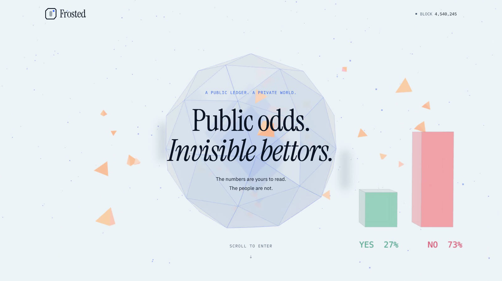
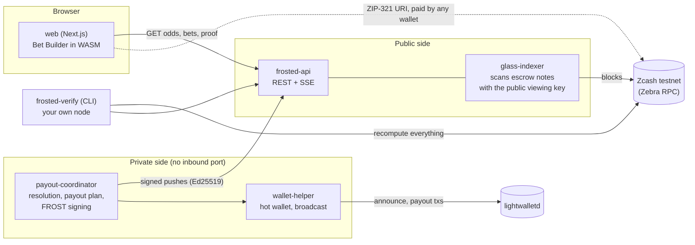
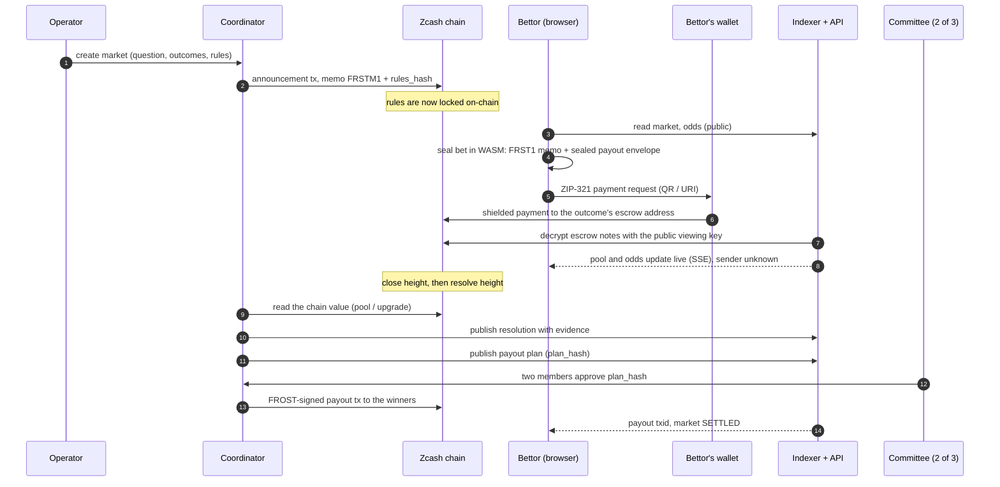
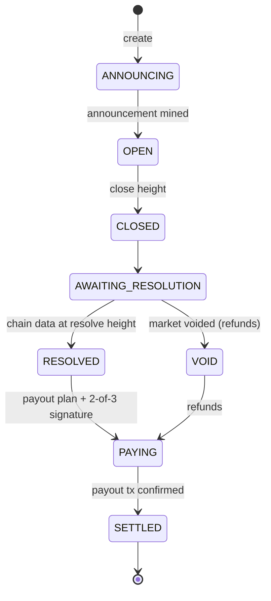

  

An anonymous prediction market on Zcash: bets are shielded payments, odds are public, payouts are signed by a FROST 2-of-3 committee, and anyone can recompute every result from the chain.

  <a href="https://frosted.quest">frosted.quest</a> ·
  <a href="https://frosted-phi.vercel.app">frosted-phi.vercel.app</a> ·
  <a href="#on-chain-proof">On-chain proof</a>

| | |
| --- | --- |
| **Track** | Zcash hackathon ([thezecathon.com](https://thezecathon.com)) |
| **Network** | Zcash **testnet** (NU7). Nothing here touches mainnet. |
| **Live site** | [frosted.quest](https://frosted.quest): 16 real testnet markets, 53 bets, 11 FROST payouts |
| **Demo video** | Two-minute walkthrough of a full cycle on testnet (link in the submission) |
| **License** | MIT or Apache-2.0 |

---

## The problem

Public prediction markets are public by default. Every bet is a transaction from a wallet, so anyone can see **who bet what, how much, and when**:

- big positions are tracked and copied the moment they appear;
- a wallet's betting history becomes a public profile;
- people with something to lose (employees, insiders, journalists, people in hostile places) cannot take a position at all, so the odds miss exactly the information a prediction market is supposed to price.

The odds should be public. The people should not.

## The solution

**Frosted** keeps the market fully auditable while hiding the bettors:

| What | How |
| --- | --- |
| **Bets are shielded** | A bet is a shielded Zcash payment to the market's escrow. The sender is never on-chain. |
| **Odds are public** | Each market publishes its **viewing key**. Anyone can decrypt the escrow's incoming notes, count the pools and compute the odds, but nobody can see who sent them. |
| **Rules can't change** | The market is announced on-chain: a transaction whose memo carries the hash of the canonical rules (`FRSTM1:` + `rules_hash`). |
| **No human decides chain markets** | Chain-verified markets resolve from data any node reports (pool values, network upgrades). |
| **Payouts need a quorum** | Winners are paid by a **FROST 2-of-3** threshold signature: two of three committee members approve the public payout plan by its hash. |
| **Verify everything yourself** | `frosted-verify` recomputes the rules hash, escrow addresses, pools, outcome and payout plan from your own node and exits non-zero on any mismatch. |
| **No account, no wallet connect** | The bet is built and sealed in the browser (WASM). Any Zcash wallet pays the resulting ZIP-321 request. |

There are **no smart contracts**: Zcash L1 has no scripting for this. Frosted gets its guarantees from shielded payments, public viewing keys, on-chain commitments and threshold signatures instead.

## Built on the Zcash stack

| Technology | What Frosted uses it for |
| --- | --- |
| [librustzcash](https://github.com/zcash/librustzcash) | Transactions, keys, note decryption, unified addresses and the hot wallet (`zcash_primitives`, `zcash_keys`, `zcash_client_backend`, `zcash_client_sqlite`, `zcash_address`, `zip321`). Pre-release crates, because the stable release cannot parse NU7 transactions ([ADR-0018](docs/decisions/0018-prerelease-librustzcash-for-nu7.md)). |
| [Orchard / Ironwood](https://github.com/zcash/orchard) | The shielded pools escrow notes live in. Amounts and senders stay encrypted. |
| [Zebra](https://github.com/ZcashFoundation/zebra) | The node the indexer, API and verifier read the chain from (JSON-RPC). Regtest runs Zebra in Docker; testnet uses a hosted Zebra node. |
| [FROST](https://github.com/ZcashFoundation/frost) (Zcash Foundation) | `frost-rerandomized` + `reddsa`: 2-of-3 RedPallas threshold signatures for payouts. |
| [ZIP-321](https://zips.z.cash/zip-0321) | The payment request (QR / URI) the Bet Builder produces. |
| [ZIP-316](https://zips.z.cash/zip-0316) unified addresses | Escrow addresses per outcome and payout addresses. |
| lightwalletd ([testnet.zec.rocks](https://testnet.zec.rocks)) | Light-client access for the wallets. |

---

## How it works

### Architecture

### One market, end to end

### Market lifecycle

### What is public and what is not

| Public (anyone, from the chain) | Private |
| --- | --- |
| Market rules and their hash | Who placed any bet |
| Every bet's amount, outcome and block height | Bet transaction ids (never published by Frosted) |
| Pools and odds, recomputable with the viewing key | Payout addresses (sealed to the coordinator, never shown publicly) |
| Resolution evidence and the payout plan (kind and amount per bet) | A Persona's bets, until its owner chooses to Thaw |
| Announcement and payout transaction ids | |

### Market types

| Type | Resolved by | Example |
| --- | --- | --- |
| `POOL_THRESHOLD` | The value of a shielded or transparent pool at the resolve block (`getblock` `valuePools`) | "Will the Ironwood pool hold at least 230,000 TAZ at block 4,541,847?" |
| `UPGRADE_ACTIVE` | Whether a network upgrade is active at the resolve block (`getblockchaininfo`) | "Will NU7 be active at block 4,540,129?" |
| `COMMITTEE` | A vote of the committee with a dispute window, for subjective questions | Any question with a public evidence source |

### Personas and Thaw (optional reputation)

A bettor can tag bets with a **Persona** (a commitment registered on-chain). Tagged bets stay unlinkable until the owner **Thaws** the Persona, revealing its key: then every tagged bet, wins and losses alike, becomes public and verifiable. This gives a provable track record without an identity, and only when the owner wants it.

---

## On-chain proof

There is no contract address on Zcash. The verifiable artefacts are **transactions**: each market's announcement (rules locked on-chain) and its FROST payout. Shielded transactions hide amounts and parties, so an explorer shows that a transaction exists, is confirmed, and when it was mined. Explorer: [testnet.zecblock.com](https://testnet.zecblock.com).

**Full cycle recorded for the demo video** (market `d5c5682b…`, two bets placed through the web Bet Builder):

| Step | Transaction | Block |
| --- | --- | --- |
| Market announced (FRSTM1, rules hash) | [`e9bd7ec9…df0a45`](https://testnet.zecblock.com/tx/e9bd7ec97313d75eaafe31060c22438a06122caf0aa66385d96c9e4473df0a45) | 4,539,790 |
| FROST 2-of-3 payout | [`ef90d2ae…e5ae00`](https://testnet.zecblock.com/tx/ef90d2aed02339b58b33548ab3c191920816c4513e8f53b7aa7570e792e5ae00) | 4,539,818 |

<b>All settled markets on the live site</b> (10 more, each with its FROST payout)

| Market | Question | Announcement | Payout |
| --- | --- | --- | --- |
| `dec55f44` | Ironwood ≥ 224,800 TAZ at 4,540,118 | [`d1c30d24…`](https://testnet.zecblock.com/tx/d1c30d24fc0e3758f7b5259e434eb95c76aa750792c196d7fa1e5179cd4e8de7) | [`affcf2d6…`](https://testnet.zecblock.com/tx/affcf2d67423adbe4b8bac82d43918193d82713bd622a6d05a4ec038ed5678ff) |
| `99b07cc1` | Orchard < 236,900 TAZ at 4,540,120 | [`0f696566…`](https://testnet.zecblock.com/tx/0f6965669a9cf995f36c15d48ea2f8ea501ed250336dabf710fe998ded529824) | [`e15ab732…`](https://testnet.zecblock.com/tx/e15ab7328f7ce8c94a2d58bfe94bc93f3d997308c090d86d10407d24cd3ebbdf) |
| `cacfed05` | Sapling ≥ 1.53M TAZ at 4,540,122 | [`f77f197e…`](https://testnet.zecblock.com/tx/f77f197e8f20847d3f919496b8e744471a260eaa52f2dfc884e92dd34cdab668) | [`8912a085…`](https://testnet.zecblock.com/tx/8912a0856780a2da9f00982a3299ff933572c095e756d70bcaa3c193a4598f32) |
| `8efc3ac8` | Transparent < 15.8M TAZ at 4,540,125 | [`864b4af4…`](https://testnet.zecblock.com/tx/864b4af4e542baa2edb2dc6bd9fd2b1f2abbe3c09c445220d8f073e8fbe0b562) | [`1463e52d…`](https://testnet.zecblock.com/tx/1463e52df77ba97e5e52e579cf7265181ee0d8f5e13da6b99bddd73ec22533e5) |
| `a608aa10` | Lockbox ≥ 176,200 TAZ at 4,540,127 | [`79ba8e11…`](https://testnet.zecblock.com/tx/79ba8e11c7cfd9ea77b3a3bb594348f5fff3224b8b10ba62f080f2295986634c) | [`f3791d2e…`](https://testnet.zecblock.com/tx/f3791d2ed05677911129a5f0887c9fe3177b2724c4c8b46c6b44c95ee185af80) |
| `01caf980` | NU7 active at 4,540,129 | [`c6772808…`](https://testnet.zecblock.com/tx/c677280850b557066dfb49fe25a0e691d7f17b6934196fd8f530e4f5960b1fc6) | [`b828f766…`](https://testnet.zecblock.com/tx/b828f7669422d72f2f0c3a956d2ed8af131599049699730d894560a47a94dde2) |
| `6f3b741b` | Sprout ≥ 428,300 TAZ at 4,540,132 | [`0a2bb037…`](https://testnet.zecblock.com/tx/0a2bb037e9c8f7e08c3303561ab2b99fb0bc19bc41051126f77b84453b32bd2b) | [`6f4bce56…`](https://testnet.zecblock.com/tx/6f4bce563df9c1cf8b1802832b403ce5c33743d42f91815941b61f4041ba363a) |
| `3adcc87c` | Ironwood < 224,700 TAZ at 4,540,134 | [`160e06f3…`](https://testnet.zecblock.com/tx/160e06f3b016682adfe269e8c2f9d1d60f4c5ed669f41a596aae76f98c3837d5) | [`5612a596…`](https://testnet.zecblock.com/tx/5612a596154948efeec3111361ba4d6438ea99edc0a7cccbbb341ab102456c05) |
| `a2293474` | Orchard ≥ 237,000 TAZ at 4,540,138 | [`b72c82dd…`](https://testnet.zecblock.com/tx/b72c82dd2e6678371d8696f3ec8b72805556ea1b6b9d633b4b0e637c2c061a0f) | [`2223888e…`](https://testnet.zecblock.com/tx/2223888e2f69abbd4e1f3554e99ec0526aa4ac24666b499a91eb3b4568a267f6) |
| `d27a9efb` | NU6.3 active at 4,540,140 | [`b26b3090…`](https://testnet.zecblock.com/tx/b26b30902e1b2678b70143f5c8d42e0eadd2c0e00c255f5ab0dc270679c42fe6) | [`5e2f232a…`](https://testnet.zecblock.com/tx/5e2f232a8de4b318a8b042d474c08924bcdf634ba318c809575bd2d6d0ce8658) |

Five more markets were still open at block 4,540,245; their announcements are listed on each market page of the live site.

Anyone can re-check a market with `frosted-verify`, using only their own node and the public data.

## Honest limits

- **Trusted dealer.** In this deployment one person holds all three FROST shares and the coordinator key ([ADR-0008](docs/decisions/0008-roles-and-custody.md)). The 2-of-3 is real cryptography, not yet separation of trust.
- **The coordinator sees payout addresses** (sealed to it in each bet's envelope), never the bettor's identity. Use a fresh payout address.
- **Testnet only**, pre-release libraries, no independent cryptographic audit.

## License

Licensed under either of [Apache License 2.0](LICENSE-APACHE) or [MIT license](LICENSE-MIT) at your option.
