# PROJECT_SPEC_FROSTED.md — Frosted

> **Public odds. Invisible bettors.**
> Spesifikasi proyek untuk The Zecathon 2026, track **Private Markets**.
> Versi: 0.2 (Part A–G) · Tanggal: 2026-10-21 · Pemilik: Naufal
> Perubahan 0.2: errata hasil review spec dan keputusan ADR 0001–0016 (lihat `docs/decisions/`).
> Dokumen ini adalah konteks utama untuk Claude Code. Ikuti nama, ID, dan istilah persis seperti yang didefinisikan di sini.

---

## 0. Konvensi dokumen

### 0.1 Penanda

| Penanda | Arti |
| --- | --- |
| `[ASSUMPTION]` | Keputusan desain yang diambil tanpa bukti eksternal. Boleh diubah jika ada alasan kuat. |
| `[TO VERIFY]` | Fakta teknis (API, crate, RPC, perilaku wallet) yang belum dibuktikan dengan kode yang jalan. **Wajib diverifikasi dengan spike sebelum diandalkan.** |
| `MUST/SHOULD/COULD/WON'T` | Prioritas MoSCoW untuk MVP hackathon. |

### 0.2 Nama kanonik (dipakai konsisten di seluruh dokumen)

| Nama | Jenis | Definisi singkat |
| --- | --- | --- |
| **Frosted** | Produk | Prediction market parimutuel di Zcash dengan odds publik dan penaruh tak terlihat. |
| **Glass Escrow** | Primitive | Akun shielded Ironwood yang *Unified Incoming Viewing Key* (UIVK)-nya dipublikasikan. Semua dana masuk bisa diaudit publik, pengirimnya tidak. |
| `zcash-glass` | Crate Rust | Library bersama: params, memo codec, Sealed Envelope, Thaw Tag, hash kanonik (JCS), scanning UIVK, odds & payout math. |
| **Market** | Entitas | Satu pertanyaan dengan 2+ **Outcome**, satu Glass Escrow, satu `close_height`, satu aturan resolusi. |
| **Outcome** | Entitas | Satu pilihan jawaban. Dipetakan 1:1 ke satu **Outcome Address** (diversified address di bawah escrow yang sama). |
| **Bet** | Entitas | Satu note shielded yang diterima di Outcome Address dan terdeteksi oleh Glass Indexer. |
| **Sealed Envelope** | Struktur data | Bagian memo yang berisi *payout address* bettor, dienkripsi ke kunci publik envelope milik Payout Coordinator. |
| **FRST1 memo** | Format | Format memo teks Frosted versi 1: `FRST1:` + base64url(payload biner). |
| **Glass Indexer** | Layanan | Pemindai publik yang memakai UIVK untuk menghitung pool dan odds. Siapa pun bisa menjalankannya. |
| **Z-only Guard** | Aturan | Bet yang transaksinya punya input transparent ditolak (tidak dihitung) dan direfund. |
| **Resolution** | Entitas | Keputusan outcome pemenang sebuah Market beserta buktinya. |
| **Chain-Verified Market** | Tipe market | Market yang outcome-nya ditentukan dari data chain Zcash (value pool, status upgrade). Siapa pun bisa memverifikasi. |
| **Committee-Resolved Market** | Tipe market | Market yang outcome-nya diputuskan komite dengan bukti yang dipublikasikan dan jendela sengketa. |
| **Resolver Committee** | Peran | 3 penandatangan FROST (threshold 2-of-3) yang mengontrol dana escrow dan memutuskan Committee-Resolved Market. Pada demo MVP ketiga share dipegang satu orang (ADR-0008). |
| **Payout Coordinator** | Layanan | Membangun transaksi payout (PCZT), mengorkestrasi FROST signing, dan menyiarkan transaksi. Tidak menerima koneksi masuk; mendorong data publik ke API (ADR-0007). |
| **Payout Plan** | Entitas | Rencana payout satu Market: item per note (`note_ref`), `plan_cutoff_height`, `plan_hash`. Jenis `STANDARD` atau `FOLLOW_UP`. |
| **Payout Batch** | Entitas | Satu atau lebih transaksi shielded (dipecah per `MAX_ACTIONS_PER_TX`) yang menjalankan satu Payout Plan: payout pemenang, refund, dan sapuan ke Treasury. |
| **Treasury** | Alamat | UA Orchard-only milik operator (kunci biasa, bukan FROST) yang dipublikasikan di `market_definition`; tujuan semua sapuan dana tak terhitung (ADR-0003). |
| **Envelope Proof** | Struktur data | `env_esk` + payout receiver + `bet_salt` yang diterbitkan bettor untuk membuktikan Sealed Envelope-nya bisa dibuka (ADR-0006). |
| **Persona** | Entitas | Identitas pseudonim forecaster yang dikendalikan oleh kunci rahasia `K_root`. |
| **Thaw** | Fitur | Membuka `K_root` sebuah Persona sehingga semua Bet ber-tag miliknya (menang dan kalah) bisa diverifikasi publik. |
| **Thaw Tag** | Struktur data | Tag 32 byte di memo Bet yang hanya bisa dikaitkan ke Persona setelah Thaw. Terikat ke market, outcome, jumlah, dan `env_epk` bet itu (ADR-0002). |
| **Persona Registry** | Glass Escrow khusus | Alamat ber-UIVK publik tempat Persona mendaftarkan komitmennya on-chain (timestamped). |
| `frosted-verify` | CLI | Alat verifikasi independen: hitung ulang odds, resolusi, dan payout dari chain; memeriksa Envelope Proof. |
| `frosted-operator` | CLI | Satu-satunya pintu aksi privat (create market, resolusi komite, plan, signing). Hanya berjalan di host coordinator via localhost (ADR-0007). |
| `market_definition` | Struktur data | Objek JCS yang di-hash menjadi `rules_hash`; memuat semua parameter yang dibutuhkan verifier (ADR-0005). |

### 0.3 ID fitur (dipakai di Part B–F)

| ID | Fitur | Prioritas |
| --- | --- | --- |
| F-01 | Market Creation (Glass Escrow setup) | MUST |
| F-02 | Bet Builder (ZIP-321 + FRST1 memo + Sealed Envelope) | MUST |
| F-03 | Glass Indexer (UIVK scanning, pool & odds) | MUST |
| F-04 | Live Odds Board | MUST |
| F-05 | Z-only Guard & refund rules | MUST |
| F-06 | Market Close (late-bet handling) | MUST |
| F-07 | Chain-Verified Resolution | MUST |
| F-08 | FROST Payout Batch (2-of-3) | MUST |
| F-09 | Persona & Thaw | SHOULD |
| F-10 | Persona Leaderboard | SHOULD |
| F-11 | Committee-Resolved Markets (bukti + jendela sengketa) | SHOULD |
| F-12 | Public Verifier (`frosted-verify` + halaman Verify + Envelope Proof) | SHOULD |
| F-13 | Post-settlement full audit (publikasi FVK escrow) | COULD |
| F-14 | Cross-chain entry via NEAR Intents 1Click | COULD |
| F-15 | Agent API (read-only + bet intent) | COULD |

---

# PART A — Product & Narrative

## 1. Executive summary

**Nama:** Frosted

**One-line pitch:** Prediction market di Zcash di mana odds-nya publik dan bisa diaudit siapa pun, tapi tidak ada yang bisa tahu siapa yang bertaruh.

**Ringkasan:** Frosted memperkenalkan primitive baru bernama **Glass Escrow**: akun shielded Ironwood yang *incoming viewing key*-nya dipublikasikan. Karena viewing key Zcash memisahkan "melihat apa yang masuk" dari "melihat siapa yang mengirim", siapa pun bisa menghitung ulang total taruhan per outcome (sehingga odds parimutuel publik dan tidak bisa dipalsukan), sementara identitas penaruh tetap tersembunyi di anonymity set shielded Zcash. Payout pada MVP dilakukan dalam satu transaksi batch shielded yang ditandatangani komite FROST 2-of-3 (bukan trustless, tapi dibuat seminimal mungkin percaya), dan market jenis **Chain-Verified** diselesaikan murni dari data chain Zcash, tanpa oracle. Fitur **Thaw** memungkinkan forecaster anonim membangun rekam jejak yang bisa diverifikasi tanpa bisa memilih-milih hanya taruhan yang menang. Frosted juga menjawab narasi sederhana: ada jutaan ZEC shielded yang "nganggur", privat tapi tidak punya kegunaan; Frosted memberinya pasar.

## 2. Narasi: siapa yang dirugikan dan kenapa ini penting

**Hari ini, setiap posisi di prediction market on-chain adalah informasi publik.** Di Polymarket, alamat wallet dan posisinya terlihat oleh siapa pun. Lebih dari 30% wallet Polymarket sudah memakai AI agent ([CoinDesk via MEXC](https://www.mexc.com/news/932530)), artinya posisi besar langsung dipantau dan disalin mesin. Volume prediction market tumbuh tajam pada 2026 ([Keyrock](https://keyrock.com/12-charts-to-watch-in-2026/)), sehingga nilai informasi dari "siapa bertaruh apa" ikut naik.

Akibatnya:
- **Trader berinformasi** kehilangan edge-nya karena langsung ditiru (copy-trading), atau sengaja bertaruh kecil-kecil supaya tidak ketahuan.
- **Orang biasa** enggan bertaruh jujur pada pertanyaan sensitif (governance, isu komunitas, kantor) karena pilihannya bisa dilacak ke identitasnya. Pasar jadi kehilangan sinyal yang paling jujur.
- **Pemegang ZEC shielded** punya aset paling privat di crypto (~4,9 juta ZEC di pool shielded menurut laporan Q3 2026 yang dirangkum di Stage 1), tapi hampir tidak ada aplikasi yang memanfaatkannya selain transfer.

**Kenapa sekarang terasa mendesak:** pasar ZEC-denominated sudah terbukti punya permintaan. Lelang blind zkSNARKs mengumpulkan 16.971 bid dengan total setoran 25.305 ZEC (≈ $36,94 juta); lebih dari separuhnya masuk lewat 1.718 swap NEAR Intents ([crypto.news](https://crypto.news/aurora-intents-routed-19m-into-zcash-nft-auction/)). Tapi mekanisme seperti itu masih bergantung pada operator yang melihat semua bid. Frosted menunjukkan bahwa *harga* bisa publik dan bisa diaudit tanpa operator perlu dipercaya soal angka, sementara *peserta* tetap privat.

> Catatan untuk pitch `[TO VERIFY]`: cari 1–2 kasus nyata whale Polymarket yang di-doxx atau di-copy-trade secara masif untuk slide masalah. Belum ada di riset ini.

## 3. Problem statement

| ID | Masalah | Ukuran yang bisa diamati |
| --- | --- | --- |
| P-1 | Posisi di prediction market on-chain transparan dan dapat dilacak ke wallet. | 100% posisi di market berbasis chain transparan bisa dibaca publik. >30% wallet Polymarket memakai AI agent. |
| P-2 | Market privat yang ada membutuhkan operator terpercaya untuk melaporkan total dan harga (operator bisa memanipulasi atau salah lapor). | Pada lelang berbasis transfer shielded, hanya operator yang bisa memverifikasi total bid. |
| P-3 | Resolusi prediction market bergantung pada oracle atau resolver yang harus dipercaya. | Hampir semua market membutuhkan pihak ketiga untuk menentukan hasil. |
| P-4 | Reputasi forecaster anonim tidak bisa diverifikasi; forecaster bisa memamerkan hanya taruhan yang menang (cherry-picking). | Klaim "win rate" di media sosial tidak punya bukti lengkap. |
| P-5 | ZEC shielded hampir tidak punya kegunaan aplikasi di luar transfer. | Tidak ada prediction market berbasis Zcash yang ditemukan pada riset Stage 2. |

## 4. Solusi

| Masalah | Solusi Frosted | Kenapa privasi Zcash wajib |
| --- | --- | --- |
| P-1 | Bet dikirim sebagai transfer shielded ke Outcome Address. Pengirim tidak pernah muncul di chain. Z-only Guard menolak bet dari input transparent. | Di chain transparan, mengirim ke alamat market selalu menampilkan alamat pengirim. |
| P-2 | **Glass Escrow**: UIVK escrow dipublikasikan, sehingga siapa pun bisa menjalankan Glass Indexer dan mendapatkan total pool per outcome yang sama persis dengan operator. | Hanya viewing key Zcash yang bisa membuka "apa yang masuk" tanpa membuka "siapa pengirimnya". |
| P-3 | **Chain-Verified Market**: hasil dihitung dari data chain Zcash (value pool, status network upgrade) yang bisa dicek siapa pun. Untuk market lain, Committee-Resolved dengan bukti publik dan jendela sengketa. Dana dikontrol FROST 2-of-3. | FROST RedPallas memungkinkan multisig untuk spend shielded tanpa membuka strukturnya di chain. |
| P-4 | **Thaw**: setiap bet membawa Thaw Tag yang terikat ke Persona. Membuka `K_root` membuka *semua* bet ber-tag Persona itu, termasuk yang kalah. Komitmen Persona dicatat on-chain sebelum bertaruh. | Tag di memo tetap tak terkait sampai pemiliknya memutuskan membuka; memo terenkripsi untuk escrow, dibaca publik hanya via UIVK. |
| P-5 | Narasi produk: memberi ZEC shielded pasar pertamanya. | — |

**Batasan jujur yang harus selalu dinyatakan:**
- Frosted **trust-minimized, bukan trustless.** Komite FROST tidak bisa berbohong soal hasil Chain-Verified Market (siapa pun bisa mengeceknya), tapi secara teori bisa menahan dana karena Zcash tidak punya script untuk payout otomatis.
- Payout Coordinator dapat membuka Sealed Envelope, sehingga ia mengetahui *payout address* setiap bettor (bukan identitas). Bettor disarankan memakai alamat baru untuk payout. Jika coordinator salah menandai envelope sebagai tidak bisa dibuka, bettor bisa membuktikannya dengan Envelope Proof.
- Thaw tidak mencegah Sybil (satu orang membuat banyak Persona).
- Pada demo MVP, satu developer memegang ketiga share FROST dan `COORDINATOR_KEY`. Sifat 2-of-3 ditunjukkan secara teknis, bukan sebagai pemisahan kepercayaan (ADR-0008).

## 5. Why now & why Zcash

**Why now (perubahan 2026 yang membuat Frosted mungkin):**
1. **Ironwood (NU6.3) aktif 28 Juli 2026** di blok 3.428.143 ([ZODL](https://zodl.com/ironwood-is-live-on-zcash/)), mempertahankan Orchard Actions dan Halo 2 dengan struktur alamat yang sama ([KuCoin](https://www.kucoin.com/blog/ua-zcash-ironwood-nu6-3-shielded-pool-migration)). Crate wallet Ironwood sudah tersedia di crates.io ([zecd release notes](https://github.com/zecrocks/zecd/releases/tag/v0.5.0-rc3)).
2. **NU7** menargetkan blok 25 detik (sebelumnya 75 detik), sehingga odds bisa bergerak hampir real-time. `[TO VERIFY]` status aktivasi mainnet NU7 (target 5 Nov 2026 per riset Stage 1).
3. **Zakura Common** membuat proving di HP turun ke < 200 ms (riset Stage 1), sehingga bertaruh dari wallet mobile terasa instan.
4. **FROST v3.0.0-rc.0** dirilis Zcash Foundation dengan `frost-rerandomized` yang didesain ulang untuk integrasi Zcash ([ZecHub](https://zechub.substack.com/p/zcash-shielded-news-vol4-0a5)); multisig shielded 2-of-3 sudah dibuktikan di mainnet oleh proyek Steward ([ZecHub Hackathon](https://zechub.wiki/tr/hackathon)). MVP Frosted memakai rerandomization gaya FROST v2 (`reddsa` 0.5 + `frost-rerandomized` 2.x, lihat T-7); migrasi ke v3 adalah langkah berikutnya.
5. **NEAR Intents** membuat pengguna dari chain lain bisa masuk ke pasar berdenominasi ZEC (terbukti di lelang zkSNARKs).

**Why Zcash (dan bukan chain lain):**
- **Pemisahan kunci.** Zcash punya hierarki kunci (spending key → full viewing key → incoming viewing key) yang membuat "audit dana masuk" bisa dibagikan tanpa memberi kemampuan belanja atau membuka pengirim.
- **Anonymity set besar.** Pool shielded Zcash adalah salah satu yang terbesar di crypto, jadi bettor tidak menonjol.
- **Memo terenkripsi 512 byte** membawa data aplikasi (envelope, tag) tanpa smart contract.
- **Diversified address** memberi satu alamat per outcome di bawah satu akun dan satu UIVK.
- Di Ethereum/Solana, mekanisme ini mustahil tanpa privacy layer tambahan. Di Aztec mungkin secara teknis, tapi anonymity set dan likuiditas ZEC/NEAR Intents tidak ada di sana.

## 6. Target users & personas

### Persona 1 — Raka, "The Informed Trader"
- **Konteks:** 29 tahun, trader crypto penuh waktu, aktif di Polymarket dan perpetual DEX. Memegang ZEC.
- **Tujuan:** bertaruh besar pada keyakinannya tanpa ditiru dan tanpa menggerakkan pasar karena orang melihat wallet-nya.
- **Pain points:** wallet-nya sudah diberi label di dashboard analitik; setiap posisi besar langsung disalin; membuat wallet baru terus-menerus melelahkan dan tetap bisa dilacak lewat funding.
- **Yang ia butuhkan dari Frosted:** bet shielded dari Zodl, odds yang bisa ia verifikasi sendiri, payout ke alamat baru.

### Persona 2 — Sari, "The Zcash Community Member"
- **Konteks:** 24 tahun, developer dan anggota komunitas Zcash Indonesia, memegang ZEC shielded di Zodl, mengikuti forum dan Arborist call.
- **Tujuan:** menyatakan pendapat jujur soal masa depan ekosistem ("NU7 aktif tepat waktu?", "pool Ironwood tembus X?") dengan nominal kecil, dan memakai ZEC shielded-nya untuk sesuatu yang menyenangkan.
- **Pain points:** tidak ingin pilihannya diketahui publik (bisa dianggap bias atau "FUD"); tidak percaya pada operator yang memegang dana.
- **Yang ia butuhkan:** Chain-Verified Market yang bisa ia cek sendiri dengan node atau explorer, UI yang jelas, dan proses bertaruh < 1 menit.

### Persona 3 — Dimas, "The Anonymous Forecaster"
- **Konteks:** 34 tahun, analis riset di industri yang tidak mengizinkannya berkomentar publik soal pasar. Menulis analisis di bawah pseudonim.
- **Tujuan:** membangun reputasi forecaster yang bisa diverifikasi tanpa membuka identitas aslinya.
- **Pain points:** klaim "track record" pseudonim tidak dipercaya karena tidak bisa dibuktikan dan rawan cherry-picking.
- **Yang ia butuhkan:** Persona dengan komitmen on-chain, Thaw yang membuka seluruh riwayat secara jujur, dan halaman profil yang bisa ia bagikan.

### Peran operasional (bukan persona pengguna)
- **Market Operator:** membuat market, menulis aturan resolusi, menjalankan payout. Semua aksi lewat `frosted-operator` di host coordinator (ADR-0007). Pada MVP = satu developer.
- **Committee Member (×3):** memegang share FROST, memutuskan Committee-Resolved Market, menandatangani Payout Batch. Committee tidak membuat market. Pada demo MVP ketiga share dipegang orang yang sama dengan operator (ADR-0008).
- **Independent Verifier:** siapa pun yang menjalankan `frosted-verify` atau Glass Indexer sendiri.

## 7. Competitive landscape

| Proyek | Apa | Kelebihan | Kekurangan relatif terhadap Frosted |
| --- | --- | --- | --- |
| Polymarket | Prediction market on-chain (Polygon) | Likuiditas sangat besar, order book | Semua posisi publik; resolusi via oracle eksternal |
| Kalshi | Prediction market teregulasi (CFTC) | Legal di AS, volume besar | KYC penuh; sentralisasi; tidak privat dari operator |
| Capitola | Meta-agregator prediction market (pemenang Colosseum Cypherpunk) | UX agregasi | Mewarisi transparansi pasar sumber |
| zkSNARKs blind auction / ShieldBid / BIDSHIELD | Sealed-bid auction dengan transfer shielded | Terbukti di mainnet, bid tak terlihat | Total dan harga hanya bisa diverifikasi operator; mekanisme lelang, bukan forecasting |
| SNARKSTR treasury | Treasury shielded dengan viewing key publik | Membuktikan pola "viewing key publik" | Bukan pasar; tanpa mekanisme harga atau payout |
| Sable (COTI) | Batch auction terenkripsi via garbled circuits | Matching tanpa dekripsi | Chain lain, butuh likuiditas dua sisi, bukan Zcash |

**Diferensiasi Frosted (satu kalimat):** satu-satunya pasar yang memakai *public incoming viewing key* sebagai mesin harga yang bisa diaudit, dengan penaruh di pool shielded Zcash, resolusi yang bisa diverifikasi dari chain, dan reputasi anonim yang anti-cherry-picking.

Pada riset Stage 2, tidak ditemukan prediction market berbasis Zcash. `[TO VERIFY]` cek ulang submission Zecathon publik sebelum submit.

## 8. Track fit

**Track:** Private Markets ($15.000; kandidat Grand Prize $20.000). Deskripsi track: *"The dark-pool thesis. Sealed-bid auctions, order flow, settlement, anything where the price should be public and the participants should not."* Frosted mengimplementasikan kalimat terakhir secara harfiah.

Kriteria juri resmi berada di balik login situs dan **belum terverifikasi** `[TO VERIFY]`. Pemetaan berikut memakai kriteria umum hackathon privasi:

| Kriteria (asumsi) | Bagaimana Frosted memenuhinya | Bukti di demo |
| --- | --- | --- |
| Kecocokan track | Harga (odds) publik dan bisa diaudit; peserta privat. | Papan odds live + tantangan "temukan penaruhnya" di explorer. |
| Penggunaan Zcash yang esensial | UIVK publik, diversified address per outcome, memo FRST1, Ironwood, FROST RedPallas. | Diagram kunci + `frosted-verify` yang hanya butuh UIVK. |
| Orisinalitas | Glass Escrow sebagai primitive baru; Thaw anti-cherry-picking. | Slide primitive + penjelasan Thaw. |
| Eksekusi teknis | Transaksi Ironwood nyata, payout FROST 2-of-3. | Txid testnet di README (mainnet mikro opsional). |
| UX | Bet < 1 menit dari Zodl via QR ZIP-321. | Demo langsung dari HP. |
| Dampak & keberlanjutan | Primitive bisa dipakai ulang (asuransi parametrik, crowdfund, arisan); kandidat hibah ZCG. | Slide roadmap. |
| Kejujuran teknis | Tabel "nyata vs simulasi", batasan trust dinyatakan eksplisit. | README. |

---

# PART B — Product Requirements Document

## 9. Goals & non-goals

### Goals (MVP hackathon)
- G-1: Membuktikan Glass Escrow bekerja di Zcash Ironwood: odds yang dihitung Glass Indexer independen identik dengan odds di UI.
- G-2: Bettor dapat bertaruh dari wallet shielded umum (target utama: Zodl) hanya dengan memindai QR ZIP-321.
- G-3: Satu siklus penuh berjalan on-chain: create → bet → close → resolve (Chain-Verified) → FROST payout batch → bettor menerima payout.
- G-4: Thaw berjalan end-to-end untuk minimal satu Persona.
- G-5: Semua klaim bisa diverifikasi dengan `frosted-verify`.

### Non-goals (MVP)
- NG-1: Order book atau keluar posisi sebelum resolusi.
- NG-2: Taruhan dengan aset selain ZEC (ZSA belum aktif di mainnet).
- NG-3: Operasi publik dengan uang sungguhan. MVP adalah demo **testnet**. Satu putaran mainnet bernominal sangat kecil oleh tim sendiri bersifat opsional (COULD, M13.4).
- NG-4: Aplikasi mobile native. Bettor memakai wallet yang sudah ada; Frosted adalah web app.
- NG-5: Payout tanpa penandatangan (tidak mungkin tanpa scripting di L1).
- NG-6: Fiat on-ramp, KYC, atau custody dana di luar escrow.
- NG-7: Pencegahan Sybil penuh pada Persona.

## 10. Success metrics

### Demo hackathon
| Metrik | Target |
| --- | --- |
| Siklus penuh on-chain (create → payout) | ≥ 1 di testnet `[ASSUMPTION]` (siklus mainnet mikro opsional, bukan metrik wajib) |
| Bet nyata dalam demo | ≥ 3 bet dari ≥ 3 wallet berbeda |
| Latensi odds | Odds ter-update ≤ 1 blok setelah bet mencapai `MIN_CONFIRMATIONS` |
| Kesesuaian verifier | `frosted-verify` menghasilkan pool per outcome identik 100% dengan API |
| Payout FROST | 1 Payout Batch ditandatangani 2-of-3 dan terkonfirmasi |
| Thaw | ≥ 1 Persona di-thaw, verifier menemukan 100% bet ber-tag-nya (menang + kalah) |
| Waktu bertaruh | Median < 60 detik dari membuka market hingga transaksi terkirim dari Zodl |

### Pasca-hackathon (6 bulan) `[ASSUMPTION]`
| Metrik | Target |
| --- | --- |
| `zcash-glass` dipakai proyek lain | ≥ 2 proyek |
| Hibah ZCG untuk primitive Glass Escrow | 1 proposal diajukan |
| Market Chain-Verified yang diselesaikan | ≥ 20 (testnet/komunitas) |
| Persona yang melakukan Thaw | ≥ 10 |
| Insiden kehilangan dana | 0 |

## 11. Feature list (MoSCoW)

| ID | Fitur | Prioritas | Deskripsi |
| --- | --- | --- | --- |
| F-01 | Market Creation | MUST | Operator membuat Market lewat `frosted-operator`: escrow FROST, Outcome Address per outcome, UIVK dipublikasikan, aturan resolusi, `close_height`, `resolve_height`, semuanya dikunci dalam `market_definition` + `rules_hash`. |
| F-02 | Bet Builder | MUST | Web app membangun FRST1 memo (Sealed Envelope + Thaw Tag opsional) di sisi klien dan menampilkan QR/URI ZIP-321. |
| F-03 | Glass Indexer | MUST | Memindai blok dengan UIVK setiap Market, mendekripsi note dan memo, menerapkan aturan validasi, menyimpan Bet, menghitung pool dan odds. |
| F-04 | Live Odds Board | MUST | Menampilkan pool, implied probability, jumlah bet, dan feed bet anonim per blok. |
| F-05 | Z-only Guard & refund rules | MUST | Bet dengan input transparent, bet terlambat, dan bet di market void direfund; bet di bawah `MIN_BET_ZAT` tidak dihitung. Dana tak terhitung > `SWEEP_THRESHOLD_ZAT` disapu ke Treasury; yang ≤ ambang itu tidak dibelanjakan (ADR-0003). |
| F-06 | Market Close | MUST | Bet yang masuk di blok > `close_height` ditandai `LATE` dan direfund. |
| F-07 | Chain-Verified Resolution | MUST | Resolusi otomatis untuk tipe `POOL_THRESHOLD` dan `UPGRADE_ACTIVE` dari data node Zcash. |
| F-08 | FROST Payout Batch | MUST | Payout Coordinator membuka envelope, menghitung payout parimutuel, membangun PCZT, mengumpulkan tanda tangan 2-of-3, menyiarkan. Fallback: kunci tunggal berlabel jelas. |
| F-09 | Persona & Thaw | SHOULD | Pembuatan Persona, registrasi komitmen on-chain ke Persona Registry, Thaw Tag di setiap bet, reveal `K_root`, verifikasi. |
| F-10 | Persona Leaderboard | SHOULD | Peringkat Persona yang sudah di-thaw berdasarkan metrik yang bisa dihitung ulang. |
| F-11 | Committee-Resolved Markets | SHOULD | Komite memasukkan hasil + URL bukti; jendela sengketa sebelum payout. |
| F-12 | Public Verifier | SHOULD | CLI `frosted-verify` dan halaman Verify yang menghitung ulang pool, resolusi Chain-Verified, dan Payout Plan publik; plus `frosted-verify envelope-proof` untuk membuktikan label `UNCLAIMABLE` yang salah (ADR-0006). |
| F-13 | Post-settlement full audit | COULD | Publikasi Full Viewing Key escrow setelah payout terkonfirmasi untuk audit dana keluar. |
| F-14 | Cross-chain entry (NEAR Intents 1Click) | COULD | Bettor dari chain lain mendapat quote swap ke ZEC yang dikirim ke wallet shielded milik bettor sendiri; bet dibuat terpisah lewat alur normal (SD-7). Pengiriman langsung ke Outcome Address sengaja tidak dipakai (korelasi jumlah/waktu, dan `[TO VERIFY]` dukungan memo 1Click). |
| F-15 | Agent API | COULD | Endpoint read-only untuk agent + `frosted-cli bet` yang membangun URI ZIP-321 dan menyegel envelope secara lokal. Server tidak pernah membangun bet (NFR-P1). |
| — | Order book / early exit | WON'T | Lihat NG-1. |
| — | Taruhan non-ZEC | WON'T | Lihat NG-2. |
| — | Mobile app native | WON'T | Lihat NG-4. |

## 12. User stories & acceptance criteria

Format: **US-xx (F-yy)** — sebagai *peran*, saya ingin *X*, supaya *Y*.

### F-01 Market Creation
**US-01** — Sebagai Market Operator, saya ingin membuat Market dengan escrow yang dikontrol FROST 2-of-3, supaya tidak ada satu orang pun yang bisa memindahkan dana sendirian.
- Given 3 Committee Member telah menyelesaikan DKG (atau trusted dealer berlabel jelas) dan Payout Coordinator memiliki `PublicKeyPackage`,
  When Operator menjalankan `frosted-operator market create` dengan definisi Market (pertanyaan, outcome, tipe resolusi, `close_height`, `resolve_height`, `fee_bps`),
  Then coordinator membuat `nk`/`rivk` baru untuk Market ini, satu escrow, menurunkan satu Outcome Address per outcome dengan diversifier index berurutan (0, 1, …), menyusun `market_definition` + `rules_hash` (§19.3), dan mendorongnya ke API sehingga tampil di `GET /v1/markets/{market_id}`.
- Given Market sudah dibuat, When siapa pun memanggil `frosted-verify market <market_id>`, Then CLI memverifikasi `rules_hash` dan bahwa setiap Outcome Address diturunkan dari UIVK yang dipublikasikan.
- Given `close_height` ≤ tinggi blok saat ini, When Operator membuat Market, Then sistem menolak dengan error `INVALID_CLOSE_HEIGHT`. Given `resolve_height` < `close_height`, Then `INVALID_RESOLVE_HEIGHT`.
- Given `MIN_BET_ZAT × fee_bps / 10_000 < MARGINAL_FEE_ZAT` (artinya `fee_bps` < `MIN_FEE_BPS`), Then sistem menolak dengan `INVALID_FEE_BPS` (ADR-0004).

**US-02** — Sebagai Market Operator, saya ingin mengumumkan Market secara on-chain, supaya aturannya tidak bisa diubah diam-diam.
- Given Market dibuat, When Payout Coordinator mengirim transaksi pembuka bernilai `MIN_ANNOUNCE_ZAT` dari hot wallet ke Outcome Address index 0 dengan memo `FRSTM1:` + `rules_hash`,
  Then Glass Indexer menerima announcement **pertama** yang `rules_hash`-nya sama dengan hash dari `market_definition` yang dipublikasikan, mencatat tinggi bloknya, status Market = `OPEN`, dan UI menampilkan "Rules locked at block N". Memo FRSTM1 dengan hash lain berstatus `INVALID_MEMO` (ADR-0009).
- Given tidak ada announcement sah dalam `ANNOUNCE_TIMEOUT_BLOCKS` sejak `birthday_height`, Then Market `VOID` dan semua dana direfund.
- Announcement selalu bernilai `MIN_ANNOUNCE_ZAT` (> `SWEEP_THRESHOLD_ZAT`), sehingga kiriman bernilai 0 tidak dipakai.

### F-02 Bet Builder
**US-03** — Sebagai bettor, saya ingin bertaruh dengan memindai satu QR dari Zodl, supaya saya tidak perlu memahami detail teknis.
- Given saya memilih outcome dan jumlah ≥ `MIN_BET_ZAT`, dan memasukkan payout Unified Address yang memiliki receiver Orchard,
  When saya menekan "Seal bet",
  Then browser saya (tanpa mengirim apa pun ke server) membangun FRST1 memo dengan Sealed Envelope yang dienkripsi ke `envelope_pk` dari `market_definition`, lalu menampilkan QR dan URI ZIP-321 berisi `address`, `amount`, dan `memo` (base64url).
- Given amount < `MIN_BET_ZAT`, Then UI menampilkan error `AMOUNT_BELOW_MIN`.
- Given payout address tidak punya receiver Orchard, When saya menekan "Seal bet", Then UI menampilkan error `PAYOUT_ADDRESS_NO_ORCHARD` dan tidak membuat QR.
- Given FRST1 memo melebihi 512 byte, Then builder gagal dengan `MEMO_TOO_LARGE` (tidak boleh terjadi dengan payload v1; ini guard).

**US-04** — Sebagai bettor, saya ingin bukti lokal bahwa bet saya tercatat, supaya saya bisa mengeceknya tanpa membuka identitas.
- Given saya telah membuat bet, Then browser menyimpan **Bet Receipt** lokal (IndexedDB) berisi `market_id`, `outcome_index`, `amount_zat`, `bet_fingerprint`, `payout_ua`, `bet_salt`, `env_esk`, dan flag `tagged`, dengan tombol ekspor JSON. `env_esk` tidak pernah dikirim ke mana pun kecuali bettor sendiri menerbitkan Envelope Proof (US-17).
- Given transaksi saya terkonfirmasi, When saya membuka halaman Market, Then UI mencocokkan `bet_fingerprint` dengan daftar bet publik dan menampilkan "Your bet is counted at block N".
- Given jumlah note on-chain berbeda dari `amount_zat` di receipt (jumlah diedit di wallet sebelum kirim), Then My Bets menandai receipt `AMOUNT_MISMATCH` dan memperingatkan bahwa bet ini tidak akan terkait ke Persona, karena Thaw Tag mengikat jumlah (ADR-0002).

### F-03 Glass Indexer
**US-05** — Sebagai Independent Verifier, saya ingin menjalankan Glass Indexer sendiri dengan UIVK publik, supaya saya tidak perlu percaya pada angka dari Frosted.
- Given UIVK dan `birthday_height` Market, When saya menjalankan `frosted-verify pools <market_id> --node <rpc>`, Then hasil pool per outcome identik dengan `GET /v1/markets/{market_id}/odds` pada tinggi blok yang sama.
- Given terjadi reorg ≤ `REORG_DEPTH`, When indexer mendeteksi hash blok berubah, Then bet dari blok yang tergantikan dihapus dan dihitung ulang.

### F-04 Live Odds Board
**US-06** — Sebagai pengunjung, saya ingin melihat odds bergerak saat bet masuk, supaya saya memahami pasar tanpa tahu siapa pesertanya.
- Given ada bet baru dengan `MIN_CONFIRMATIONS` konfirmasi, When halaman Market terbuka, Then bar odds, total pool, dan feed "anonymous bet: 0.50 ZEC → YES at block N" ter-update ≤ 5 detik setelah indexer memprosesnya (via SSE).
- Then feed tidak pernah menampilkan alamat, txid, atau isi envelope.
  - Catatan: txid bet **tidak** ditampilkan di UI meskipun bisa ditemukan oleh siapa pun yang menjalankan scanner. Menyembunyikannya di UI mengurangi korelasi kasual, bukan jaminan kriptografis.

### F-05 Z-only Guard & refund rules
**US-07** — Sebagai bettor, saya ingin bet saya tidak dihitung jika saya tidak sengaja mengirim dari alamat transparent, supaya identitas saya tidak bocor ke pasar.
- Given transaksi bet memiliki ≥ 1 input transparent, When indexer memprosesnya, Then status Bet = `REJECTED_TRANSPARENT`, tidak dihitung di pool, dan masuk antrean refund ke payout address di envelope.
- Given amount ≤ `SWEEP_THRESHOLD_ZAT`, Then status = `UNECONOMIC_DUST`: tidak dihitung, tidak direfund, dan tidak pernah dibelanjakan (tidak ada sesi FROST untuknya).
- Given note diterima di diversifier yang bukan Outcome Address mana pun, Then status = `UNKNOWN_OUTCOME`, tidak dihitung, dan disapu ke Treasury.
- Given `SWEEP_THRESHOLD_ZAT` < amount < `MIN_BET_ZAT`, Then status = `IGNORED_DUST`, tidak dihitung, tidak direfund, dan disapu ke Treasury (didokumentasikan di halaman Market).
- Given memo tidak bisa di-parse sebagai FRST1 v1 atau `market_id` di memo tidak cocok, Then status = `INVALID_MEMO`, tidak dihitung, dan disapu ke Treasury (tidak bisa direfund karena payout address tidak terbaca).
- Given memo valid tetapi Sealed Envelope tidak bisa dibuka oleh Payout Coordinator, Then bet tetap `COUNTED` di pool (indexer publik tidak bisa memeriksa envelope), lalu saat payout ditandai `UNCLAIMABLE` dan bagiannya disapu ke Treasury (lihat §19.5). Bettor yang dirugikan bisa menerbitkan Envelope Proof (US-17).

### F-06 Market Close
**US-08** — Sebagai bettor, saya ingin aturan penutupan yang tegas, supaya tidak ada yang bisa bertaruh setelah hasil diketahui.
- Given `close_height = H`, When bet terdeteksi di blok > H, Then status = `LATE` dan masuk antrean refund.
- Given tip ≥ H, Then status Market = `CLOSED` (bet baru pasti masuk di blok > H), UI menonaktifkan Bet Builder dan menampilkan "Closed at block H". Bet di blok ≤ H tetap dihitung.

### F-07 Chain-Verified Resolution
**US-09** — Sebagai bettor di Chain-Verified Market, saya ingin hasil ditentukan dari data chain, supaya tidak ada pihak yang bisa memalsukannya.
- Given Market bertipe `POOL_THRESHOLD(pool, threshold_zat, comparator)` dan tip ≥ `resolve_height + MIN_CONFIRMATIONS`,
  When resolver job berjalan,
  Then ia membaca `chainValueZat` pool tersebut pada `resolve_height`, menentukan outcome, menyimpan Resolution dengan `evidence` (nilai, hash blok), dan status Market = `RESOLVED`.
- Given Market bertipe `UPGRADE_ACTIVE(upgrade_name)`, Then outcome YES jika `activationheight` upgrade tersebut ≤ `resolve_height` menurut `getblockchaininfo`. Jika upgrade tidak terdaftar sama sekali di `upgrades`, outcome NO (ADR-0016).
- Given data tidak tersedia (RPC gagal), Then job mencoba ulang dengan backoff dan tidak pernah menebak hasil.

### F-08 FROST Payout Batch
**US-10** — Sebagai pemenang, saya ingin menerima payout shielded ke alamat yang saya tentukan, supaya kemenangan saya juga privat.
- Given Market `RESOLVED` dan semua bet valid sudah final,
  When Payout Coordinator menjalankan `plan`,
  Then ia menghasilkan Payout Plan pada `plan_cutoff_height` (= tip saat plan dibuat): payout parimutuel per pemenang, refund (LATE, REJECTED_TRANSPARENT, atau semua bet jika Market `VOID`), sapuan ke Treasury (dana tak terhitung > `SWEEP_THRESHOLD_ZAT` dan `UNCLAIMABLE`), `operator_fee`, dan perkiraan fee ZIP 317 yang seluruhnya ditanggung operator (§19.6).
- Given Payout Plan dipublikasikan sebagai `plan_hash` + plan publik dan ≥ 2 dari 3 Committee Member menyetujui,
  When FROST signing selesai,
  Then transaksi Payout Batch disiarkan dan statusnya `CONFIRMED` setelah `MIN_CONFIRMATIONS`.
- Given jumlah action melebihi `MAX_ACTIONS_PER_TX` (action = max(spend, output) per transaksi), Then Payout Batch dipecah menjadi beberapa transaksi berurutan.
- Given tidak ada pemenang (pool outcome pemenang = 0), Then Market `VOID`, `operator_fee = 0`, dan semua bet `COUNTED` direfund dikurangi `REFUND_FEE_ZAT`.
- Given `operator_fee` + dana tersapu + Σ `REFUND_FEE_ZAT` < total fee ZIP 317, Then plan **gagal dibuat** dengan `FEE_SHORTFALL`; operator menambal dulu. Payout pemenang tidak pernah dipotong (ADR-0004).
- Given note masuk setelah `plan_cutoff_height`, Then note itu tidak masuk plan dan tetap di escrow sampai Operator membuat plan `FOLLOW_UP` secara manual (ADR-0003).

### F-09 Persona & Thaw
**US-11** — Sebagai forecaster anonim, saya ingin mendaftarkan Persona sebelum bertaruh, supaya riwayat saya nanti terbukti dimulai sejak tanggal itu.
- Given saya membuat Persona di browser (menghasilkan `K_root` 32 byte acak, disimpan lokal + backup),
  When saya mengirim transaksi shielded ke Persona Registry dengan memo `FRSTP1:` + base64url(`persona_commitment`),
  Then indexer mencatat Persona dengan `registered_height`.

**US-12** — Sebagai forecaster, saya ingin setiap bet saya membawa Thaw Tag, supaya nanti bisa dibuktikan sebagai milik saya.
- Given Persona aktif di browser, When saya membuat bet, Then Bet Builder menambahkan `thaw_tag = BLAKE2b-256(key=K_root, personal="FrostedThawTag02", data=market_id ‖ outcome_index ‖ amount_zat ‖ env_epk)` (format persis di §19.3). Tidak ada counter lokal.

**US-13** — Sebagai forecaster, saya ingin melakukan Thaw, supaya rekam jejak saya bisa diverifikasi publik.
- Given saya mengirim `K_root` ke `POST /v1/personas/{persona_id}/thaw`,
  When server memverifikasi `BLAKE2b-256(personal="FrostedPersona01", K_root) == persona_commitment`,
  Then server menghitung ulang tag untuk **setiap** bet ber-tag (flag `has_thaw_tag`) di semua Market dari data publik bet itu (`market_id`, `outcome_index`, `amount_zat`, `env_epk`), mencocokkannya dengan `thaw_tag` di memo, dan menerbitkan Thaw Report (semua bet ber-tag, menang/kalah, P&L). Tidak ada gap limit (ADR-0002).
- Given satu bet ber-tag tercatat sebelum `registered_height`, Then bet itu ditandai `PRE_REGISTRATION` dan tidak dihitung dalam reputasi.
- Given dua bet atau lebih memiliki `thaw_tag` yang sama, Then hanya kemunculan pertama (urut tinggi blok, posisi tx, indeks action) yang dihitung; sisanya ditandai `DUPLICATE_TAG` dan tidak dihitung dalam reputasi. Payout bet-bet itu tetap normal.
- Then siapa pun bisa menjalankan `frosted-verify thaw <K_root>` dan mendapat laporan identik.

### F-10 Persona Leaderboard
**US-14** — Sebagai pengunjung, saya ingin melihat peringkat forecaster yang sudah di-thaw, supaya saya tahu siapa yang akurat.
- Given ≥ 1 Persona di-thaw, Then halaman Leaderboard menampilkan alias, jumlah bet terselesaikan, win rate, ROI, dan `registered_height`, dengan badge "≥ 10 bet" untuk mengurangi efek Sybil keberuntungan.

### F-11 Committee-Resolved Markets
**US-15** — Sebagai Committee Member, saya ingin memasukkan hasil dengan bukti dan jendela sengketa, supaya keputusan bisa diperiksa sebelum dana bergerak.
- Given Market bertipe `COMMITTEE` dan tip ≥ `resolve_height`, When 2 dari 3 member mencatat vote lewat `frosted-operator resolution propose|confirm <market_id>` di host coordinator dengan outcome dan `evidence_url` yang sama, Then status = `PROPOSED`, coordinator mendorong vote dan status ke API, dan UI menampilkan hitung mundur `dispute_window_blocks` (dari `resolution_params`).
- Given jendela sengketa berakhir tanpa member mencabut, Then status = `RESOLVED` dan F-08 boleh berjalan.

### F-12 Public Verifier
**US-16** — Sebagai Independent Verifier, saya ingin satu perintah yang memeriksa seluruh Market, supaya audit mudah.
- Given node RPC sendiri, When saya menjalankan `frosted-verify all <market_id>`, Then CLI melaporkan: `rules_hash` valid, derivasi Outcome Address valid, pool per outcome, hasil Chain-Verified (jika berlaku), `plan_hash` = BLAKE2b(JCS(plan publik)), jenis dan jumlah setiap item plan per `note_ref` cocok dengan hasil hitung ulang dari bet publik, dan status PASS/FAIL per pemeriksaan. Publik bisa mengecek jenis dan jumlah payout per bet beserta totalnya, tetapi **tidak** bisa melihat alamat penerima.

**US-17 (F-12)** — Sebagai bettor yang bet-nya ditandai `UNCLAIMABLE`, saya ingin membuktikan envelope saya valid, supaya kebohongan coordinator bisa diperiksa siapa pun.
- Given plan dipublikasikan, When saya menekan "Check my plan item" di My Bets, Then browser menghitung `receiver_commitment` dari receipt dan mencocokkannya dengan item plan untuk `note_ref` bet saya (jenis dan jumlah).
- Given item saya berjenis `UNCLAIMABLE`, When saya mengekspor Envelope Proof (`note_ref`, `env_esk`, payout receiver, `bet_salt`) dan siapa pun menjalankan `frosted-verify envelope-proof <file>`, Then CLI memeriksa X25519 basepoint(`env_esk`) = `env_epk` di memo, menurunkan kunci AEAD dengan `envelope_pk` dari `market_definition`, mendekripsi `env_ciphertext` dengan AAD yang sama, dan memastikan plaintext = receiver ‖ `bet_salt`. PASS berarti envelope bisa dibuka dan label `UNCLAIMABLE` salah.
- Then UI memperingatkan sebelum ekspor bahwa menerbitkan proof membuka payout receiver bet itu.

## 13. Non-functional requirements

### Privasi (prioritas tertinggi)
- NFR-P1: Server Frosted **tidak pernah** menerima payout address dalam bentuk plaintext dari web app. Envelope dienkripsi di browser.
- NFR-P2: Web app tanpa analytics pihak ketiga, tanpa cookie pelacak, tanpa font atau script dari CDN yang mencatat IP. `[ASSUMPTION]` semua aset di-bundle.
- NFR-P3: Log server tidak menyimpan IP atau user-agent untuk endpoint publik (`LOG_IP=false`).
- NFR-P4: UI tidak menampilkan txid, alamat pengirim, atau isi memo mentah.
- NFR-P5: Bet Receipt (termasuk `env_esk` dan `bet_salt`) dan `K_root` hanya disimpan di perangkat pengguna, dengan peringatan backup yang jelas.
- NFR-P6: Dokumentasi menyatakan secara eksplisit metadata apa yang bocor (lihat Part D §24).

### Keamanan
- NFR-S1: Share FROST disimpan hanya di perangkat masing-masing Committee Member; Payout Coordinator tidak pernah memegang share.
- NFR-S2: Kunci envelope (`ENVELOPE_SK`) hanya ada di Payout Coordinator, terenkripsi saat disimpan.
- NFR-S3: Setiap Payout Plan punya `plan_hash` yang ditampilkan ke signer sebelum menandatangani; signer menolak jika hash berbeda.
- NFR-S4: API publik tidak punya endpoint admin. Satu-satunya endpoint tulis adalah ingest dari coordinator, diautentikasi tanda tangan Ed25519 dengan `COORDINATOR_KEY` `[ASSUMPTION]`. Aksi privat hanya lewat `frosted-operator` di localhost host coordinator; coordinator tidak menerima koneksi masuk (ADR-0007).
- NFR-S5: `zcash-glass::params` meng-assert invariant saat startup (lihat §23.4): `MIN_ANNOUNCE_ZAT > SWEEP_THRESHOLD_ZAT`, `MIN_BET_ZAT > SWEEP_THRESHOLD_ZAT`, `DEFAULT_FEE_BPS ≥ MIN_FEE_BPS`. Proses gagal start jika dilanggar.

### Performa
- NFR-F1: Glass Indexer memproses blok baru ≤ 5 detik setelah node menerimanya (untuk ≤ 20 Market aktif).
- NFR-F2: `GET /v1/markets/{id}/odds` p95 < 300 ms.
- NFR-F3: Bet Builder menghasilkan QR < 500 ms di HP kelas menengah.

### Keandalan
- NFR-R1: Konfirmasi minimum `MIN_CONFIRMATIONS = 3` sebelum bet dihitung `[ASSUMPTION]`.
- NFR-R2: Penanganan reorg hingga `REORG_DEPTH = 10` blok.
- NFR-R3: Indexer idempoten dan bisa melanjutkan dari blok terakhir setelah restart.
- NFR-R4: Payout Coordinator tidak pernah menyiarkan dua Payout Batch untuk Market yang sama (lock per Market + status di DB).

### UX
- NFR-U1: Alur bertaruh ≤ 4 langkah: pilih outcome → jumlah → payout address (+ toggle Persona opsional) → seal & scan QR.
- NFR-U2: Setiap status bet punya penjelasan bahasa manusia (contoh: `LATE` → "Your bet arrived after the market closed; it will be refunded"). Pemetaan lengkap di §23.2a.
- NFR-U3: Bahasa UI: Inggris (juri global) dengan istilah konsisten dengan dokumen ini.

### Aksesibilitas
- NFR-A1: Kontras warna memenuhi WCAG 2.1 AA.
- NFR-A2: Odds tidak hanya disampaikan lewat warna (ada angka persentase dan label).
- NFR-A3: Semua kontrol bisa dioperasikan dengan keyboard; QR selalu disertai tombol "Copy URI".

## 14. Assumptions, constraints, dependencies

### Asumsi
| ID | Asumsi | Status |
| --- | --- | --- |
| A-1 | Ironwood memakai Orchard receiver di Unified Address yang sama; dana ke receiver Orchard pasca-NU6.3 masuk ke pool Ironwood. | Didukung sumber; `[TO VERIFY]` di testnet |
| A-2 | Zodl dapat memindai URI ZIP-321 dengan parameter `memo` dan mengirimkannya utuh. | `[TO VERIFY]` (spike pertama) |
| A-3 | Memo teks ASCII (`FRST1:` + base64url) lebih kompatibel dengan wallet dibanding memo biner. | `[ASSUMPTION]` |
| A-4 | FROST RedPallas (crate `reddsa`, fitur `frost`) bisa menandatangani spend Ironwood karena memakai Orchard Actions. | `[TO VERIFY]` (spike pertama) |
| A-5 | `getblockchaininfo` Zebra/Zakura mengembalikan `valuePools` termasuk `ironwood` serta `upgrades`. | Didukung snapshot test `zakura-rpc`; `[TO VERIFY]` di node live |
| A-6 | Nilai value pool pada tinggi historis bisa diambil (misalnya lewat `getblock` verbose). | `[TO VERIFY]`; fallback di Part D |
| A-7 | Biaya transaksi mengikuti ZIP 317 (fee marginal per logical action). | `[TO VERIFY]` angka pastinya di Part D |

### Batasan
- C-1: Zcash L1 tidak punya scripting; semua logika aplikasi off-chain + FROST.
- C-2: Memo maksimal 512 byte per output.
- C-3: Compact block (lightwalletd/Zaino) hanya membawa 52 byte pertama ciphertext, jadi **memo tidak tersedia di compact block**; indexer harus mengambil transaksi penuh ([lightwalletd compact_formats.proto](https://github.com/zcash/lightwalletd/blob/83bb19918fb36a5f6d5013fba7938daf3d73db1d/walletrpc/compact_formats.proto), [Zebra lightwalletd.rs](https://zebra.zfnd.org/internal/src/zebra_rpc/lightwalletd.rs.html)).
- C-4: Hukum: prediction market dengan uang sungguhan dapat dikategorikan perjudian (termasuk di Indonesia). MVP tidak dioperasikan untuk publik; demo memakai testnet dan nominal sangat kecil oleh tim. Ini bukan nasihat hukum.
- C-5: Kriteria juri resmi belum diketahui (di balik login).

### Dependensi
| Dependensi | Peran | Risiko |
| --- | --- | --- |
| Zebra / Zakura node (testnet + mainnet) | JSON-RPC, data chain, broadcast | Sinkronisasi node memakan waktu |
| librustzcash crates upstream dari crates.io (orchard 0.15.x, zcash_client_backend 0.24.0-rc.x, zcash_primitives 0.29.x, zcash_keys, zip321, pczt) | Kunci, scanning, transaksi | API rc bisa berubah. Fork Zakura hanya jika spike membuktikan fitur Ironwood yang dibutuhkan tidak ada di upstream, dengan alasan dicatat di `docs/SPIKES.md` (ADR-0010) |
| ZF FROST (`reddsa` 0.5.2 + `frost-rerandomized` 3.0.0) | Threshold signing in-process di `frosted-operator` (ADR-0013, ADR-0014) | Terbukti di M0.3/M0.4; randomizer dari PCZT lewat API deprecated |
| Zodl wallet | Wallet bettor utama | Dukungan memo ZIP-321 |
| NEAR Intents 1Click API | F-14 (COULD) | Tidak dibutuhkan untuk MVP |

---

# PART C — User Experience

## 15. User flows

### UF-1 — Place a bet (F-02, F-03, F-05, F-06)

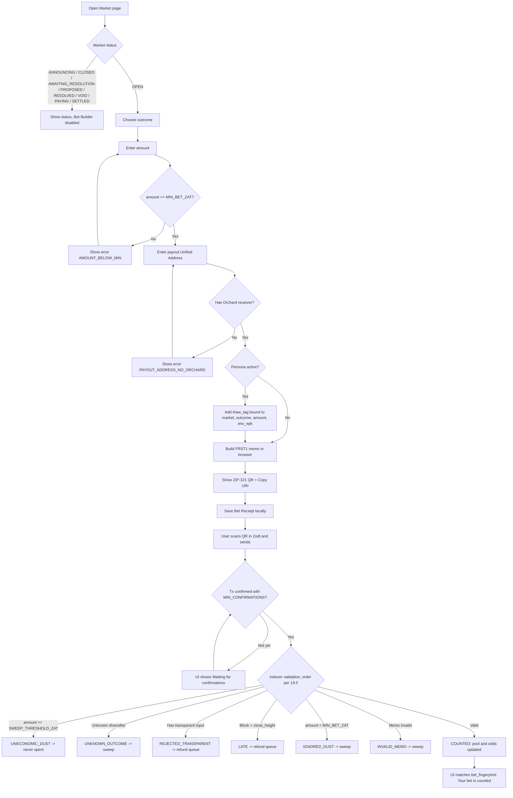

### UF-2 — Create a market (F-01)

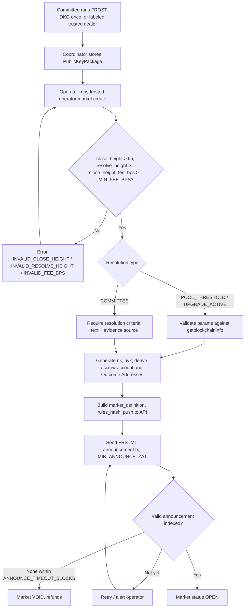

### UF-3 — Resolve and pay out a Chain-Verified Market (F-07, F-08)

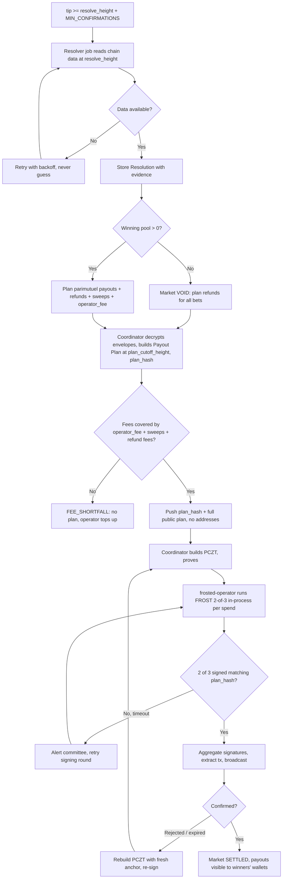

### UF-4 — Committee-Resolved Market (F-11)

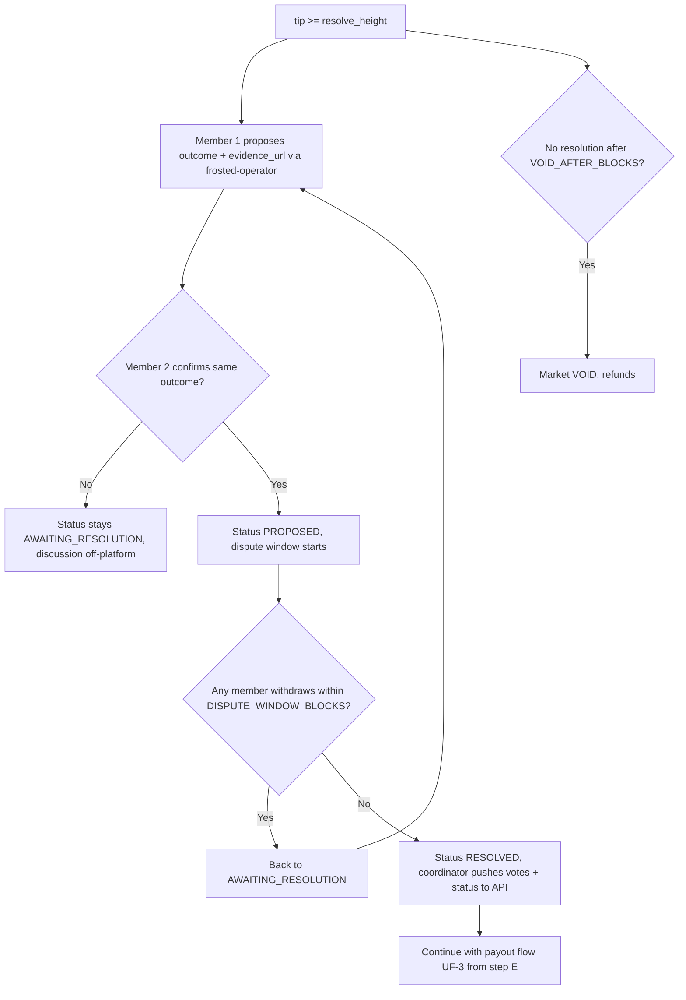

### UF-5 — Persona registration and Thaw (F-09, F-10)

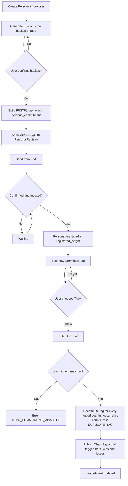

### UF-6 — Independent verification (F-12)

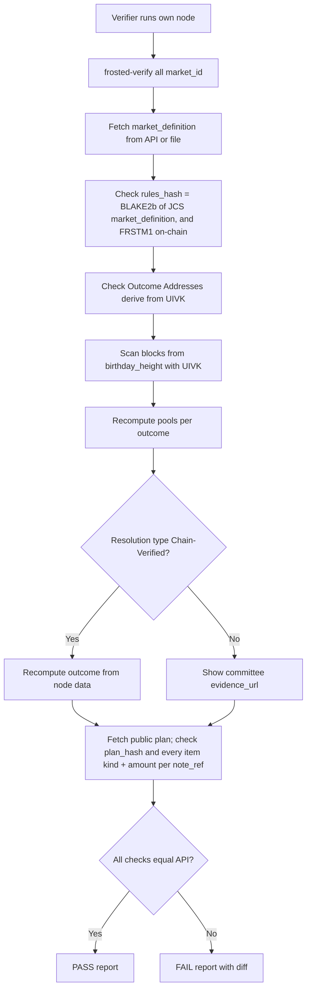

## 16. Screen list

Aturan visual semua layar (palet, tipografi, layout, gerak, daftar DILARANG) ada di `docs/DESIGN.md` dan wajib diikuti setiap change UI.

| ID | Screen | Tujuan | Komponen kunci | Fitur |
| --- | --- | --- | --- | --- |
| S-01 | Markets (Home) | Menemukan market | Daftar kartu Market (pertanyaan, odds ringkas, pool total, status, blok tersisa), filter status/tipe, banner "How Frosted works" | F-04 |
| S-02 | Market Detail | Melihat odds & bertaruh | Odds bar live, pool per outcome, feed bet anonim, aturan resolusi + `rules_hash`, UIVK + tombol "Verify yourself", panel Bet Builder | F-03, F-04, F-06 |
| S-03 | Bet Builder (panel/modal di S-02) | Membuat bet | Stepper 4 langkah, input amount, input payout UA dengan validasi, toggle Persona, QR + Copy URI, peringatan "kirim dari alamat shielded" | F-02, F-09 |
| S-04 | My Bets | Melacak bet lokal | Daftar Bet Receipt dari IndexedDB, status sesuai §23.2a, tanda `AMOUNT_MISMATCH`, tombol "Check my plan item", ekspor Envelope Proof, ekspor/impor JSON | F-02, F-12 |
| S-05 | Resolution & Payout | Transparansi settlement | Tipe resolusi, evidence, status (AWAITING_RESOLUTION/PROPOSED/RESOLVED/SETTLED/VOID), `plan_hash`, plan publik (item per `note_ref`, tanpa alamat), sapuan ke Treasury, txid Payout Batch | F-07, F-08, F-11 |
| S-06 | Persona | Membuat & mengelola Persona | Generate `K_root`, backup phrase, status registrasi, QR registrasi, jumlah bet ber-tag (lokal) | F-09 |
| S-07 | Thaw | Membuka rekam jejak | Peringatan permanen, input/konfirmasi `K_root`, hasil Thaw Report | F-09 |
| S-08 | Persona Profile | Rekam jejak publik | Alias, `registered_height`, daftar bet ber-tag (menang/kalah), win rate, ROI | F-09, F-10 |
| S-09 | Leaderboard | Peringkat forecaster | Tabel Persona yang sudah di-thaw, badge jumlah bet | F-10 |
| S-10 | Verify | Audit di browser | Pilih Market → tampilkan perintah `frosted-verify` + hasil pemeriksaan server-side yang bisa dicocokkan; instruksi `frosted-verify envelope-proof` | F-12 |
| S-11 | Operator Status | Status operasional (read-only di web publik) | Status DKG, announcement, resolusi, plan, progres signing (sesi selesai/total). Semua aksi lewat `frosted-operator` di host coordinator (ADR-0007) | F-01, F-07, F-08, F-11 |
| S-12 | How It Works | Edukasi | Diagram Glass Escrow, batasan trust, metadata yang bocor, FAQ legal | — |

## 17. Wireframe descriptions

### S-01 Markets (Home)
```
+--------------------------------------------------------------+
| FROSTED   Markets  Leaderboard  Verify  How it works  [Persona]|
+--------------------------------------------------------------+
| Public odds. Invisible bettors.                               |
| [Learn how Glass Escrow works ->]                             |
+--------------------------------------------------------------+
| Filter: [All] [Open] [Resolved]   Type: [Chain-Verified] [Committee] |
+--------------------------------------------------------------+
| +-------------------------+  +-------------------------+     |
| | Will Ironwood pool hold |  | Will NU7 be active by   |     |
| | >= 5,000,000 ZEC at     |  | block 3,6xx,xxx?        |     |
| | block 3,6xx,xxx?        |  |                         |     |
| | YES 62% ████████░░ NO 38%|  | YES 81% █████████░ NO 19%|    |
| | Pool 12.4 ZEC · 9 bets  |  | Pool 4.1 ZEC · 5 bets   |     |
| | CHAIN-VERIFIED · closes |  | CHAIN-VERIFIED · OPEN   |     |
| | in 412 blocks           |  |                         |     |
| +-------------------------+  +-------------------------+     |
+--------------------------------------------------------------+
```

### S-02 Market Detail + S-03 Bet Builder
```
+--------------------------------------------------------------+
| < Markets                                                     |
| Will the Ironwood pool hold >= 5,000,000 ZEC at block H?      |
| [CHAIN-VERIFIED]  Status: OPEN  Closes at block C (in 412)    |
+-------------------------------+------------------------------+
| ODDS (live)                   | PLACE A SEALED BET           |
| YES  62%  ████████████░░░░    | Step 1  Outcome: (•) YES ( ) NO |
|      7.70 ZEC · 6 bets        | Step 2  Amount: [ 0.50 ] ZEC |
| NO   38%  ███████░░░░░░░░░    |         min 0.01 ZEC         |
|      4.70 ZEC · 3 bets        | Step 3  Payout address:      |
| Total pool 12.40 ZEC          |   [ u1....................  ]|
|                               |   Tip: use a fresh address   |
| ANONYMOUS FEED                |         [x] Tag with Persona |
| blk 4,51x,203  0.50 ZEC -> YES|             "orion"          |
| blk 4,51x,201  2.00 ZEC -> NO | Step 4  [ Seal & scan ]      |
| blk 4,51x,198  0.10 ZEC -> YES|                              |
|                               |  +--------+  zcash:u1...     |
| RULES                         |  |  QR    |  [Copy URI]      |
| Resolves from getblockchain-  |  +--------+                  |
| info valuePools["ironwood"]   |  Send from a SHIELDED address|
| at block H. rules_hash 9f3c.. |  in Zodl. Transparent inputs |
| locked at block N             |  are rejected and refunded.  |
| UIVK: uivk1...  [Copy]        |                              |
| [Verify yourself ->]          |                              |
+-------------------------------+------------------------------+
```

### S-04 My Bets
```
+--------------------------------------------------------------+
| My Bets (stored only on this device)   [Export] [Import]      |
+--------------------------------------------------------------+
| Market                 Outcome Amount  Status        Block    |
| Ironwood >= 5M ZEC     YES     0.50    COUNTED       4,51x,203|
| NU7 active by H        NO      0.20    PENDING (1/3) -        |
| Old market             YES     0.10    LATE->refund  4,49x,010|
+--------------------------------------------------------------+
| ! Clearing browser data deletes these receipts. Export them.  |
+--------------------------------------------------------------+
```

### S-05 Resolution & Payout
```
+--------------------------------------------------------------+
| Resolution                                                    |
| Type: CHAIN-VERIFIED (POOL_THRESHOLD ironwood >= 5,000,000)   |
| Value at block H: 5,123,456.78 ZEC   Block hash: 00ab...      |
| Outcome: YES      Status: RESOLVED                            |
+--------------------------------------------------------------+
| Payout                                                        |
| plan_hash: 4e1a...   Winners: 6   Refunds: 1   Fee: 0.12 ZEC  |
| Swept to treasury: 1 note   Cutoff: block H+10                |
| Signing: [■■■■■■■■■□□] 9 of 11 sessions (each 2-of-3)         |
| Payout tx: confirmed at block H+12  (txid shown for audit)    |
| [Run frosted-verify all <market_id>]                          |
+--------------------------------------------------------------+
```
Catatan: txid Payout Batch ditampilkan karena ini transaksi milik escrow, bukan milik bettor; isinya tetap shielded.

### S-06 Persona / S-07 Thaw
```
+--------------------------------------------------------------+
| Persona "orion"   Registered at block 4,48x,100               |
| Bets tagged: 12 (local count)                                 |
| [Show backup phrase]  [Export]                                |
+--------------------------------------------------------------+
| THAW                                                          |
| Thawing reveals ALL bets tagged by this Persona, including    |
| losses. This cannot be undone.                                |
| Type the persona alias to confirm: [ orion ]                  |
| [ Thaw permanently ]                                          |
+--------------------------------------------------------------+
```

### S-08 Persona Profile / S-09 Leaderboard
```
+--------------------------------------------------------------+
| Leaderboard (thawed personas only)                            |
| Rank Persona  Settled bets  Win rate  ROI     Registered      |
| 1    orion    14 [10+]      71%       +38%    blk 4,48x,100   |
| 2    kestrel   6            67%       +52%    blk 4,50x,880   |
+--------------------------------------------------------------+
| Personas with fewer than 10 settled bets are shown without    |
| the [10+] badge. One person may control several personas.     |
+--------------------------------------------------------------+
```

### S-10 Verify
```
+--------------------------------------------------------------+
| Verify market <market_id>                                     |
| Run it yourself:                                              |
|   frosted-verify all <market_id> --node http://127.0.0.1:8232 |
| Server-side check (for convenience, do not trust it):         |
|  [PASS] Outcome addresses derive from published UIVK          |
|  [PASS] Pools recomputed: YES 7.70 / NO 4.70                  |
|  [PASS] Chain-verified outcome: YES                           |
|  [PASS] Public payout plan inputs match plan_hash             |
+--------------------------------------------------------------+
```

### S-11 Operator Console
```
+--------------------------------------------------------------+
| Operator status (read-only)    Committee: 3 shares, DKG done ✓|
+--------------------------------------------------------------+
| #a1f3  RESOLVED   plan 4e1a..   signing 9/11 sessions         |
| #77c0  AWAITING_RESOLUTION (COMMITTEE)                        |
+--------------------------------------------------------------+
| Actions run only on the coordinator host (localhost):         |
|   frosted-operator market create --file market.json           |
|   frosted-operator resolution propose <id> --outcome 0 ...    |
|   frosted-operator payout plan <id>                           |
|   frosted-operator payout sign <id>                           |
+--------------------------------------------------------------+
```

### S-12 How It Works
Halaman satu kolom: (1) diagram Glass Escrow (siapa melihat apa), (2) daftar "Yang bisa dilihat publik / yang tidak", (3) batasan trust (komite FROST, Payout Coordinator melihat payout address), (4) metadata yang tetap bocor, (5) FAQ legal ("Frosted adalah riset dan demo; jangan bertaruh dengan uang yang tidak siap kamu hilangkan; cek hukum di negaramu").

---

# PART D — Technical Design

## 18. System architecture overview

Frosted terdiri dari dua sisi yang **sengaja dipisah**:
- **Sisi publik** (Glass Indexer + API + web): hanya memegang data yang memang publik (UIVK, bet yang bisa didekripsi siapa pun dengan UIVK). Siapa pun bisa menjalankan ulang sisi ini.
- **Sisi privat** (Payout Coordinator + Committee): memegang kunci envelope, `nk`/`rivk` escrow, `COORDINATOR_KEY`, dan share FROST. Berjalan di host terpisah dengan database, `zebrad`, dan Zaino sendiri; pada demo default (laptop lokal, ADR-0012) pemisahan ini berupa project Docker Compose dan DB terpisah di mesin yang sama. **Tidak menerima koneksi masuk**: data publik didorong ke API lewat HTTPS keluar yang ditandatangani, dan semua aksi privat lewat `frosted-operator` di localhost (ADR-0007).

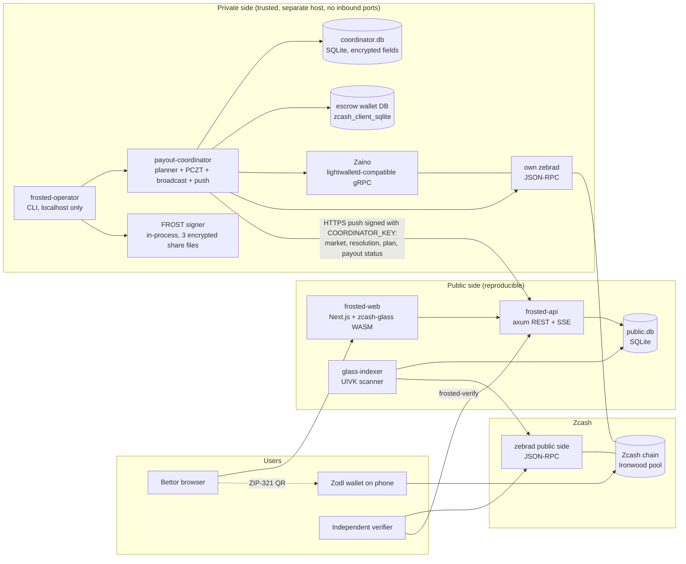

**Komponen:**

| Komponen | Bahasa | Tanggung jawab | Data sensitif? |
| --- | --- | --- | --- |
| `zcash-glass` | Rust (lib + WASM) | Memo codec FRST1/FRSTM1/FRSTP1, Sealed Envelope, Thaw Tag, odds math, payout math, UIVK scanning helper | Tidak (kode murni) |
| `glass-indexer` | Rust | Mengikuti chain, mendekripsi output dengan UIVK setiap Market + Persona Registry, menulis `public.db` | Tidak |
| `frosted-api` | Rust (axum) | REST + SSE untuk web dan verifier; endpoint ingest yang hanya menerima push bertanda tangan `COORDINATOR_KEY` | Tidak menyimpan rahasia (hanya pubkey coordinator) |
| `payout-coordinator` | Rust | Escrow key material, envelope decryption, resolver job, payout planning, PCZT, FROST orchestration, broadcast, push ke API. Tidak membuka port masuk selain localhost untuk `frosted-operator` | **Ya** |
| `frosted-operator` | Rust CLI | Aksi privat: create market, vote resolusi komite, plan, signing, plan `FOLLOW_UP`. Hanya di host coordinator | **Ya** (berjalan di host privat) |
| FROST signer (modul `frosted-operator`) | Rust (`reddsa` 0.5.2, `frost-rerandomized` 3.0.0) | Ronde FROST 2-of-3 in-process per spend; konfirmasi `plan_hash` per member (ADR-0014) | Share FROST dalam file terenkripsi per member; tidak pernah dipegang `payout-coordinator` |
| `frosted-web` | TypeScript (Next.js) | UI, Bet Builder (via WASM), My Bets (IndexedDB), Persona | `K_root` dan receipt hanya di perangkat user |
| `frosted-verify` | Rust CLI | Audit independen | Tidak |
| `zebrad` | Rust (ZF) | Node, JSON-RPC, broadcast | Tidak |
| Zaino / lightwalletd gRPC | — | Sinkronisasi wallet escrow (compact blocks, witness) untuk coordinator; berjalan di host privat bersama `zebrad` milik coordinator | Tidak (tapi pola query-nya sensitif) |

**Pilihan desain utama dan alasannya:**
- **Indexer memakai JSON-RPC Zebra + transaksi penuh**, bukan compact block, karena compact block hanya membawa 52 byte pertama ciphertext sehingga memo tidak ada ([Zebra lightwalletd.rs](https://zebra.zfnd.org/internal/src/zebra_rpc/lightwalletd.rs.html)).
- **Coordinator memakai `zcash_client_backend` + `zcash_client_sqlite`** untuk saldo, witness, dan pembuatan PCZT, karena alur `import_account_ufvk` → `create_pczt_from_proposal` → `extract_and_store_transaction_from_pczt` sudah ada di library ([lib.rs features](https://lib.rs/crates/zcash_client_backend/features)) dan dipakai wallet lain untuk signer eksternal.
- **SQLite** untuk kedua database: satu host per sisi, cukup untuk skala hackathon, tanpa ops tambahan. Skema dirancang bisa dipindah ke Postgres.
- **WASM untuk Bet Builder**: parsing Unified Address (F4Jumble + bech32m) dan enkripsi envelope memakai kode Rust yang sama dengan backend, sehingga tidak ada dua implementasi format.
- **Coordinator push-only** (ADR-0007): host privat tidak punya permukaan serangan dari internet. API menghitung ulang `rules_hash` dan `plan_hash` dari data yang didorong, sehingga push yang rusak ditolak. Opsi pull (API → coordinator) dicatat sebagai roadmap untuk komite multi-pihak.

## 19. Zcash integration in detail

### 19.1 Pool, alamat, dan transaksi

| Aspek | Keputusan | Detail |
| --- | --- | --- |
| Pool | **Ironwood** untuk semua dana escrow dan payout | Ironwood aktif di mainnet sejak blok 3.428.143 dan di testnet sejak 4.134.000 (`[TO VERIFY]` V-26 tinggi testnet). Orchard hanya bisa keluar lewat turnstile. |
| Jenis transaksi | v6 (NU6.3) | Zebra 6.x mendukung "the NU6.3 Ironwood shielded pool and v6 transaction format" ([Zebra 6.0.0-rc.0](https://github.com/ZcashFoundation/zebra/releases/tag/v6.0.0-rc.0)). |
| Outcome Address | Unified Address yang **hanya** berisi receiver Orchard, diversifier index = `outcome_index` | Ironwood memakai struktur alamat yang sama dengan Orchard. `[TO VERIFY]` di testnet bahwa kiriman ke receiver Orchard pasca-NU6.3 menghasilkan note Ironwood. |
| Payout address bettor | UA milik bettor yang punya receiver Orchard | Envelope menyimpan **raw Orchard receiver 43 byte**, bukan string UA. |
| Persona Registry address | Satu UA Orchard-only milik Glass Escrow khusus registry | UIVK dipublikasikan. |
| Treasury address | Satu UA Orchard-only milik operator (kunci biasa, bukan FROST) | Dicantumkan di setiap `market_definition`; tujuan semua item `SWEEP` dan `UNCLAIMABLE` (ADR-0003). |

### 19.2 Hierarki kunci escrow

Satu **FROST group** (DKG sekali untuk 3 member) menghasilkan spend validating key `ak`. Setiap Market mendapat `nk` dan `rivk` baru yang acak, sehingga setiap Market punya FVK/IVK sendiri, tapi semuanya dibelanjakan oleh grup FROST yang sama.

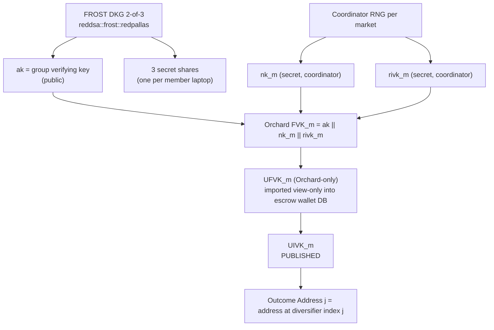

| Kunci | Pemegang | Dipublikasikan? | Fungsi |
| --- | --- | --- | --- |
| FROST secret share (×3) | Masing-masing member | Tidak pernah | Menandatangani spend escrow (2-of-3) |
| `ak` (group verifying key) | Semua | Ya (bagian FVK) | Validasi tanda tangan |
| `nk_m`, `rivk_m` | Payout Coordinator (terenkripsi saat disimpan) | Tidak, kecuali F-13 setelah settlement | Membentuk FVK, membuat proof spend |
| UFVK_m | Payout Coordinator | Tidak (F-13: ya, setelah settlement) | Sinkronisasi wallet escrow, witness, dana keluar |
| **UIVK_m** | Semua orang | **Ya** | Glass Indexer: melihat semua dana masuk + memo |
| `ENVELOPE_SK` / `envelope_pk` (X25519) | SK: Coordinator; PK: publik | PK ya, dikunci di `market_definition` (ikut `rules_hash`) | Membuka Sealed Envelope |
| `env_esk` (X25519 ephemeral, satu per bet) | Bettor (Bet Receipt) | Hanya jika bettor menerbitkan Envelope Proof | Membuktikan envelope bisa dibuka (ADR-0006) |
| `K_root` (Persona) | Bettor | Hanya saat Thaw | Thaw Tag dan komitmen Persona |
| `COORDINATOR_KEY` (Ed25519) | Payout Coordinator | PK ya (dikonfigurasi di API) | Menandatangani push ke endpoint ingest. Tidak ada kunci admin per member (ADR-0007) |

Terbukti di M0.3 (`docs/SPIKES.md`, grup stabil `orchard` 0.15.5, `zcash_keys` 0.16.1 feature `unstable-frost`):
1. `reddsa::frost::redpallas::keys::generate_with_dealer(3, 2, IdentifierList::Default, rng)` sudah menerapkan `EvenY`; `PublicKeyPackage::verifying_key().serialize()` (32 byte) langsung valid sebagai `ak`.
2. `orchard::keys::FullViewingKey::from_bytes(&[u8; 96])` (`ak ‖ nk ‖ rivk`) publik dan memvalidasi `ak`, `nk`, `rivk`; `nk` = `pallas::Base::random()`, `rivk` = `pallas::Scalar::random()`.
3. `zcash_keys::keys::UnifiedFullViewingKey::from_orchard_fvk(fvk)` → `.to_unified_incoming_viewing_key()` → `.encode(&params)`; decode dengan `UnifiedIncomingViewingKey::decode(&params, s)?.orchard()`.
4. Ironwood memakai item UFVK Orchard yang sama; upstream tidak punya item Ironwood terpisah. Outcome Address: `IncomingViewingKey::address_at(j)` (sama dengan `fvk.address_at(j, Scope::External)`).

### 19.3 Format memo (semua memo Frosted adalah teks ASCII)

Semua memo memakai prefix teks + base64url tanpa padding, agar wallet yang hanya mendukung memo teks tetap bisa mengirimnya. Crate `zip321` menyediakan `memo_to_base64`/`memo_from_base64` untuk parameter memo URI ([docs.rs zip321](https://docs.rs/zip321)).

**FRST1 (bet memo)**

```
memo_text = "FRST1:" + base64url_nopad(payload)

payload (173 bytes):
  offset  size  field
  0       1     version            = 0x01
  1       1     flags              bit0 = has_thaw_tag
  2       16    market_id          random 16 bytes, fixed per Market
  18      32    thaw_tag           BLAKE2b-256 tag, or 32 zero bytes if not tagged
  50      32    env_epk            X25519 ephemeral public key
  82      24    env_nonce          XChaCha20-Poly1305 nonce
  106     67    env_ciphertext     AEAD(plaintext = orchard_receiver[43] || bet_salt[8]) + tag[16]

AEAD key   = HKDF-SHA256(ikm = X25519(env_esk, envelope_pk),   // envelope_pk dari market_definition
                         salt = market_id,
                         info = "Frosted envelope v1")
AEAD AAD   = payload[0..50]   (version, flags, market_id, thaw_tag)

Total memo length = 6 + 231 = 237 bytes  (< 512)
```

- `bet_fingerprint = hex(BLAKE2b-256(personal = "FrostedBetFP0001", payload)[0..8])`. Fingerprint **tidak dijamin unik** (payload yang disalin persis menghasilkan fingerprint sama); kunci unik sebuah note adalah `note_ref`.
- Outcome **tidak** ditulis di memo. Outcome ditentukan hanya oleh Outcome Address penerima (sumber kebenaran tunggal).
- `env_esk` dibuat di browser, disimpan di Bet Receipt, dan tidak pernah dikirim (ADR-0006).
- `[ASSUMPTION]` HKDF-SHA256 dan X25519 dipilih karena tersedia sebagai crate Rust yang matang dan bisa dikompilasi ke WASM.

**FRSTM1 (market announcement memo)**
```
memo_text  = "FRSTM1:" + hex(rules_hash)     // 7 + 64 = 71 bytes
rules_hash = BLAKE2b-256(personal = "FrostedRules0001", JCS(market_definition))
```
Announcement sah hanya jika dikirim ke outcome 0, bernilai > `SWEEP_THRESHOLD_ZAT`, dan `rules_hash`-nya sama dengan hash `market_definition` yang dipublikasikan. Hanya yang pertama dipakai (ADR-0009). Pengirimnya tidak bisa (dan tidak perlu) diketahui.

**`market_definition`** (ADR-0005). Semua parameter yang memengaruhi validasi ada di sini, sehingga verifier tidak butuh tabel eksternal:
```
{ version, params_version, network, market_id, question,
  outcomes: [{outcome_index, label, address}],
  resolution_type, resolution_params,
  birthday_height, close_height, resolve_height,
  fee_bps, min_bet_zat, refund_fee_zat, min_confirmations,
  sweep_threshold_zat, announce_timeout_blocks,
  uivk, envelope_pk, treasury_address }
```
`resolution_params` untuk `COMMITTEE` memuat `dispute_window_blocks` dan `void_after_blocks`. Skema JSON di §22.3.

**FRSTP1 (persona registration memo)**
```
memo_text = "FRSTP1:" + base64url_nopad(0x01 || persona_commitment[32])
persona_commitment = BLAKE2b-256(personal = "FrostedPersona01", data = K_root)
persona_id = hex(persona_commitment[0..16])
```

**Thaw Tag v2** (ADR-0002)
```
thaw_tag = BLAKE2b-256(key = K_root, personal = "FrostedThawTag02",
                       data = market_id[16] || outcome_index as u8
                              || amount_zat as u64 little-endian || env_epk[32])
```
- Thaw memeriksa setiap bet ber-tag: hitung ulang tag dari data publik bet, bandingkan dengan `thaw_tag` di memo. Tidak ada counter dan tidak ada gap limit.
- Menyalin tag ke bet lain tidak berguna: data berbeda berarti tag tidak cocok; salinan persis (payload sama) tetap membayar ke receiver milik Persona.
- Tag kembar: hanya kemunculan pertama (urut tinggi blok, posisi tx, indeks action) yang dihitung, sisanya `DUPLICATE_TAG`.
- Jika wallet mengubah jumlah sebelum mengirim, tag tidak cocok dan bet tidak terkait ke Persona (`AMOUNT_MISMATCH` di My Bets).

**Hash kanonik** (ADR-0005). Kanonikalisasi JSON memakai **RFC 8785 (JCS)**. Semua angka harus < 2^53 (assertion; total supply ZEC 2,1×10^15 zat aman).
```
note_ref            = hex(BLAKE2b-256(personal = "FrostedNoteRef01",
                                      data = txid[32] || action_index as u32 LE)[0..8])
receiver_commitment = hex(BLAKE2b-256(personal = "FrostedRcvr00001",
                                      data = orchard_receiver[43] || bet_salt[8]))
plan_hash           = BLAKE2b-256(personal = "FrostedPlan00001", JCS(plan))

plan = { market_id, plan_kind ("STANDARD" | "FOLLOW_UP"), plan_cutoff_height,
         result (winning_outcome_index | "VOID"), operator_fee_zat,
         items: [ { note_ref, bet_fingerprint | null, kind, amount_zat,
                    receiver_commitment | null } ]          // urut menurut note_ref
       }
kind ∈ { WIN, REFUND, UNCLAIMABLE, SWEEP }
```
- Item `SWEEP` dan `UNCLAIMABLE` dikirim ke `treasury_address` (publik), sehingga `receiver_commitment = null`.
- Publik bisa mengecek jenis dan jumlah payout per bet beserta totalnya, tetapi **tidak** bisa melihat alamat penerima. Setiap bettor bisa mengecek item miliknya sendiri karena ia tahu receiver + `bet_salt`.
- `note_ref` diturunkan dari txid, tapi txid sendiri tetap tidak ditampilkan di UI/API (siapa pun yang memindai dengan UIVK memang bisa menemukannya).

Semua string personalization BLAKE2b tepat 16 byte (syarat BLAKE2b).

### 19.4 Di mana setiap fitur Zcash dipakai

| Fitur Zcash | Dipakai di | Cara |
| --- | --- | --- |
| Diversified address | F-01 | Satu Outcome Address per outcome di bawah satu UIVK |
| Incoming viewing key (publik) | F-03, F-04, F-09, F-12 | Glass Indexer mendekripsi semua output escrow |
| Note decryption | F-03 | `try_note_decryption(&IronwoodDomain::for_action(action), &prepared_ivk, action)` mengembalikan `(note, recipient, memo)` ([orchard 0.15 tests](https://docs.rs/crate/orchard/0.15.0/source/tests/builder.rs)) |
| Recipient → outcome | F-03 | `orchard::keys::IncomingViewingKey::diversifier_index(&Address) -> Option<DiversifierIndex>` dibandingkan dengan `outcome_index`. Dekripsi: `Transaction::read(bytes, branch_id_for_height)` → `tx.ironwood_bundle()` → `try_note_decryption(&IronwoodDomain::for_action(a), &ivk.prepare(), a)`; plaintext note Ironwood versi V3 (`OrchardDomain` hanya V2). Terbukti di M0.2 |
| Memo 512 byte | F-02, F-01, F-09 | FRST1, FRSTM1, FRSTP1 |
| ZIP-321 payment URI | F-02, F-09 | QR untuk Zodl |
| PCZT | F-08 | Payout dengan penandatangan eksternal |
| FROST RedPallas (ZIP 312) | F-08 | Tanda tangan spend authorization 2-of-3 |
| ZIP 317 fee | F-08 | `fee = 5000 × max(2, logical_actions)` zat; aksi Ironwood dihitung seperti aksi Orchard ([Zebra zip317.rs](https://zebra.zfnd.org/internal/src/zebra_chain/transaction/unmined/zip317.rs.html)). `[TO VERIFY]` A-7 di node live. Seluruh fee ditanggung operator (ADR-0004) |
| `getblock` / `getblockchaininfo` `valuePools` | F-07 | Chain-Verified Resolution. `valuePools` di kedua RPC menyertakan pool `ironwood` ([Zebra 6.0.0-rc.0](https://github.com/ZcashFoundation/zebra/releases/tag/v6.0.0-rc.0)). `[TO VERIFY]` V-20 ID pool persis |
| `upgrades.activationheight` | F-07 | Resolusi `UPGRADE_ACTIVE`. `[TO VERIFY]` V-20 nama upgrade (misalnya `"NU7"`) |

### 19.5 Aturan validasi bet (dijalankan Glass Indexer, deterministik)

Untuk setiap aksi Ironwood di setiap transaksi pada blok `h`, dan untuk setiap Market `m` dengan `birthday_height ≤ h`. Semua parameter dibaca dari `market_definition` m. Aturan hanya bergantung pada tinggi blok, bukan status Market, sehingga deterministik bagi verifier: bet saat `ANNOUNCING` dihitung selama `birthday_height ≤ h ≤ close_height` (ADR-0009).
1. Coba dekripsi dengan UIVK_m. Gagal → abaikan.
2. Jika `amount ≤ sweep_threshold_zat` → `UNECONOMIC_DUST` (tidak pernah dibelanjakan).
3. Tentukan `outcome_index` dari diversifier index alamat penerima. Tidak cocok dengan Outcome mana pun → `UNKNOWN_OUTCOME`.
4. Jika memo diawali `FRSTM1:`, dikirim ke outcome 0, dan `rules_hash` cocok → announcement (hanya yang pertama; berikutnya diperlakukan seperti FRSTM1 tidak sah). FRSTM1 dengan hash lain → `INVALID_MEMO`.
5. Jika transaksi memiliki ≥ 1 input transparent → `REJECTED_TRANSPARENT`.
6. Jika `h > close_height` → `LATE`.
7. Jika `amount < min_bet_zat` → `IGNORED_DUST`.
8. Jika memo tidak bisa di-parse sebagai FRST1 v1, atau `market_id` di memo ≠ `m.market_id` → `INVALID_MEMO`.
9. Selain itu → `PENDING`, lalu `COUNTED` setelah `min_confirmations`.

Akibat urutan ini, bet transparent ≤ `sweep_threshold_zat` berstatus `UNECONOMIC_DUST`, bukan `REJECTED_TRANSPARENT`; refund-nya memang tidak ekonomis. Invariant `MIN_ANNOUNCE_ZAT > SWEEP_THRESHOLD_ZAT` dan `MIN_BET_ZAT > SWEEP_THRESHOLD_ZAT` (§23.4) menjamin announcement dan bet sah tidak pernah jatuh ke aturan 2.

Catatan: indexer publik **tidak** bisa memverifikasi envelope (tidak punya `ENVELOPE_SK`). Envelope yang rusak baru diketahui coordinator saat planning; bet seperti itu tetap `COUNTED` di pool (uang memang masuk), tapi payout-nya tidak bisa dikirim, menjadi `UNCLAIMABLE`, dan disapu ke Treasury. Bettor bisa membantahnya dengan Envelope Proof (US-17). Ini didokumentasikan di halaman How It Works.

### 19.6 Matematika payout (integer, satuan zatoshi)

Semua note yang masuk pada `h ≤ plan_cutoff_height` (ADR-0003, ADR-0004):
```
pool_total      = Σ amount of COUNTED bets
winning_total   = Σ amount of COUNTED bets on winning outcome
operator_fee    = floor(pool_total × fee_bps / 10_000)        (0 jika Market VOID)
distributable   = pool_total − operator_fee

payout_i        = floor(amount_i × distributable / winning_total)    for each winning COUNTED bet i
dust_remainder  = distributable − Σ payout_i    -> added to operator_fee

refund_j        = amount_j − refund_fee_zat     for LATE / REJECTED_TRANSPARENT bets
VOID market     : every COUNTED bet is refunded with refund_j, operator_fee = 0

swept_total     = Σ amount of IGNORED_DUST, INVALID_MEMO, UNKNOWN_OUTCOME,
                  announcement note, and UNCLAIMABLE shares       -> treasury
not spent       : UNECONOMIC_DUST notes (no spend, no FROST session)

tx_fee          = Σ ZIP-317 fees of all Payout Batch transactions
fee_budget      = operator_fee + swept_total + Σ refund_fee_zat
require tx_fee ≤ fee_budget, else plan fails with FEE_SHORTFALL
treasury_out    = operator_fee + swept_total + Σ refund_fee_zat − tx_fee
```
- Payout pemenang tidak pernah dipotong fee transaksi. Jika `tx_fee > fee_budget`, plan **tidak dibuat** (`FEE_SHORTFALL`) dan operator menambal dulu (fail-closed).
- Klarifikasi M8 (disetujui 2026-10-23): estimator mencakup fee transaksi perantara untuk menggabungkan dana pada batch besar. Setiap transaksi tetap memenuhi `MAX_ACTIONS_PER_TX`; perantara tidak mengurangi jumlah pemenang dan seluruh fee tetap dibebankan ke `fee_budget` di atas. Estimasi yang hanya menghitung jumlah note awal tidak cukup bila ada input carry dari transaksi sebelumnya.
- Validasi saat create market (`MIN_BET_ZAT × fee_bps / 10_000 ≥ MARGINAL_FEE_ZAT`) membuat setiap bet `COUNTED` membiayai spend-nya sendiri, sehingga `FEE_SHORTFALL` seharusnya tidak terjadi; tetap dicek sebagai assertion + test.
- Karena setiap `refund_j` dan note tersapu > `sweep_threshold_zat` = `MARGINAL_FEE_ZAT`, refund dan sapuan selalu positif.
- Jika `winning_total = 0` → Market `VOID`.
- Setelah `SETTLED`: saldo escrow = Σ `UNECONOMIC_DUST` + note yang masuk setelah `plan_cutoff_height`. Note setelah cutoff hanya ditangani lewat plan `FOLLOW_UP` manual.
- Fungsi ini diimplementasikan sekali di `zcash-glass::payout` dan dipakai coordinator serta `frosted-verify`.

## 20. Technical flows (sequence diagrams)

### SD-1 Committee DKG (sekali) dan pembuatan Market

```mermaid
sequenceDiagram
    autonumber
    participant D as trusted dealer (frosted-operator)
    participant OP as frosted-operator (localhost)
    participant C as payout-coordinator
    participant API as frosted-api
    participant Z as zebrad

    Note over D,C: One-time setup (demo: one person, labeled trusted dealer; DKG = roadmap)
    D->>D: reddsa::frost::redpallas::keys::generate_with_dealer(3, 2, ..) (EvenY applied)
    D->>D: write 3 encrypted share files, one per member
    D-->>C: PublicKeyPackage (verifying_key().serialize() = ak)
    C->>C: store committee group, ak

    Note over C,API: Per market
    OP->>C: market create (localhost)
    C->>C: validate heights and fee_bps >= MIN_FEE_BPS
    C->>C: generate nk_m, rivk_m, build FVK_m, UFVK_m, UIVK_m
    C->>C: derive Outcome Addresses at diversifier index 0..n-1
    C->>C: import_account_ufvk into escrow wallet DB, birthday = tip
    C->>C: rules_hash = BLAKE2b(FrostedRules0001, JCS(market_definition))
    C->>API: POST /v1/ingest/markets (signed COORDINATOR_KEY)
    API->>API: recompute rules_hash, store, status ANNOUNCING
    C->>Z: send FRSTM1 announcement (MIN_ANNOUNCE_ZAT) to outcome 0 from hot wallet
    Z-->>C: txid
    API-->>API: status OPEN once glass-indexer sees a valid announcement
```

Catatan: transaksi announcement dikirim dari **hot wallet** kecil milik coordinator (kunci biasa, bukan FROST), hanya berisi `MIN_ANNOUNCE_ZAT`. Tanpa announcement sah dalam `announce_timeout_blocks` sejak `birthday_height`, Market menjadi `VOID` (ADR-0009).

### SD-2 Bet placement dan indexing

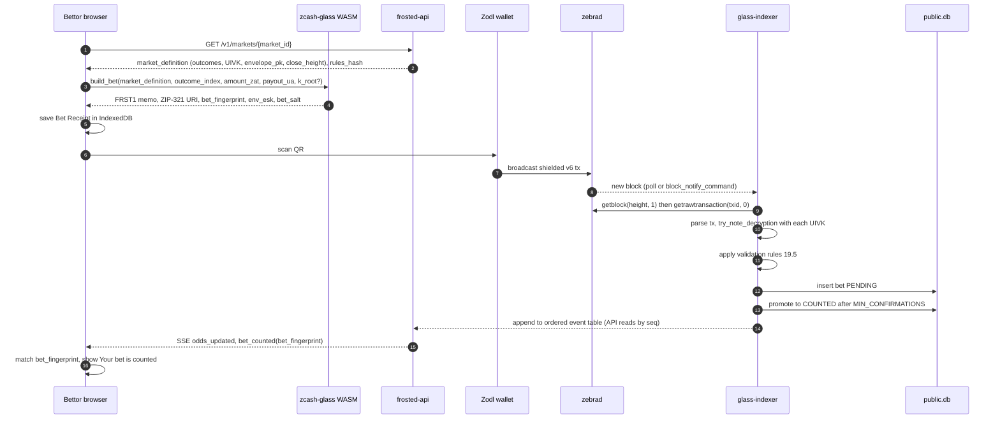

### SD-3 Chain-Verified Resolution

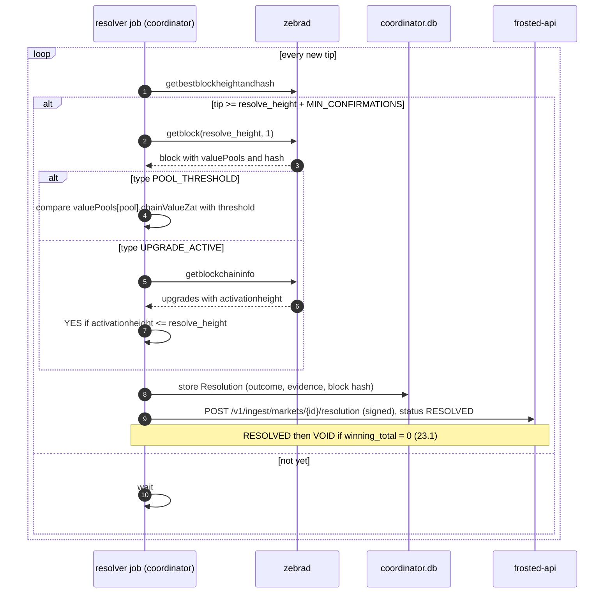

Terbukti di M0.5: `getblock("<h>", 1)` mengembalikan `valuePools[]` per blok dengan `id`, `chainValueZat` (nilai pool **setelah** blok `h`), dan `valueDeltaZat`. Fallback snapshot tidak diperlukan. Evidence resolusi menyimpan `chainValueZat` blok `resolve_height` dan hash bloknya. Untuk `UPGRADE_ACTIVE`, upgrade yang **tidak terdaftar** di `getblockchaininfo.upgrades` dianggap belum aktif (outcome NO), dan evidence mencatat daftar upgrade yang dilaporkan node (ADR-0016).

### SD-4 Payout Batch dengan PCZT + FROST

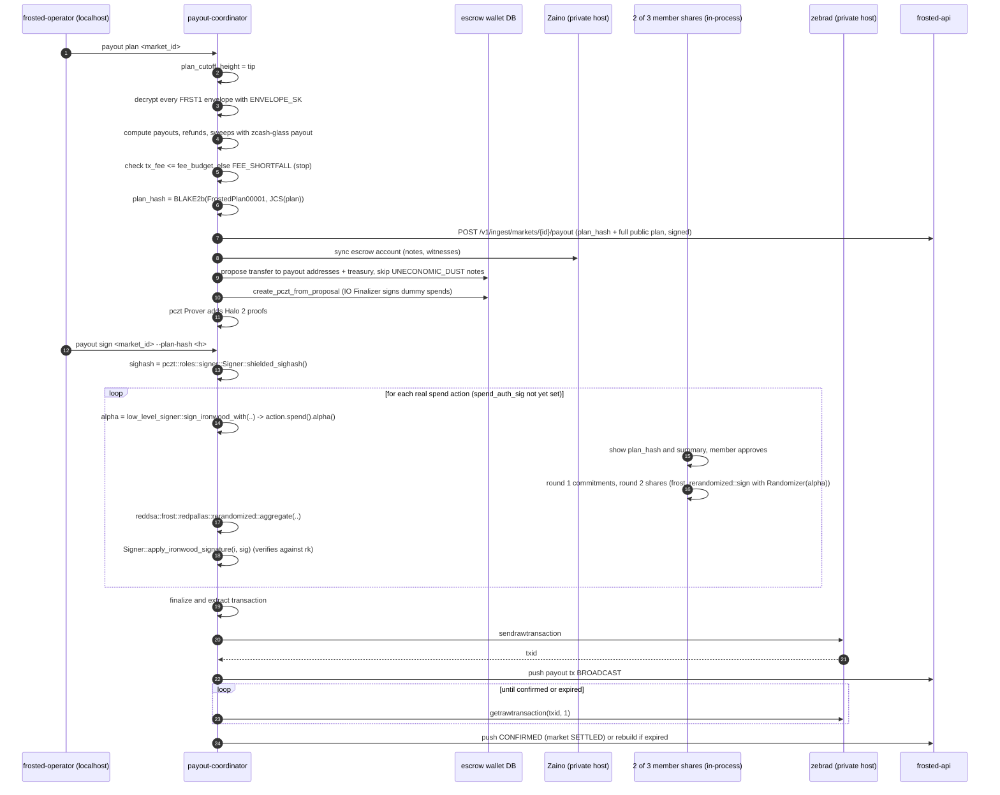

API PCZT dan FROST yang terbukti di M0.4 (`docs/SPIKES.md`, grup librustzcash pre-release rev `eb38d7a`, ADR-0015):
- Sighash: `pczt::roles::signer::Signer::new(pczt)?.shielded_sighash() -> [u8; 32]`.
- `alpha` per aksi: `pczt::roles::low_level_signer::Signer::new(pczt).sign_ironwood_with(..)` lalu `action.spend().alpha()`.
- Sisip tanda tangan eksternal: `Signer::apply_ironwood_signature(index, orchard::primitives::redpallas::Signature::from([u8; 64]))`; memverifikasi terhadap `rk`.
- Dummy spend sudah ditandatangani IO Finalizer saat PCZT dibuat; signer melewati aksi yang `spend_auth_sig()` sudah terisi.
- FROST v3 dengan randomizer eksternal: `frost_rerandomized::sign(signing_package, nonces, key_package, Randomizer)` + `RandomizedParams::from_randomizer(..)` + `reddsa::frost::redpallas::rerandomized::aggregate(..)` (API deprecated, dibungkus satu modul; ADR-0013). Risiko bias randomizer dicatat di T-7.
- Biaya: satu sesi FROST per spend nyata, 2–7 ms per sesi in-process; fee ZIP 317 = `5000 × max(2, actions)` zat (terukur 10.000 zat untuk 2 aksi).
- `zcash-devtool pczt update-with-signature` belum mendukung Ironwood; coordinator menyisipkan tanda tangan sendiri.

### SD-5 Persona registration dan Thaw

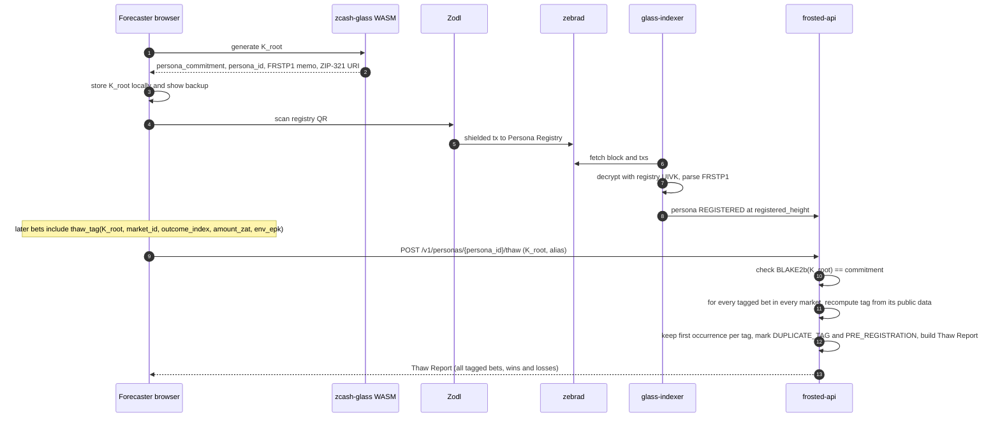

### SD-6 Independent verification

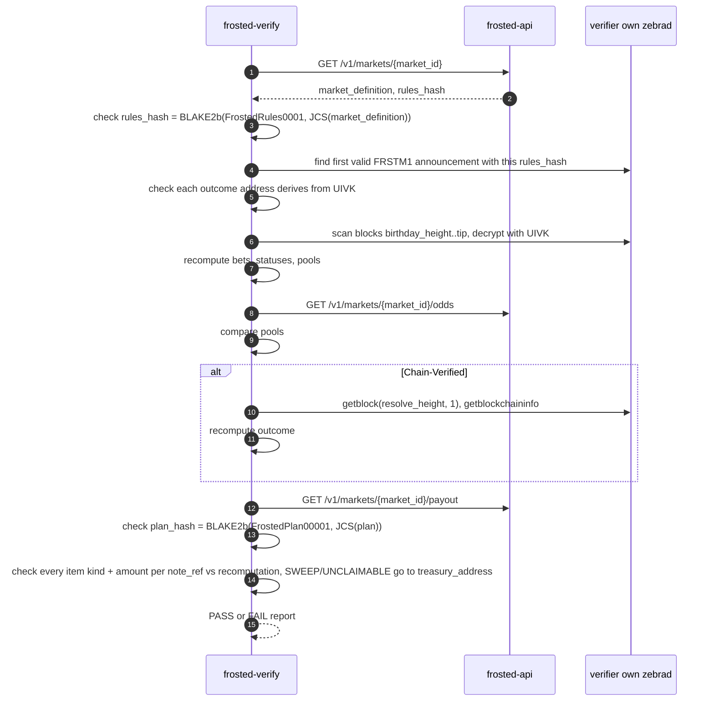

### SD-7 (COULD, F-14) Cross-chain entry via NEAR Intents 1Click

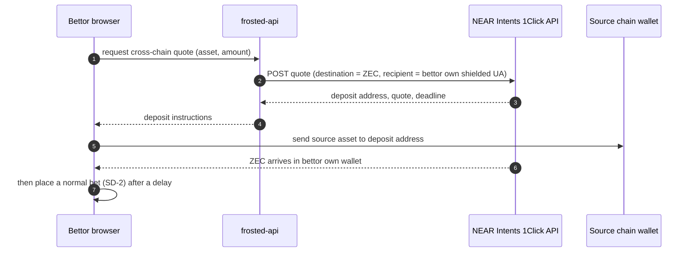

Desain sengaja **tidak** mengirim swap langsung ke Outcome Address karena: (a) `[TO VERIFY]` apakah 1Click bisa menyertakan memo ke tujuan Zcash, dan (b) jumlah dan waktu swap yang publik di chain sumber bisa dikorelasikan dengan bet yang publik lewat UIVK. Bettor dianjurkan menunggu dan memakai jumlah berbeda.

## 21. Data model & ERD

Tiga lokasi penyimpanan:
- **public.db** (glass-indexer + frosted-api): data yang bisa direkonstruksi siapa pun dari chain + UIVK.
- **coordinator.db** + **escrow wallet DB** (private host): rahasia escrow, envelope, rencana payout lengkap.
- **Browser IndexedDB** (perangkat user): Bet Receipt dan Persona.

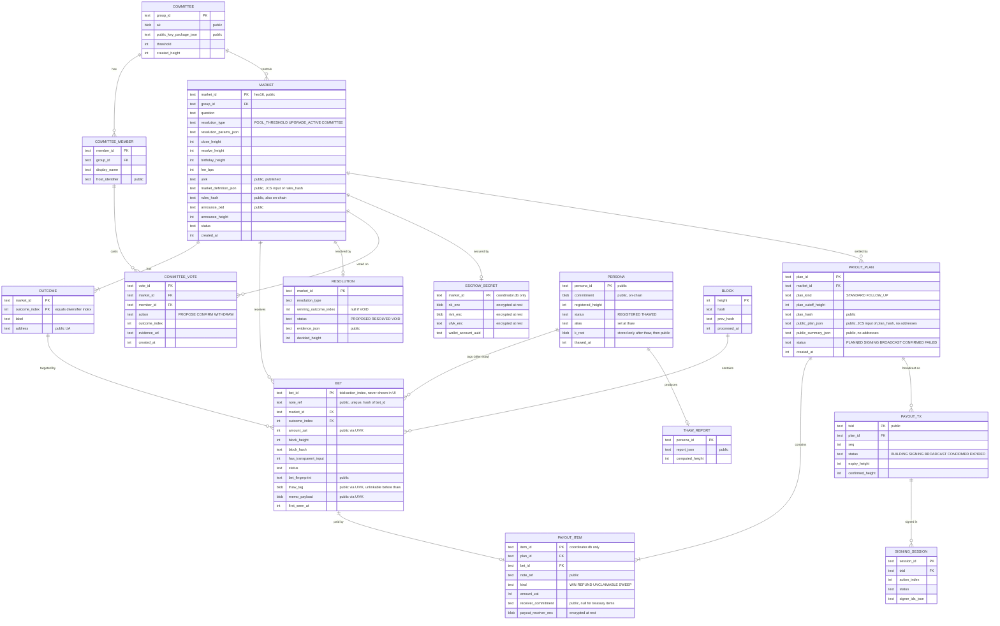

**Pembagian tabel per database:**

| Database | Tabel |
| --- | --- |
| `public.db` | `BLOCK`, `MARKET`, `OUTCOME`, `BET`, `RESOLUTION`, `COMMITTEE` (field publik), `COMMITTEE_VOTE` (salinan hasil push), `PAYOUT_PLAN` (field publik), `PAYOUT_TX`, `PERSONA`, `THAW_REPORT` |
| `coordinator.db` | `COMMITTEE`, `COMMITTEE_MEMBER`, `COMMITTEE_VOTE`, `ESCROW_SECRET`, `PAYOUT_PLAN` (lengkap), `PAYOUT_ITEM`, `SIGNING_SESSION`, `RESOLUTION` (sumber) |

Data mengalir satu arah: coordinator mendorong field publik ke API (ADR-0007). `public.db` tidak pernah menyimpan field `*_enc`.

### 21.1 Klasifikasi penyimpanan per field (privacy by design)

| Data | On-chain | public.db | coordinator.db | Browser | Tidak pernah disimpan |
| --- | --- | --- | --- | --- | --- |
| Jumlah bet, outcome, tinggi blok | Terenkripsi, terbuka via UIVK | Ya | — | Receipt | — |
| Alamat pengirim bet | Tidak ada di chain shielded | — | — | — | **Ya** |
| `txid` bet | Ya | Ya (tidak diekspos UI/API publik) | — | Opsional | — |
| Memo FRST1 | Terenkripsi, terbuka via UIVK | Ya | — | — | — |
| Payout receiver (plaintext) | Tidak | Tidak | Hanya dalam proses memori saat planning | Receipt | **Plaintext di disk: tidak pernah** |
| Payout receiver (terenkripsi) | Di envelope | Di memo (ciphertext) | `payout_receiver_enc` | — | — |
| `receiver_commitment` | — | Ya (plan publik) | Ya | Dihitung dari receipt | — |
| `env_esk` | — | — | — | Receipt | Di server: tidak pernah (kecuali bettor menerbitkan Envelope Proof) |
| `note_ref` | — | Ya | Ya | Opsional | — |
| `ENVELOPE_SK` | — | — | Terenkripsi (file kunci) | — | — |
| `nk_m`, `rivk_m`, UFVK | — | — | Terenkripsi | — | — |
| UIVK | — | Ya | Ya | — | — |
| FROST share | — | — | — | — | Hanya di laptop member |
| `K_root` sebelum Thaw | — | — | — | Ya | Di server: tidak pernah |
| `K_root` setelah Thaw | — | Ya (publik) | — | Ya | — |
| IP/user-agent pengunjung | — | — | — | — | **Ya** (`LOG_IP=false`) |

### 21.2 Data sisi klien (IndexedDB `frosted`)

| Store | Field | Keterangan |
| --- | --- | --- |
| `bet_receipts` | `bet_fingerprint` (key), `market_id`, `outcome_index`, `amount_zat`, `payout_ua`, `bet_salt`, `env_esk`, `tagged`, `note_ref` (setelah cocok on-chain), `created_at`, `last_status`, `amount_mismatch` | Bisa diekspor/diimpor JSON; sumber Envelope Proof |
| `persona` | `persona_id` (key), `k_root` (dienkripsi passphrase, AES-GCM via WebCrypto), `alias`, `registered_height` | `[ASSUMPTION]` passphrase lokal |

## 22. API specification

**Base URL:** `/v1`. Format JSON (UTF-8). Semua jumlah dalam **zatoshi** (integer); web yang memformat ke ZEC untuk tampilan. Tidak ada cookie. CORS hanya untuk origin web.

**Error format (semua endpoint HTTP, dan output JSON `frosted-operator`):**
```json
{ "error": { "code": "MARKET_NOT_FOUND", "message": "Market a1f3... does not exist" } }
```

**Kode error:**

| Code | Lapisan | HTTP | Arti |
| --- | --- | --- | --- |
| `MARKET_NOT_FOUND` | API, operator | 404 | Market tidak ada |
| `PERSONA_NOT_FOUND` | API | 404 | Persona tidak ada |
| `THAW_COMMITMENT_MISMATCH` | API | 400 | `K_root` tidak cocok dengan komitmen |
| `PERSONA_ALREADY_THAWED` | API | 409 | Sudah di-thaw |
| `UNAUTHORIZED` | API (ingest) | 401 | Tanda tangan coordinator hilang/salah |
| `STALE_REQUEST` | API (ingest) | 401 | Timestamp push berselisih > `INGEST_MAX_SKEW_SECS` |
| `RULES_HASH_MISMATCH` | API (ingest) | 400 | `rules_hash` tidak sama dengan hash JCS `market_definition` yang didorong |
| `PLAN_HASH_MISMATCH` | API (ingest) | 400 | `plan_hash` tidak sama dengan hash JCS plan yang didorong |
| `NODE_UNAVAILABLE` | API, operator | 503 | Zebra tidak bisa dihubungi |
| `INTERNAL` | API, operator | 500 | Error lain |
| `INVALID_CLOSE_HEIGHT` | operator | — | `close_height` ≤ tip |
| `INVALID_RESOLVE_HEIGHT` | operator | — | `resolve_height` < `close_height` |
| `INVALID_RESOLUTION_PARAMS` | operator | — | Parameter tidak valid untuk tipe resolusi |
| `INVALID_FEE_BPS` | operator | — | `MIN_BET_ZAT × fee_bps / 10_000 < MARGINAL_FEE_ZAT` |
| `MAINNET_DEMO_LIMIT` | operator | — | Total saldo escrow mainnet ≥ `MAX_MAINNET_DEMO_ZAT` |
| `MARKET_NOT_RESOLVED` | operator | — | Payout diminta sebelum RESOLVED/VOID |
| `PLAN_ALREADY_EXISTS` | operator | — | Sudah ada plan aktif |
| `FEE_SHORTFALL` | operator | — | Fee ZIP 317 > `operator_fee` + dana tersapu + Σ `REFUND_FEE_ZAT`; plan tidak dibuat |

**Kode error klien (WASM/web, tidak pernah dikirim ke server):**

| Code | Arti |
| --- | --- |
| `AMOUNT_BELOW_MIN` | amount < `MIN_BET_ZAT` |
| `PAYOUT_ADDRESS_NO_ORCHARD` | Payout UA tidak punya receiver Orchard |
| `PAYOUT_ADDRESS_WRONG_NETWORK` | Payout UA memakai jaringan berbeda dari `market_definition.network` |
| `MEMO_TOO_LARGE` | FRST1 memo > 512 byte (guard) |
| `AMOUNT_MISMATCH` | Jumlah note on-chain ≠ `amount_zat` di receipt (peringatan, bukan error builder) |

**Autentikasi ingest:** header `X-Frosted-Timestamp: <unix seconds>` dan `X-Frosted-Signature: <base64 Ed25519 signature>` dengan `COORDINATOR_KEY`, atas string `METHOD\nPATH\nTIMESTAMP\nhex(SHA-256(body))`. API hanya menyimpan `COORDINATOR_PUBKEY`. Tidak ada kunci admin per member dan tidak ada kunci operator terpisah (ADR-0007).

### 22.1 Endpoint publik

| Method | Path | Request | Response 200 | Errors |
| --- | --- | --- | --- | --- |
| GET | `/v1/health` | — | `{status, tip_height, indexer_height, lag_blocks}` | 503 |
| GET | `/v1/chain/tip` | — | `{height, hash}` | `NODE_UNAVAILABLE` |
| GET | `/v1/markets` | query `status?`, `resolution_type?`, `kind?` (`chain_verified` \| `committee`) | `{markets: [MarketSummary]}` | — |
| GET | `/v1/markets/{market_id}` | — | `Market` (memuat `market_definition` + `rules_hash`) | `MARKET_NOT_FOUND` |
| GET | `/v1/markets/{market_id}/odds` | query `at_height?` | `Odds` | `MARKET_NOT_FOUND` |
| GET | `/v1/markets/{market_id}/bets` | query `after_height?`, `limit?` (≤ 500) | `{bets: [PublicBet]}` | `MARKET_NOT_FOUND` |
| GET | `/v1/markets/{market_id}/stream` | — | SSE: `odds_updated`, `bet_counted`, `bet_status_changed`, `market_status_changed`, `payout_updated` | `MARKET_NOT_FOUND` |
| GET | `/v1/markets/{market_id}/resolution` | — | `Resolution` atau `null` | `MARKET_NOT_FOUND` |
| GET | `/v1/markets/{market_id}/payout` | — | `PayoutPublic` (plan publik lengkap) atau `null` | `MARKET_NOT_FOUND` |
| GET | `/v1/markets/{market_id}/verify` | — | `VerifyReport` (pemeriksaan sisi server, kenyamanan saja) | `MARKET_NOT_FOUND` |
| GET | `/v1/personas/registry` | — | `{uivk, address, birthday_height}` | — |
| GET | `/v1/personas/{persona_id}` | — | `Persona` | `PERSONA_NOT_FOUND` |
| POST | `/v1/personas/{persona_id}/thaw` | `{k_root_b64, alias}` | `ThawReport` | `PERSONA_NOT_FOUND`, `THAW_COMMITMENT_MISMATCH`, `PERSONA_ALREADY_THAWED` |
| GET | `/v1/leaderboard` | query `min_bets?` | `{entries: [LeaderboardEntry]}` | — |

`envelope_pk` tidak lagi punya endpoint sendiri: kunci itu bagian dari `market_definition` dan terkunci lewat `rules_hash` (ADR-0005).

### 22.2 Endpoint ingest (hanya dari `payout-coordinator`) dan `frosted-operator`

Coordinator tidak menerima koneksi masuk. Semua data sisi privat yang publik masuk ke API lewat push yang ditandatangani (ADR-0007). Push idempoten per `(market_id, jenis, versi)`.

Untuk ingest HTTP, `versi = hex(SHA-256(body))` dari byte body yang juga dilindungi tanda tangan. Ini versi berbasis isi, bukan field/header baru. Retry dengan body identik mengembalikan respons tersimpan tanpa menulis ulang; perubahan isi resolution/payout menjadi versi baru. Definisi market tetap immutable untuk `market_id` yang sama. Kontrak ini disetujui saat implementasi M5.

| Method | Path | Request | Response | Errors |
| --- | --- | --- | --- | --- |
| POST | `/v1/ingest/markets` | `{market_definition, rules_hash}` | `Market` (status `ANNOUNCING`) | `UNAUTHORIZED`, `STALE_REQUEST`, `RULES_HASH_MISMATCH` |
| POST | `/v1/ingest/markets/{market_id}/resolution` | `Resolution` + `votes` (komite) | `Resolution` | `MARKET_NOT_FOUND`, `UNAUTHORIZED`, `STALE_REQUEST` |
| POST | `/v1/ingest/markets/{market_id}/payout` | `PayoutPublic` (plan publik, status plan dan tx, progres signing) | `PayoutPublic` | `MARKET_NOT_FOUND`, `UNAUTHORIZED`, `STALE_REQUEST`, `PLAN_HASH_MISMATCH` |

API menghitung ulang `rules_hash` dan `plan_hash` dari body; push yang tidak cocok ditolak.

**`frosted-operator`** (CLI di host coordinator, berbicara ke coordinator lewat localhost):

| Perintah | Fungsi | Error utama |
| --- | --- | --- |
| `market create --file <CreateMarket.json>` | Buat Market, push ke API, kirim announcement | `INVALID_CLOSE_HEIGHT`, `INVALID_RESOLVE_HEIGHT`, `INVALID_RESOLUTION_PARAMS`, `INVALID_FEE_BPS`, `MAINNET_DEMO_LIMIT` |
| `resolution propose\|confirm\|withdraw <market_id> [--outcome i] [--evidence-url u] --member <id>` | Vote Committee-Resolved Market | `MARKET_NOT_FOUND` |
| `payout plan <market_id>` | Buat plan `STANDARD` | `MARKET_NOT_RESOLVED`, `PLAN_ALREADY_EXISTS`, `FEE_SHORTFALL` |
| `payout follow-up <market_id>` | Buat plan `FOLLOW_UP` untuk note setelah `plan_cutoff_height` | `MARKET_NOT_RESOLVED`, `FEE_SHORTFALL` |
| `payout sign <market_id> --plan-hash <h>` | Menjalankan ronde FROST 2-of-3 in-process per spend; menampilkan `plan_hash` + ringkasan dan meminta konfirmasi per member (ADR-0014) | `MARKET_NOT_RESOLVED` |
| `payout status <market_id>` | Status plan, tx, dan sesi signing | `MARKET_NOT_FOUND` |

Roadmap (bukan MVP): opsi pull, di mana member dari pihak berbeda mengirim vote bertanda tangan ke API dan coordinator mengambilnya lewat GET keluar.

### 22.3 Skema objek

```jsonc
// MarketSummary
{ "market_id": "a1f3c0de9b7e4f21a0b1c2d3e4f50617", "question": "...", "status": "OPEN",
  "resolution_type": "POOL_THRESHOLD", "close_height": 4521000, "pool_total_zat": 1240000000,
  "odds": [{ "outcome_index": 0, "label": "YES", "probability": 0.62 }] }

// MarketDefinition  (input JCS untuk rules_hash, ADR-0005)
{ "version": 1, "params_version": 1, "network": "testnet",
  "market_id": "a1f3c0de9b7e4f21a0b1c2d3e4f50617", "question": "...",
  "outcomes": [ { "outcome_index": 0, "label": "YES", "address": "utest1..." },
                { "outcome_index": 1, "label": "NO",  "address": "utest1..." } ],
  "resolution_type": "POOL_THRESHOLD",
  "resolution_params": { "pool": "ironwood", "comparator": "gte", "threshold_zat": 500000000000000 },
  "birthday_height": 4519000, "close_height": 4521000, "resolve_height": 4521100,
  "fee_bps": 100, "min_bet_zat": 1000000, "refund_fee_zat": 5000, "min_confirmations": 3,
  "sweep_threshold_zat": 5000, "announce_timeout_blocks": 100,
  "uivk": "uivk...", "envelope_pk": "<base64url X25519 public key>",
  "treasury_address": "utest1..." }

// Market
{ "market_definition": { /* MarketDefinition */ }, "rules_hash": "9f3c...",
  "status": "OPEN", "announce_height": 4519003 }

// Odds
{ "market_id": "...", "at_height": 4520210, "pool_total_zat": 1240000000,
  "outcomes": [ { "outcome_index": 0, "pool_zat": 770000000, "bets": 6, "probability": 0.6210 },
                { "outcome_index": 1, "pool_zat": 470000000, "bets": 3, "probability": 0.3790 } ],
  "pending_bets": 1 }
// probability = null jika pool_total_zat = 0; UI menampilkan "—".

// PublicBet  (no txid, no address)
{ "note_ref": "0a1b2c3d4e5f6071", "bet_fingerprint": "3fa1b2c4d5e6f708", "outcome_index": 0,
  "amount_zat": 50000000, "block_height": 4520203, "status": "COUNTED", "tagged": true }

// Resolution
{ "market_id": "...", "status": "RESOLVED", "winning_outcome_index": 0,
  "evidence": { "source": "getblock", "height": 4521100, "block_hash": "00ab...",
                "pool": "ironwood", "chain_value_zat": 512345678000000 },
  "votes": [] }   // COMMITTEE: [{member_id, action, outcome_index, evidence_url, created_at}]
// UPGRADE_ACTIVE evidence menambahkan field opsional reported_upgrades:
// [{"name":"NU6.3","activation_height":4134000}, ...], daftar publik dari node.
// Disetujui saat implementasi M8; upgrade yang tidak terdaftar tetap outcome NO.

// PayoutPublic  (status = status plan: PLANNED | SIGNING | BROADCAST | CONFIRMED | FAILED)
{ "plan_hash": "4e1a...", "status": "CONFIRMED",
  "plan": { "market_id": "...", "plan_kind": "STANDARD", "plan_cutoff_height": 4521110,
            "result": 0, "operator_fee_zat": 12400000,
            "items": [ { "note_ref": "0a1b2c3d4e5f6071", "bet_fingerprint": "3fa1b2c4d5e6f708",
                         "kind": "WIN", "amount_zat": 79714285, "receiver_commitment": "c0ff..." },
                       { "note_ref": "1b2c3d4e5f607182", "bet_fingerprint": null,
                         "kind": "SWEEP", "amount_zat": 10000, "receiver_commitment": null } ] },
  "summary": { "winners": 6, "refunds": 1, "unclaimable": 0, "swept": 1, "uneconomic_dust": 0,
               "operator_fee_zat": 12400000, "tx_fee_zat": 70000, "distributed_zat": 1227600000 },
  "signing": { "sessions_done": 11, "sessions_total": 11, "threshold": 2 },
  "txs": [ { "txid": "...", "status": "CONFIRMED", "confirmed_height": 4521122 } ] }
// tx_fee_zat dibayar dari operator_fee + sapuan + refund fee, bukan dari pemenang (§19.6).

// CreateMarket  (input `frosted-operator market create --file`)
{ "question": "...", "outcomes": ["YES", "NO"],
  "resolution_type": "POOL_THRESHOLD",
  "resolution_params": { "pool": "ironwood", "comparator": "gte", "threshold_zat": 500000000000000 },
  "close_height": 4521000, "resolve_height": 4521100, "fee_bps": 100 }

// ThawReport
{ "persona_id": "...", "alias": "orion", "registered_height": 4480100,
  "bets": [ { "market_id": "...", "note_ref": "0a1b2c3d4e5f6071", "outcome_index": 0,
              "amount_zat": 50000000, "block_height": 4520203, "result": "WON",
              "payout_zat": 79714285, "counted_in_reputation": true,
              "exclusion": null } ],          // null | "PRE_REGISTRATION" | "DUPLICATE_TAG"
  "stats": { "settled": 14, "won": 10, "win_rate": 0.714, "roi": 0.38 } }

// Persona (kontrak minimal M5; disetujui saat implementasi)
{ "persona_id": "...", "commitment": "<32-byte hex>", "registered_height": 4480100,
  "status": "REGISTERED", "alias": null, "thawed_at": null }
// Hanya jika status = THAWED, tambahkan k_root_b64 (base64url tanpa padding).
// K_root tidak pernah muncul pada respons Persona yang belum di-thaw.

// LeaderboardEntry (dari stats THAW_REPORT publik, bukan angka perkiraan)
{ "persona_id": "...", "alias": "orion", "registered_height": 4480100,
  "settled": 14, "won": 10, "win_rate": 0.714, "roi": 0.38 }
// Hanya Persona THAWED dengan THAW_REPORT yang sudah dihitung. Tanpa laporan, entries = [].
```

**Parameter resolusi yang valid:**

| `resolution_type` | `resolution_params` | Outcomes |
| --- | --- | --- |
| `POOL_THRESHOLD` | `pool ∈ {transparent, sprout, sapling, orchard, ironwood, lockbox}` (id persis dari `valuePools`, terbukti di M0.5), `comparator ∈ {gte, lt}`, `threshold_zat` | Tepat `["YES","NO"]` |
| `UPGRADE_ACTIVE` | `upgrade_name` sesuai `getblockchaininfo.upgrades[].name` (contoh `"NU6.3"`, `"NU7"`); tidak terdaftar = belum aktif (ADR-0016) | Tepat `["YES","NO"]` |
| `COMMITTEE` | `criteria` (teks), `evidence_source` (teks), `dispute_window_blocks` (default `DISPUTE_WINDOW_BLOCKS`), `void_after_blocks` (default `VOID_AFTER_BLOCKS`) | 2–4 outcome |

`kind` di `GET /v1/markets`: `chain_verified` = `POOL_THRESHOLD` atau `UPGRADE_ACTIVE`; `committee` = `COMMITTEE`.

### 22.4 Interface non-HTTP

| Interface | Bentuk | Dipakai oleh |
| --- | --- | --- |
| `zcash-glass` (Rust) | `params::{.., assert_invariants}`, `memo::{encode_frst1, decode_frst1, encode_frstm1, encode_frstp1}`, `envelope::{seal, open, verify_proof}`, `thaw::{commitment, tag}`, `hash::{rules_hash, plan_hash, receiver_commitment, note_ref}`, `odds::compute`, `payout::plan`, `scan::decrypt_action` | indexer, coordinator, verify, api |
| `zcash-glass-wasm` (JS) | `build_bet({market_definition, outcome_index, amount_zat, payout_ua, k_root?}) -> {memo_text, zip321_uri, bet_fingerprint, env_esk, bet_salt}`, `new_persona(registry_address) -> {k_root, persona_id, frstp1_uri}`, `parse_payout_ua(ua) -> {ok, error}`, `receiver_commitment(receipt)`, `envelope_proof(receipt, note_ref)` | web |
| `frosted-verify` CLI | `frosted-verify market <id>`, `pools <id>`, `resolution <id>`, `thaw <k_root>`, `envelope-proof <file>`, `all <id>`; flag `--node <rpc_url>`, `--api <url>` | verifier, bettor |
| `frosted-operator` CLI | Lihat §22.2 | operator, committee (host coordinator) |
| Zebra JSON-RPC (dipakai) | `getbestblockheightandhash`, `getblock`, `getrawtransaction`, `getblockchaininfo`, `sendrawtransaction` | indexer, coordinator |

**Batas antar-grup crate (ADR-0015):** komponen dengan grup librustzcash stabil (indexer, verifier, `zcash-glass` feature `zcash`) dan grup pre-release (coordinator, operator) hanya bertukar data dalam bentuk bytes/string (UFVK/UIVK ter-encode, tx hex, PCZT bytes, JSON), tidak pernah lewat tipe Rust dari crate librustzcash.

## 23. State management & background jobs

### 23.1 Market state machine

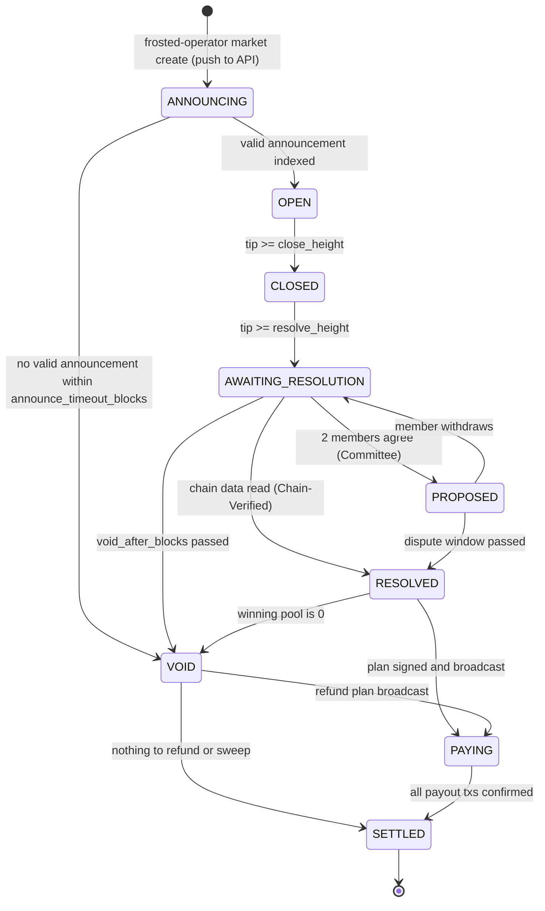

- Status Market mengatur UI (Bet Builder hanya aktif saat `OPEN`). Penghitungan bet hanya bergantung pada tinggi blok (§19.5), sehingga bet saat `ANNOUNCING` tetap dihitung jika `birthday_height ≤ h ≤ close_height` (ADR-0009).
- `CLOSED` saat `tip ≥ close_height`: sejak saat itu bet baru pasti masuk di blok > `close_height` (LATE). Bet di blok ≤ `close_height` tetap dihitung.
- Status Resolution (`PROPOSED`, `RESOLVED`, `VOID` di tabel `RESOLUTION`) hanya menggambarkan keputusan; status Market di atas adalah sumber kebenaran siklus hidup. Status Payout Plan terpisah: `PLANNED → SIGNING → BROADCAST → CONFIRMED`, atau `FAILED`.
- Setelah `SETTLED`, plan `FOLLOW_UP` (manual) tidak mengubah status Market.

### 23.2 Bet state machine

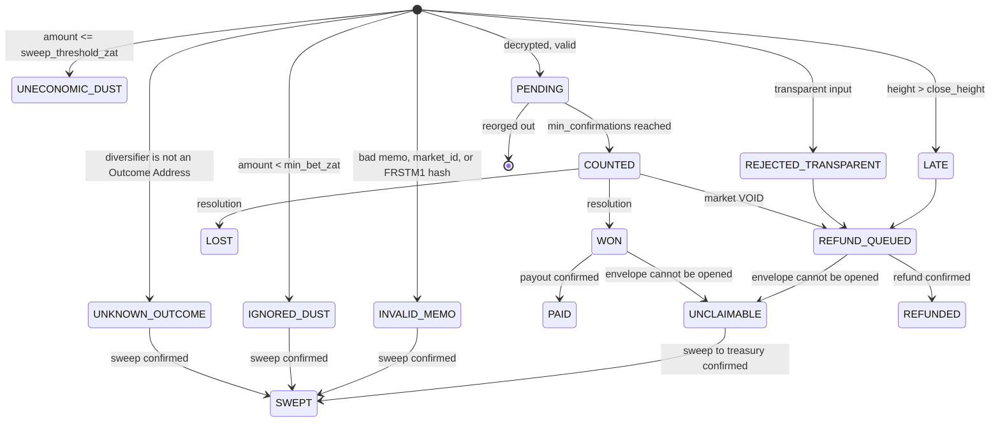

- `UNECONOMIC_DUST` terminal: note tidak pernah dibelanjakan dan tidak ada sesi FROST untuknya.
- Note yang masuk setelah `plan_cutoff_height` tetap di statusnya sampai plan `FOLLOW_UP` (ADR-0003).
- Announcement sah bukan Bet; note-nya disapu ke Treasury saat payout.
- `PRE_REGISTRATION` dan `DUPLICATE_TAG` adalah flag di Thaw Report, bukan status Bet.

### 23.2a Pemetaan status di My Bets (NFR-U2)

| Status | Label My Bets | Penjelasan UI (Inggris) |
| --- | --- | --- |
| (klien) `WAITING` | Waiting | "We have not seen your transaction yet." |
| `PENDING` | Confirming (n/`min_confirmations`) | "Your bet is in a block and waiting for confirmations." |
| `COUNTED` | Counted | "Your bet is counted in the pool." |
| `WON` | Won | "You won. Payout will be sent after committee signing." |
| `PAID` | Paid | "Payout confirmed to your payout address." |
| `LOST` | Lost | "This outcome did not win." |
| `LATE` | Late, refund | "Your bet arrived after the market closed; it will be refunded." |
| `REJECTED_TRANSPARENT` | Rejected, refund | "Sent from a transparent address. Not counted; it will be refunded, but the link is already public on-chain." |
| `REFUND_QUEUED` | Refund queued | "A refund (minus the refund fee) is included in the payout plan." |
| `REFUNDED` | Refunded | "Refund confirmed." |
| `IGNORED_DUST` | Below minimum | "Below the minimum bet. Not counted and not refunded." |
| `UNECONOMIC_DUST` | Too small | "Smaller than the network fee to move it. Not counted, not refunded." |
| `UNKNOWN_OUTCOME` | Unknown outcome | "Sent to an address that is not an outcome of this market. Not counted, not refunded." |
| `INVALID_MEMO` | Invalid memo | "The memo could not be read, so there is no payout address. Not counted, not refunded." |
| `UNCLAIMABLE` | Unclaimable | "The coordinator says your envelope could not be opened. If that is wrong, export an Envelope Proof." |
| `SWEPT` | Swept | "Moved to the operator treasury as documented." |
| (klien) `AMOUNT_MISMATCH` | Amount changed | "The amount sent differs from the sealed amount, so this bet is not linked to your Persona." |

### 23.3 Background jobs

| ID | Job | Proses | Pemicu | Idempotensi & error |
| --- | --- | --- | --- | --- |
| J-1 | `chain_follower` | glass-indexer | Poll `getbestblockheightandhash` setiap `CHAIN_POLL_INTERVAL_SECS`, atau `[notify] block_notify_command` Zebra | Simpan `(height, hash)`; deteksi reorg dengan membandingkan `prev_hash` |
| J-2 | `glass_scanner` | glass-indexer | Setiap blok baru | Upsert berdasarkan `bet_id`; rewind hingga `REORG_DEPTH` |
| J-3 | `confirmation_promoter` | glass-indexer | Setiap blok | `PENDING → COUNTED` saat konfirmasi ≥ `min_confirmations` |
| J-4 | `market_lifecycle` | glass-indexer | Setiap blok | Transisi ANNOUNCING→OPEN, ANNOUNCING→VOID (timeout), OPEN→CLOSED, CLOSED→AWAITING_RESOLUTION berdasarkan tinggi |
| J-5 | `chain_resolver` | coordinator | Setiap blok | Hanya tulis Resolution sekali; retry dengan backoff saat RPC gagal; hasil di-push ke API |
| J-6 | `committee_timer` | coordinator | Setiap blok | `dispute_window_blocks` dan `void_after_blocks`; hasil di-push ke API |
| J-7 | `escrow_wallet_sync` | coordinator | Setiap `ESCROW_SYNC_INTERVAL_SECS` dan sebelum planning | Memakai sync `zcash_client_backend` ke Zaino di host privat |
| J-8 | `payout_planner` | coordinator | Manual (`frosted-operator payout plan` / `follow-up`) `[ASSUMPTION]` | Satu plan aktif per Market (lock); gagal `FEE_SHORTFALL` tanpa efek samping |
| J-9 | `signing_orchestrator` | coordinator | Setelah plan disetujui | Satu sesi per spend; timeout per sesi `SIGNING_SESSION_TIMEOUT_SECS`; sesi baru tanpa mengubah plan |
| J-10 | `broadcast_monitor` | coordinator | Setiap blok | Jika tx expired → rebuild PCZT dengan anchor baru, tanda tangan ulang; `plan_hash` tidak berubah |
| J-11 | `thaw_worker` | frosted-api | Permintaan thaw | Deterministik; hasil di-cache di `THAW_REPORT` |
| J-12 | `sse_broadcaster` | frosted-api | Event dari J-2/J-3/J-4 dan ingest | Tanpa state; klien reconnect otomatis |
| J-13 | `coordinator_push` | coordinator | Setiap perubahan market, resolusi, plan, tx, sesi signing | Retry dengan backoff; idempoten per `(market_id, jenis, versi)`; satu-satunya jalur keluar ke API |

### 23.4 Konstanta global (satu sumber kebenaran: `zcash-glass::params`)

Nilai yang memengaruhi validasi disalin ke `market_definition` saat market dibuat (ADR-0005), sehingga verifier membaca dari definisi itu, bukan dari tabel ini. `PARAMS_VERSION` naik setiap kali salah satu nilai berubah.

| Konstanta | Nilai | Catatan |
| --- | --- | --- |
| `PARAMS_VERSION` | 1 | Ikut `market_definition.params_version` |
| `MIN_BET_ZAT` | 1_000_000 (0,01 ZEC) | `[ASSUMPTION]` |
| `MIN_CONFIRMATIONS` | 3 | `[ASSUMPTION]` |
| `REORG_DEPTH` | 10 | `[ASSUMPTION]` |
| `MARGINAL_FEE_ZAT` | 5_000 | Fee marginal satu logical action ZIP 317; `[TO VERIFY]` A-7 |
| `REFUND_FEE_ZAT` | 5_000 | `[ASSUMPTION]` = `MARGINAL_FEE_ZAT` |
| `SWEEP_THRESHOLD_ZAT` | 5_000 | `[ASSUMPTION]` = `MARGINAL_FEE_ZAT`; note ≤ nilai ini = `UNECONOMIC_DUST` |
| `MIN_FEE_BPS` | 50 (turunan) | `ceil(MARGINAL_FEE_ZAT × 10_000 / MIN_BET_ZAT)`; validasi create market |
| `DEFAULT_FEE_BPS` | 100 | 1% |
| `MAX_ACTIONS_PER_TX` | 50 | `[ASSUMPTION]`; action = max(spend, output) per transaksi; payout dipecah bila lebih |
| `MIN_ANNOUNCE_ZAT` | 10_000 | `[ASSUMPTION]` |
| `ANNOUNCE_TIMEOUT_BLOCKS` | 100 | `[ASSUMPTION]`; lewat dari ini tanpa announcement sah → `VOID` |
| `DISPUTE_WINDOW_BLOCKS` | 144 | `[ASSUMPTION]`; default untuk `resolution_params` COMMITTEE |
| `VOID_AFTER_BLOCKS` | 5_760 | `[ASSUMPTION]`; default untuk `resolution_params` COMMITTEE |
| `MAX_MAINNET_DEMO_ZAT` | 50_000_000 (0,5 ZEC) | `[ASSUMPTION]`; `frosted-operator` menolak market mainnet baru jika total saldo escrow mainnet ≥ nilai ini (`MAINNET_DEMO_LIMIT`) |
| `INGEST_MAX_SKEW_SECS` | 60 | Selisih timestamp maksimum untuk push |
| `SIGNING_SESSION_TIMEOUT_SECS` | 600 | Timeout per sesi FROST (J-9) |
| `CHAIN_POLL_INTERVAL_SECS` | 2 | J-1 |
| `ESCROW_SYNC_INTERVAL_SECS` | 30 | J-7 |

**Invariant yang di-assert saat startup** (proses gagal start jika dilanggar, NFR-S5):
- `MIN_ANNOUNCE_ZAT > SWEEP_THRESHOLD_ZAT` dan `MIN_BET_ZAT > SWEEP_THRESHOLD_ZAT`: announcement dan bet sah tidak pernah jatuh ke `UNECONOMIC_DUST`.
- `DEFAULT_FEE_BPS ≥ MIN_FEE_BPS`.
- `REFUND_FEE_ZAT ≥ MARGINAL_FEE_ZAT` dan `SWEEP_THRESHOLD_ZAT ≥ MARGINAL_FEE_ZAT`: setiap refund dan sapuan membiayai action-nya sendiri.
- Semua angka yang masuk JCS < 2^53.

Catatan: nilai berbasis blok (`ANNOUNCE_TIMEOUT_BLOCKS`, `DISPUTE_WINDOW_BLOCKS`, `VOID_AFTER_BLOCKS`) berubah durasinya jika NU7 mengubah waktu blok (V-15).

## 24. Security & privacy threat model

### 24.1 Aset

| Aset | Dampak jika bocor/hilang |
| --- | --- |
| Dana escrow | Kerugian finansial bettor |
| Identitas bettor (siapa bertaruh apa) | Pelanggaran janji inti produk |
| Payout address bettor | Bisa mengaitkan bet ke wallet bettor |
| FROST shares | Pencurian dana (jika ≥ 2 bocor) |
| `ENVELOPE_SK` | Semua payout address terbuka |
| `nk_m`/`rivk_m`/UFVK | Riwayat dana keluar escrow terbuka |
| `K_root` (sebelum Thaw) | Semua bet Persona terkait |
| Integritas odds/resolusi | Kecurangan pasar |

### 24.2 Ancaman, vektor, mitigasi

| ID | Ancaman | Vektor | Mitigasi | Sisa risiko |
| --- | --- | --- | --- | --- |
| T-1 | Komite mencuri/menahan dana | 2 member berkolusi | 2-of-3 dengan member dari pihak berbeda; `plan_hash` publik; resolusi Chain-Verified bisa diverifikasi; F-13 audit. **Pada demo MVP mitigasi "pihak berbeda" tidak berlaku**: satu developer memegang ketiga share dan `COORDINATOR_KEY` (ADR-0008) | **Tetap ada**: trust-minimized, bukan trustless; di demo setara kustodian tunggal |
| T-2 | Coordinator berbohong soal pool/odds | Data API dimanipulasi | UIVK publik + `frosted-verify` | Rendah |
| T-3 | Coordinator berbohong soal payout | Plan curang, termasuk menandai pemenang jujur sebagai `UNCLAIMABLE` agar bagiannya masuk Treasury | `plan_hash` + plan publik lengkap (jenis dan jumlah per `note_ref`); member memverifikasi plan sebelum tanda tangan; setiap bettor mengecek item miliknya lewat `receiver_commitment`; Envelope Proof membuktikan `UNCLAIMABLE` palsu (ADR-0006); F-13 | Rendah–sedang (alamat penerima tetap tidak terlihat publik; deteksi bergantung pada bettor yang mengecek) |
| T-4 | Bettor terdeanonimisasi lewat input transparent | Bettor mengirim dari t-address | UI memperingatkan; Z-only Guard menolak dan merefund | **Kebocoran sudah terjadi di chain**; refund tidak membatalkannya |
| T-5 | Korelasi jumlah dan waktu | Bet publik via UIVK dikorelasikan dengan swap/withdraw exchange | Edukasi: tunggu dan pakai jumlah acak; F-14 tidak mengirim langsung ke market | Sedang |
| T-6 | Coordinator mengetahui payout address | Coordinator membuka envelope | Dinyatakan terbuka; anjurkan alamat baru; masa depan: threshold decryption | Diterima untuk MVP |
| T-7 | Bias randomizer FROST | Coordinator memilih `alpha` | FROST v3 dipakai dengan randomizer dari PCZT lewat API deprecated (ADR-0013), disadari; migrasi ke alur native v3 (randomizer dari commitment round 1) pasca-MVP | Rendah |
| T-8 | Kebocoran IP pengunjung | Log server/CDN, log platform Vercel (snapshot mode), Cloudflare Tunnel (live opsional) | `LOG_IP=false` di server sendiri, tanpa analytics, aset di-bundle, dukungan akses via Tor; snapshot mode tidak memuat data bettor; README menyatakan bahwa Vercel dan Cloudflare melihat trafik (ADR-0012) | Rendah (server sendiri); Sedang (Vercel/Cloudflare) |
| T-9 | XSS lewat memo | Memo berbahaya | Memo tidak pernah dirender; hanya field hasil parse yang divalidasi | Rendah |
| T-10 | Double count saat reorg | Blok diganti | `REORG_DEPTH`, `MIN_CONFIRMATIONS`, upsert idempoten | Rendah |
| T-11 | Bet setelah hasil diketahui | Bet di batas penutupan | Aturan berbasis tinggi blok; `resolve_height ≥ close_height`; Chain-Verified memakai data setelah close | Rendah |
| T-12 | Manipulasi metrik Chain-Verified | Whale memindahkan dana ke/dari pool | Pilih ambang besar relatif terhadap ukuran pool; tampilkan peringatan | Sedang (sifat pasar) |
| T-13 | Aturan market diubah diam-diam | Operator mengubah DB, atau pihak lain mengirim FRSTM1 palsu | `rules_hash` on-chain (FRSTM1) atas JCS `market_definition` (termasuk params, `envelope_pk`, `treasury_address`); hanya announcement pertama dengan hash yang cocok yang sah | Rendah |
| T-14 | Sybil pada reputasi | Banyak Persona | Badge jumlah bet, umur Persona, pengungkapan terbuka | **Tetap ada** |
| T-15 | Kehilangan share FROST | Laptop hilang | 2-of-3 menoleransi 1 kehilangan; backup terenkripsi | Rendah |
| T-16 | Pencurian `K_root` | Malware di browser | Enkripsi passphrase lokal; peringatan | Sedang |
| T-17 | "Harvest now, decrypt later" | Komputer kuantum memecahkan X25519/ECDH | Payout address di envelope tidak post-quantum; dinyatakan terbuka | Rendah (jangka panjang) |
| T-18 | Spam dust | Banyak note kecil ke Outcome Address untuk membebani sweep, fee, dan signing | `MIN_BET_ZAT`; note ≤ `SWEEP_THRESHOLD_ZAT` tidak pernah dibelanjakan (tanpa sesi FROST); note yang disapu membiayai spend-nya sendiri; `FEE_SHORTFALL` fail-closed sehingga spam tidak bisa memotong pemenang (ADR-0003, ADR-0004) | Rendah |
| T-19 | Penyalinan memo / Thaw Tag | Memo terbaca via UIVK; payload disalin ke bet lain untuk mengotori reputasi Persona | Thaw Tag v2 mengikat market, outcome, jumlah, `env_epk`; salinan persis tetap membayar ke receiver Persona; tag kembar → hanya kemunculan pertama, sisanya `DUPLICATE_TAG` (ADR-0002) | Rendah |
| T-20 | `COORDINATOR_KEY` bocor | Push palsu ke API | API menghitung ulang `rules_hash` dan `plan_hash`; `rules_hash` terkunci on-chain; verifier independen menghitung ulang dari chain | Rendah (data publik bisa dicek ulang) |
| T-21 | Serangan jaringan ke host privat | Port masuk ke coordinator | Coordinator push-only; signing FROST in-process dan `frosted-operator` hanya di localhost; tidak ada server signing (ADR-0007) | Rendah |

### 24.3 Metadata yang **tetap** bocor (harus ditulis di How It Works)

- Untuk setiap bet: jumlah, outcome, tinggi blok, dan memo (termasuk Thaw Tag dan ciphertext envelope) **publik bagi siapa pun yang memegang UIVK**. Inilah desainnya.
- Adanya transaksi shielded di blok tersebut (bukan isinya) terlihat oleh siapa pun yang memindai chain.
- Payout Coordinator mengetahui payout address setiap bettor.
- Jika F-13 diaktifkan, payout address dan jumlah payout menjadi publik setelah settlement.
- Setelah Thaw, semua bet ber-tag Persona menjadi publik dan saling terkait.
- Plan publik membuka jenis dan jumlah payout per bet (`note_ref`), bukan alamat penerimanya.
- Alamat Treasury dan semua sapuan ke sana publik.
- Envelope Proof yang diterbitkan bettor membuka payout receiver bet itu.
- Setelah `SETTLED`, escrow masih menyimpan `UNECONOMIC_DUST` dan note yang masuk setelah `plan_cutoff_height`.
- Server API melihat permintaan HTTP (disarankan Tor bagi yang peduli).

## 25. Tech stack

Versi di bawah adalah versi yang **diketahui ada** saat riset. Claude Code wajib menjalankan `cargo search <crate>` / `npm view <pkg> version` dan mengunci versi terbaru yang kompatibel dalam satu kelompok librustzcash yang sama. Default-nya crate **upstream** dari crates.io; fork Zakura hanya dipakai jika spike membuktikan fitur Ironwood yang dibutuhkan tidak ada di upstream, dengan alasan dicatat di `docs/SPIKES.md` (ADR-0010).

| Layer | Teknologi | Versi (terverifikasi / minimum) | Alasan |
| --- | --- | --- | --- |
| Node | `zebrad` | ≥ 6.2.x (dukungan NU6.3 Ironwood); gunakan 7.x jika NU7 sudah aktif `[TO VERIFY]` | Satu-satunya implementasi konsensus utama; `getblock` membawa `valuePools` termasuk Ironwood |
| Node alternatif | Zakura | 5.x (`zakura-rpc` 5.0.0) | Fork Zebra yang lebih cepat sync; RPC kompatibel |
| gRPC wallet indexer | Zaino (`zainod`) atau server lightwalletd-compatible | `[TO VERIFY]` versi dengan dukungan `ironwood_actions` (`zaino-proto` memiliki field ini) | Dibutuhkan `zcash_client_backend` untuk sinkronisasi escrow |
| Zcash core (grup stabil: indexer, verifier, `zcash-glass` feature `zcash`) | `orchard` | 0.15.5 | `IronwoodDomain`, note decryption (M0.2); grup pre-release memakai 0.16.0 |
| | `zcash_primitives` | 0.30.1 (stabil); 0.31.0-pre.2 di grup pre-release | Parsing transaksi v6, `ironwood_bundle()` |
| | `zcash_protocol` | 0.10.x | Parameter jaringan |
| | `zcash_keys` | 0.16.1, features `orchard`, `unstable-frost` | UFVK/UIVK dari FVK FROST, alamat (M0.3) |
| | `zcash_address` | 0.13.x | Parsing Unified Address |
| | `zcash_note_encryption` | 0.4.2 (grup stabil) | `try_note_decryption` |
| Wallet escrow (grup pre-release: coordinator, operator; ADR-0015) | `zcash_client_backend` | 0.25.0-pre.2 (librustzcash git rev `eb38d7a`), fitur `orchard`, `pczt`, `lightwalletd-tonic`, `sync` | Wallet escrow view-only, PCZT Ironwood (M0.4) |
| | `zcash_client_sqlite` | 0.23.0-pre.2 (rev `eb38d7a`) | Penyimpanan wallet escrow |
| | `pczt` | 0.10.0-pre.2 (git rev `eb38d7a`) untuk coordinator; lihat ADR-0015 | Role PCZT; spend Ironwood hanya terbukti di grup pre-release (M0.4) |
| | `zip321` | ≥ 0.9.0-rc.1 | URI pembayaran + memo base64 |
| FROST | `reddsa` | 0.5.2 dengan fitur `frost` (0.6.x membuang feature ini) | Ciphersuite `redpallas` (ZIP 312); terbukti di M0.3/M0.4 |
| | `frost-rerandomized` | 3.0.0 (lewat `reddsa` 0.5.2, FROST v3) | Re-randomized FROST; randomizer dari PCZT lewat API deprecated (ADR-0013) |
| | ~~`frostd`, `frost-client`~~ | tidak dipakai di MVP | Masih FROST 2.x; signing in-process di `frosted-operator` (ADR-0014) |
| Kriptografi app | `x25519-dalek` 3.0.0, `chacha20poly1305` 0.10.1 (XChaCha20Poly1305), `hkdf` 0.12.4 + `sha2` 0.10.9, `blake2b_simd` 1.0.5 (keyed + personalization), `ed25519-dalek` (hanya `COORDINATOR_KEY`) | Terkunci di `Cargo.lock`. Versi lebih baru (`chacha20poly1305` 0.11, `hkdf` 0.13, `sha2` 0.11) tidak bisa dipakai bersama `zcash_primitives` 0.30.1, yang mengunci `crypto-common =0.2.0-rc.1` (SPIKES Appendix M4) | Crate RustCrypto/dalek matang, bisa dikompilasi ke WASM |
| Kanonikalisasi | Implementasi RFC 8785 (JCS), misalnya `serde_jcs` | `[TO VERIFY]` V-24 crate dan kesesuaian dengan RFC 8785 | `rules_hash` dan `plan_hash` harus identik di Rust native dan WASM |
| Backend | Rust 1.94.0, `tokio` 1.54, `axum` 0.8.x, `sqlx` **0.8.6** (SQLite), `serde`, `tracing` | `sqlx` 0.9 tidak dipakai karena konflik `crypto-common` dengan `zcash_primitives` 0.30.1 (SPIKES Appendix M4) | Stack Rust standar; satu bahasa dengan librustzcash |
| WASM | `wasm-bindgen`, `wasm-pack` | `[TO VERIFY]` | Satu implementasi format untuk browser dan server |
| Frontend | Next.js (App Router) + TypeScript + Tailwind CSS | ≥ 15 `[TO VERIFY]` | Cepat dibangun, SSR untuk halaman publik, ekosistem besar |
| QR | `qrcode` (npm) | `[TO VERIFY]` | Render QR ZIP-321 di klien |
| Client storage | IndexedDB via `idb` (npm) | `[TO VERIFY]` | Bet Receipt dan Persona lokal |
| Container | Docker Compose | — | Satu perintah untuk menjalankan semua komponen; project publik dan privat terpisah |
| Hosting demo publik | Vercel (snapshot mode, read-only) | — | Default publik tanpa node/API (ADR-0012); Vercel melihat IP pengunjung |
| Tunnel (opsional) | Cloudflare Tunnel (`cloudflared`) | `[TO VERIFY]` versi | Live demo dari laptop; Cloudflare melihat trafik |
| Wallet uji | Zodl (iOS/Android) | rilis terbaru | Wallet referensi, dukungan ZIP-321 `[TO VERIFY]` memo dan apakah jumlah dari URI bisa diedit (V-25) |

---

# PART E — Build Plan for Claude Code

## 26. Repository structure

```
frosted/
├── Cargo.toml                    # Rust workspace (semua crate di crates/)
├── rust-toolchain.toml           # Pin Rust stable sesuai MSRV librustzcash [TO VERIFY]
├── .env.example
├── README.md                     # Ringkasan, tabel "real vs simulated", txid demo
├── LICENSE-MIT / LICENSE-APACHE  # Dual license, sama dengan librustzcash
├── docs/
│   ├── PROJECT_SPEC_FROSTED.md   # Dokumen ini (sumber kebenaran)
│   ├── SPIKES.md                 # Hasil spike M0 (dicatat oleh Claude Code)
│   ├── test-vectors/             # JSON test vector untuk memo, envelope, thaw, payout
│   └── decisions/                # ADR singkat bila ada keputusan berubah
├── crates/
│   ├── zcash-glass/              # Lib inti: params, memo, envelope, thaw, hash, odds, payout;
│   │                             # scan + parse UA di belakang feature `zcash` (inti bebas orchard/zcash_*)
│   ├── zcash-glass-wasm/         # Binding wasm-bindgen untuk web
│   ├── glass-indexer/            # Binary: follower + scanner + lifecycle jobs
│   ├── frosted-api/              # Binary: axum REST + SSE + proxy admin
│   ├── payout-coordinator/       # Binary: escrow keys, resolver, planner, PCZT, FROST, broadcast, push
│   ├── frosted-operator/         # Binary CLI (host coordinator, localhost): market, resolusi, plan, signing
│   ├── frosted-verify/           # Binary CLI: audit independen + envelope-proof
│   └── frosted-cli/              # (COULD, F-15) CLI bet untuk agent/power user
├── web/                          # Next.js app (frosted-web)
│   ├── app/                      # Route: /, /markets/[id], /my-bets, /persona, /thaw,
│   │                             #        /p/[persona_id], /leaderboard, /verify/[id],
│   │                             #        /operator (read-only status), /how
│   ├── components/
│   ├── lib/                      # api client, IndexedDB (idb), wasm loader
│   └── public/
├── infra/
│   ├── docker-compose.yml        # zebrad, zaino, indexer, api, web, caddy
│   ├── docker-compose.private.yml# payout-coordinator, zebrad, zaino (host terpisah, tanpa port masuk)
│   ├── zebra/
│   │   ├── regtest.toml
│   │   ├── testnet.toml
│   │   └── mainnet.toml
│   ├── zaino/                    # Konfigurasi gRPC indexer
│   └── caddy/Caddyfile           # TLS + reverse proxy, tanpa access log IP
├── spikes/                       # Kode eksperimen M0 (boleh kotor, tidak dipakai produksi; di luar workspace Cargo;
│                                 # dijalankan lewat change OpenSpec `run-feasibility-spikes`, ADR-0011 amended)
│   ├── s1-regtest-env/           # M0.1
│   ├── s2-ironwood-ivk-decrypt/  # M0.2
│   ├── s3-fvk-from-frost/        # M0.3
│   ├── s4-frost-pczt-sign/       # M0.4
│   ├── s5-valuepools-at-height/  # M0.5
│   └── s6-zodl-memo/             # M0.6
└── scripts/
    ├── dev-up.sh                 # Jalankan stack regtest
    ├── seed-demo.sh              # Buat market demo + bet uji
    ├── export-snapshot.sh        # Ekspor respons API publik satu market SETTLED ke JSON (snapshot mode)
    └── committee/                # Panduan trusted dealer + signing in-process per member (ADR-0014)
```

## 27. Development environment

### 27.1 Tools wajib

| Tool | Kegunaan |
| --- | --- |
| Rust stable + `wasm-pack` + target `wasm32-unknown-unknown` | Semua crate dan WASM |
| Node.js LTS + pnpm | Web |
| Docker + Docker Compose | Menjalankan zebrad, zaino, layanan |
| `zebrad` (binary rilis atau Docker) | Node regtest/testnet/mainnet. Zebra menyediakan binary rilis Linux x86_64/aarch64 dan bisa dipasang dengan `cargo binstall zebrad` ([Zebra 6.0.0-rc.0](https://github.com/ZcashFoundation/zebra/releases/tag/v6.0.0-rc.0)) |
| `zcash-devtool` (ZODL) | Wallet CLI untuk bettor uji di regtest/testnet `[TO VERIFY]` dukungan Ironwood |
| `frost-zcash-demo` | Referensi saja; MVP memakai `reddsa`/`frost-rerandomized` 3.0.0 langsung di `frosted-operator` (ADR-0014) |
| Zodl (HP) | Wallet bettor untuk demo mainnet; `[TO VERIFY]` ketersediaan build testnet |
| `sqlite3` | Inspeksi database |

### 27.2 Tiga lingkungan

| Lingkungan | Dipakai untuk | Dana | Catatan |
| --- | --- | --- | --- |
| **Regtest lokal** | Development, CI, test integrasi | Hasil mining lokal | NU6.3 bisa diaktifkan opt-in di regtest (sesuai catatan rilis zecd). `[TO VERIFY]` kunci konfigurasi activation height dan internal miner di Zebra |
| **Testnet** | Demo utama, uji Zodl | TAZ (koin testnet). Explorer: [testnet.zcashexplorer.app](https://testnet.zcashexplorer.app) | Ironwood aktif di testnet sejak blok 4.134.000 (`[TO VERIFY]` V-26). `[TO VERIFY]` URL faucet TAZ yang aktif. Node testnet lokal baru disiapkan di M12 (§27.5); sebelum itu, uji Zodl memakai server lightwalletd milik Zodl, bukan node sendiri |
| **Mainnet (mikro), opsional** | COULD (M13.4): satu putaran bukti di dunia nyata | ZEC nyata, total saldo escrow < `MAX_MAINNET_DEMO_ZAT` | Hanya tim sendiri sebagai bettor. Bukan operasi publik. Tidak ada node mainnet penuh di laptop; opsi akses dievaluasi dulu (V-30) |

### 27.3 Node

- **Default:** development dan semua spike M0 di **regtest laptop lokal** (ADR-0012). VPS opsional dan hanya untuk sisi publik.
- **Testnet (hanya M12):** utamakan **endpoint testnet publik** (JSON-RPC atau lightwalletd-compatible), karena koin testnet tidak bernilai. Sebelum dipakai, verifikasi bahwa endpoint menyediakan `getrawtransaction` (transaksi penuh), `getblock(h, 1)` dengan `valuePools`, `getblockchaininfo` dengan `valuePools`/`upgrades`, dan `sendrawtransaction`, serta lightwalletd dengan data Ironwood untuk sync escrow (V-31). Fallback: node testnet lokal di SSD eksternal (§27.5).
- Konsekuensi endpoint publik di testnet (diterima karena dana tidak bernilai, dicatat di "Real vs simulated"): penyedia melihat IP laptop, transaksi yang diambil indexer, dan transaksi payout yang disiarkan coordinator. Untuk mainnet, coordinator tetap tidak boleh memakai endpoint pihak ketiga (ADR-0007).
- **Mainnet (opsional):** tidak ada rencana node mainnet penuh di laptop. Jika mainnet mikro dijalankan, evaluasi dulu Zakura dengan pruning/snapshot atau endpoint publik (V-30).
- Pada demo laptop, sisi publik dan privat boleh berbagi satu node/endpoint.
- Indexer publik boleh memakai RPC pihak ketiga hanya untuk demo darurat, dengan catatan bahwa penyedia RPC melihat txid yang diambil. `[ASSUMPTION]`
- Aktifkan `[notify] block_notify_command` Zebra untuk memicu J-1 tanpa polling (opsional).

### 27.4 `.env.example`

```dotenv
# ---------- Shared ----------
FROSTED_NETWORK=regtest                 # regtest | testnet | mainnet
ZEBRA_RPC_URL=http://127.0.0.1:18232    # [TO VERIFY] port default per network
ZEBRA_RPC_COOKIE_FILE=                  # path cookie auth jika diaktifkan
LIGHTWALLETD_GRPC_URL=http://127.0.0.1:9067   # Zaino / lightwalletd-compatible [TO VERIFY] port
LOG_LEVEL=info
LOG_IP=false

# ---------- Public side ----------
PUBLIC_DB_PATH=./data/public.db
API_BIND=0.0.0.0:8080
API_PUBLIC_ORIGIN=http://localhost:3000
COORDINATOR_PUBKEY=                              # Ed25519 pubkey untuk verifikasi push ingest

# ---------- Private side (payout-coordinator, tanpa port masuk) ----------
COORDINATOR_BIND=127.0.0.1:8090                  # hanya untuk frosted-operator di host yang sama
API_INGEST_URL=http://localhost:8080/v1/ingest   # tujuan push keluar
COORDINATOR_KEY_FILE=./private/coordinator.key   # Ed25519, satu-satunya kunci auth
TREASURY_ADDRESS=                                # UA Orchard-only, masuk market_definition
COORDINATOR_DB_PATH=./private/coordinator.db
ESCROW_WALLET_DB_PATH=./private/escrow-wallet.db
SECRETS_KEY_FILE=./private/secrets.key           # kunci enkripsi at-rest (32 byte)
ENVELOPE_SK_FILE=./private/envelope.sk
HOT_WALLET_SEED_FILE=./private/hot-wallet.seed   # untuk FRSTM1 announcement
COMMITTEE_GROUP_ID=
COMMITTEE_MEMBERS_JSON=./private/committee.json  # member_id, display_name, frost_identifier

# ---------- Params (override zcash-glass::params hanya untuk testing) ----------
# Nilai yang dipakai sebuah market tercatat di market_definition-nya.
MIN_BET_ZAT=1000000
MIN_CONFIRMATIONS=3
MAX_MAINNET_DEMO_ZAT=50000000

# ---------- Web ----------
NEXT_PUBLIC_API_URL=http://localhost:8080/v1
NEXT_PUBLIC_NETWORK=regtest
NEXT_PUBLIC_SNAPSHOT_MODE=false                  # true = read-only dari JSON hasil export-snapshot.sh (Vercel)
```

### 27.5 Kebutuhan node lokal (laptop)

Angka dari dokumentasi Zebra pada saat riset; bisa bertambah seiring pertumbuhan chain dan aktivitas Ironwood. `[TO VERIFY]` V-29 ulang saat M12.0.

| Node | Kapan | Disk state Zebra | Disk yang disiapkan | Waktu sync | Catatan |
| --- | --- | --- | --- | --- | --- |
| Regtest | Development + semua spike M0 | < 1 GB | 5 GB | Instan (mining lokal) | Di disk internal |
| Testnet (fallback) | M12, hanya jika endpoint testnet publik tidak memenuhi V-31 | ~10 GB (docs Zebra); panduan pihak ketiga memakai ~40 GB | **≥ 80 GB bebas** (state + Zaino + Docker + ruang tumbuh) | ~setengah hari; cukup semalaman | Disarankan di SSD eksternal |
| Mainnet | Tidak direncanakan | ~300 GB (docs Zebra) | — | ~3 hari | Tidak ada node mainnet penuh di laptop; lihat V-30 |

**Opsi SSD eksternal (fallback testnet):**
- SSD eksternal USB 3.1/3.2 atau Thunderbolt (bukan HDD; Zebra banyak melakukan random I/O). Kapasitas ≥ 128 GB sudah cukup untuk testnet + Zaino.
- Format APFS (macOS) atau ext4 (Linux); arahkan `cache_dir` zebrad dan direktori data Zaino ke SSD lewat volume Docker atau `infra/zebra/testnet.toml`.
- Sync semalaman dengan laptop tersambung listrik, sleep dinonaktifkan (`caffeinate` di macOS), dan SSD tidak dilepas selama node jalan.
- RAM ≥ 8 GB agar Zebra, Zaino, dan stack Frosted bisa jalan bersamaan.

## 28. Implementation milestones

Aturan umum untuk Claude Code:
- Kerjakan milestone **berurutan**, dengan satu pengecualian (ADR-0001): modul murni M2 (M2.1–M2.6, M2.8: params, memo, envelope, thaw, odds, payout, hash) boleh dikerjakan paralel dengan M0. M2.7 (`scan`) dan M3+ menunggu hasil M0 tercatat di `docs/SPIKES.md`.
- Spike M0 dijalankan lewat change OpenSpec `run-feasibility-spikes` (agar bisa dikerjakan dengan `/opsx:apply`); kode spike tetap di `spikes/`, di luar workspace Cargo, dan hasilnya di `docs/SPIKES.md` (ADR-0011, amended). M0.1 adalah bagian dari change `setup-dev-environment`.
- Semua spike dikerjakan di regtest laptop lokal. Verifikasi pada node live (bagian live M0.5) ditunda ke M12 dan ditandai "deferred to M12" di `docs/SPIKES.md` (ADR-0012).
- Setiap task harus diakhiri dengan test yang lulus (`cargo test` / `pnpm test`) dan commit kecil.
- Jika hasil spike bertentangan dengan dokumen ini, **jangan improvisasi diam-diam**: tulis ADR di `docs/decisions/` dan perbarui bagian terkait.

### M0 — Spikes (go/no-go)

| Task | Isi | Definition of done | Fallback jika gagal |
| --- | --- | --- | --- |
| M0.1 `s1-regtest-env` | Jalankan zebrad regtest dengan NU6.3 aktif, mining lokal, dan Zaino | Skrip `dev-up.sh` menghasilkan tinggi blok > NU6.3, RPC `getblockchaininfo` menampilkan pool `ironwood`, dan `zcash-devtool` bisa mengirim note bermemo ke UA Orchard-only | Pakai testnet saja untuk semua integrasi |
| M0.2 `s2-ironwood-ivk-decrypt` | Kirim note ke UA Orchard-only di regtest, ambil tx via `getrawtransaction`, parse dengan `zcash_primitives`, dekripsi dengan `IronwoodDomain` + IVK | Program mencetak value, memo, dan diversifier index yang benar | Blocker: tanpa ini Glass Escrow tidak jalan. Eskalasi ke forum Zcash/Discord |
| M0.3 `s3-fvk-from-frost` | DKG `reddsa::frost::redpallas` (trusted dealer cukup) → `ak`; gabungkan dengan `nk`, `rivk` acak → FVK → UFVK → UIVK + alamat | UIVK string ter-encode; M0.2 berhasil mendekripsi note ke alamat ini | Blocker untuk FROST. Fallback: escrow dengan kunci tunggal biasa (F-08 berlabel "single-key demo") |
| M0.4 `s4-frost-pczt-sign` | Sinkronkan akun escrow view-only (UFVK M0.3) lewat Zaino dengan `zcash_client_backend`, buat PCZT yang membelanjakan note escrow, ambil sighash + alpha, tanda tangani 2-of-3, sisipkan, extract, broadcast | Akun escrow tersinkron lewat Zaino (saldo dan witness benar); tx terkonfirmasi di regtest; catat jumlah sesi FROST (= jumlah spend), durasi per sesi, apakah `frostd` bisa banyak pesan per sesi, dan fee ZIP 317 aktual | Fallback seperti M0.3; sync gagal → `z_gettreestate` + scanning sendiri (V-22); dokumentasikan alasan |
| M0.5 `s5-valuepools-at-height` | Panggil `getblock(h, 1)` dan periksa `valuePools` | Nilai `ironwood.chainValueZat` pada tinggi historis tercetak | Fallback snapshot (SD-3) |
| M0.6 `s6-zodl-memo` | Buat URI ZIP-321 dengan memo FRST1 dummy; scan dengan Zodl (testnet atau mainnet mikro) | Memo yang diterima identik byte per byte; catat apakah Zodl mengizinkan jumlah dari URI diedit sebelum kirim (V-25) | Fallback: bettor memakai `zcash-devtool`/Zingo; atau UI "copy memo" manual |

**Output M0:** `docs/SPIKES.md` berisi hasil, versi crate yang terbukti jalan, nama fungsi yang benar untuk setiap `[TO VERIFY]` di Part D, dan alasan jika fork Zakura dipakai (ADR-0010).

### M1 — Fondasi repo

| Task | Definition of done |
| --- | --- |
| M1.1 Workspace Cargo + semua crate kosong + `rust-toolchain.toml` | `cargo build --workspace` sukses |
| M1.2 Next.js app di `web/` dengan Tailwind, layout, navigasi kosong untuk S-01..S-12 | `pnpm build` sukses |
| M1.3 `infra/docker-compose.yml` untuk regtest (zebrad, zaino) | `docker compose up` menghasilkan node sehat |
| M1.4 CI (GitHub Actions): `cargo fmt --check`, `clippy`, `cargo test`, `pnpm lint`, `pnpm test` | Pipeline hijau |

### M2 — `zcash-glass` (inti, tanpa jaringan)

| Task | Definition of done |
| --- | --- |
| M2.1 `params`: semua konstanta §23.4 + `assert_invariants` | Unit test nilai; invariant yang dilanggar → gagal start |
| M2.2 `memo`: encode/decode FRST1, FRSTM1, FRSTP1 sesuai §19.3 | Round-trip test; panjang FRST1 = 237; test vector JSON di `docs/test-vectors/memo.json` |
| M2.3 `envelope`: `seal(envelope_pk, market_id, header, receiver, salt) -> (payload, env_esk)` / `open(envelope_sk, payload)` / `verify_proof(proof, payload, envelope_pk)` | Round-trip; AAD salah → gagal; proof valid → PASS, proof palsu → FAIL; test vector |
| M2.4 `thaw`: `commitment(k_root)`, `persona_id`, `tag(k_root, market_id, outcome_index, amount_zat, env_epk)` | Test vector; personalization 16 byte; jumlah berbeda → tag berbeda |
| M2.5 `odds`: pool per outcome, probability | Test: jumlah probability = 1 (± pembulatan) |
| M2.6 `payout`: rencana §19.6 (parimutuel, VOID, refund, sweep, `UNECONOMIC_DUST`, `plan_cutoff_height`, `FEE_SHORTFALL`) | Property test (`proptest`): Σ payout ≤ distributable; tidak ada nilai negatif; pemenang tidak pernah dipotong fee; `FEE_SHORTFALL` saat fee tak tertutup; VOID tanpa `operator_fee`; determinisme |
| M2.7 `scan`: `decrypt_action(uivk, action) -> Option<DecryptedBet>` memakai temuan M0.2, di belakang feature `zcash` (atau modul terpisah) agar inti tetap bebas `orchard`/`zcash_*` | Test dengan fixture tx regtest; `cargo build -p zcash-glass` tanpa feature tetap tidak menarik crate Zcash |
| M2.8 `hash`: `rules_hash`, `plan_hash`, `receiver_commitment`, `note_ref` (JCS RFC 8785) | Test vector JCS; determinisme lintas urutan field; angka ≥ 2^53 ditolak; hasil identik di native dan WASM |

### M3 — `zcash-glass-wasm`

| Task | Definition of done |
| --- | --- |
| M3.1 `build_bet(params)` → `{memo_text, zip321_uri, bet_fingerprint, env_esk, bet_salt}` | Test wasm (wasm-bindgen-test); URI ter-parse ulang oleh `zip321` |
| M3.2 `parse_payout_ua(ua)` → error `PAYOUT_ADDRESS_NO_ORCHARD` bila tidak ada receiver Orchard | Test UA valid/invalid |
| M3.3 `new_persona(registry_address)` → `{k_root, persona_id, frstp1_uri}` | Test |
| M3.4 Paket npm lokal diimpor web | Halaman uji di web memanggil fungsi tanpa error |
| M3.5 `receiver_commitment(receipt)` dan `envelope_proof(receipt, note_ref)` | Hasil sama dengan implementasi native (test vector) |

### M4 — `glass-indexer`

| Task | Definition of done |
| --- | --- |
| M4.1 Migrasi SQLite `public.db` sesuai pembagian tabel §21 | `sqlx migrate run` sukses |
| M4.2 J-1 `chain_follower` + deteksi reorg | Test integrasi regtest: invalidate blok → rewind benar |
| M4.3 J-2 `glass_scanner` dengan aturan §19.5 (urutan persis) | Test regtest: bet valid, bet dari t-address, bet terlambat, bet dust, dust tak ekonomis, diversifier asing, memo salah, FRSTM1 palsu, bet saat ANNOUNCING → status sesuai |
| M4.4 J-3, J-4 | Status bet dan market berubah sesuai tinggi blok, termasuk ANNOUNCING → VOID setelah `announce_timeout_blocks` |
| M4.5 Scan Persona Registry (FRSTP1) | Persona `REGISTERED` dengan `registered_height` benar |
| M4.6 Channel event internal untuk SSE | Event terkirim saat bet `COUNTED` |

### M5 — `frosted-api`

| Task | Definition of done |
| --- | --- |
| M5.1 Endpoint publik §22.1 (kecuali thaw & verify) | Test HTTP; skema sesuai §22.3 |
| M5.2 SSE `/stream` | Test: klien menerima `odds_updated` setelah bet |
| M5.3 Endpoint ingest §22.2 + verifikasi tanda tangan `COORDINATOR_KEY` + hitung ulang `rules_hash`/`plan_hash` | Test: tanda tangan salah → 401; timestamp lama → `STALE_REQUEST`; hash tidak cocok → `RULES_HASH_MISMATCH`/`PLAN_HASH_MISMATCH` |
| M5.4 Middleware privasi: tanpa log IP, tanpa cookie | Test: log tidak berisi IP |

### M6 — `frosted-web` (alur bettor)

| Task | Definition of done |
| --- | --- |
| M6.1 S-01 Markets | Data dari API, filter bekerja |
| M6.2 S-02 Market Detail + odds live (SSE) | Bar odds berubah tanpa reload |
| M6.3 S-03 Bet Builder 4 langkah (WASM) + QR + Copy URI | QR terbaca Zodl/devtool; validasi error tampil |
| M6.4 S-04 My Bets (IndexedDB, ekspor/impor, pencocokan `bet_fingerprint`, status §23.2a, `AMOUNT_MISMATCH`) | Status "counted" muncul untuk bet sendiri; jumlah yang diedit terdeteksi |
| M6.7 S-04 "Check my plan item" + ekspor Envelope Proof | Item cocok untuk bet sendiri; peringatan muncul sebelum ekspor proof |
| M6.5 S-12 How It Works | Konten §24.3 tampil |
| M6.6 Aksesibilitas NFR-A1..A3 | Lighthouse a11y ≥ 90 `[ASSUMPTION]` |

### M7 — `payout-coordinator`: escrow & market

| Task | Definition of done |
| --- | --- |
| M7.1 Penyimpanan rahasia terenkripsi (`SECRETS_KEY_FILE`) | Test: field `*_enc` tidak bisa dibaca tanpa kunci |
| M7.2 Import `PublicKeyPackage` hasil DKG committee | Group tersimpan |
| M7.3 `frosted-operator market create`: validasi (termasuk `INVALID_FEE_BPS`, `MAINNET_DEMO_LIMIT`), `nk`/`rivk`, FVK/UFVK/UIVK, Outcome Address, `import_account_ufvk` ke escrow wallet DB, `market_definition` + `rules_hash` | Market muncul di API dengan UIVK; M0.2 mendekripsi bet ke alamatnya |
| M7.4 Hot wallet + kirim FRSTM1 announcement (`MIN_ANNOUNCE_ZAT`) | Market `OPEN` setelah announcement sah terindeks |
| M7.5 J-7 `escrow_wallet_sync` lewat Zaino di host privat | Saldo escrow di wallet DB = pool total + uang tak terhitung |
| M7.6 J-13 `coordinator_push` (HTTPS keluar, bertanda tangan) | Push idempoten; coordinator tidak membuka port selain localhost |

### M8 — Resolusi & payout

| Task | Definition of done |
| --- | --- |
| M8.1 J-5 `chain_resolver` untuk `POOL_THRESHOLD` dan `UPGRADE_ACTIVE` | Test regtest dengan ambang yang pasti YES dan pasti NO |
| M8.2 Planner (`frosted-operator payout plan`): buka envelope, hitung plan dengan `zcash-glass::payout` pada `plan_cutoff_height`, sapuan, cek `FEE_SHORTFALL`, `plan_hash`, plan publik | Plan sama dengan perhitungan `frosted-verify` (tanpa alamat); fee kurang → plan tidak dibuat |
| M8.3 Builder PCZT (proposal → PCZT → proof) | PCZT valid untuk semua output plan (termasuk Treasury); note `UNECONOMIC_DUST` tidak dibelanjakan; pecah jika > `MAX_ACTIONS_PER_TX` |
| M8.4 FROST 2-of-3 in-process di `frosted-operator` (API M0.4, ADR-0013/0014); signer melihat `plan_hash` | 2-of-3 signature teragregasi per aksi dan lolos `apply_ironwood_signature` |
| M8.5 Extract + broadcast + J-10 monitor + rebuild saat expired | Payout terkonfirmasi di regtest; wallet pemenang menerima note dengan jumlah benar |
| M8.6 S-05 Resolution & Payout + S-11 status read-only + `frosted-operator payout status` | Progres signing tampil sebagai sesi selesai/total |
| M8.8 Plan `FOLLOW_UP` manual (`frosted-operator payout follow-up`) | Note setelah `plan_cutoff_height` dibayar/disapu lewat plan baru dengan `plan_hash` sendiri |
| M8.7 `scripts/committee/` panduan member | Member baru bisa ikut signing mengikuti README dalam < 15 menit |

### M9 — Persona & Thaw (SHOULD)

| Task | Definition of done |
| --- | --- |
| M9.1 S-06 Persona (generate, backup, enkripsi passphrase, QR registrasi) | Persona terdaftar di regtest |
| M9.2 Thaw Tag v2 di Bet Builder | Tag benar sesuai test vector |
| M9.3 J-11 thaw worker + endpoint thaw | Report memuat bet menang **dan** kalah; bet sebelum registrasi ditandai `PRE_REGISTRATION`; tag kembar → `DUPLICATE_TAG` |
| M9.4 S-07, S-08, S-09 | Leaderboard tampil dengan badge `10+` |

### M10 — Verifier (SHOULD)

| Task | Definition of done |
| --- | --- |
| M10.1 `frosted-verify` subcommands: `market`, `pools`, `resolution`, `thaw`, `envelope-proof`, `all` | Output PASS pada market demo; FAIL jika API dimanipulasi (uji dengan mock); `envelope-proof` PASS untuk proof valid, FAIL untuk proof palsu |
| M10.2 S-10 Verify + endpoint `/verify` | Hasil sama dengan CLI |

### M11 — Committee-Resolved Markets (SHOULD)

| Task | Definition of done |
| --- | --- |
| M11.1 `frosted-operator resolution propose\|confirm\|withdraw` + J-6 + push ke API | Alur UF-4 lulus test |
| M11.2 Tampilan status dan hitung mundur dispute window (read-only) | Hitung mundur tampil |

### M12 — Hardening, demo, dokumentasi

| Task | Definition of done |
| --- | --- |
| M12.0 Akses testnet: verifikasi endpoint testnet publik (JSON-RPC: `getrawtransaction`, `getblock(h, 1)` dengan `valuePools`, `getblockchaininfo`, `sendrawtransaction`; lightwalletd-compatible dengan data Ironwood) (V-31); jika tidak memenuhi, node testnet lokal di SSD eksternal (§27.5). Lalu jalankan verifikasi live yang ditunda dari M0.5 (V-27) | Hasil V-31 tercatat di `docs/SPIKES.md`; satu sumber testnet yang memenuhi semua RPC terpilih; bagian "deferred to M12" terisi |
| M12.1 `seed-demo.sh`: 2 market Chain-Verified + 1 Committee di testnet | Market tampil dengan odds |
| M12.2 Satu siklus penuh testnet | Txid tercatat di README |
| M12.3 README: arsitektur, cara menjalankan, tabel "real vs simulated" (termasuk kustodian kunci tunggal, ADR-0008, dan satu laptop untuk sisi publik + privat, ADR-0012), batasan trust | Review checklist §33 |
| M12.4 Video demo | Sesuai §31 |
| M12.5 Snapshot mode: flag `NEXT_PUBLIC_SNAPSHOT_MODE`, `scripts/export-snapshot.sh` (endpoint publik saja), deploy `frosted-web` read-only ke Vercel | Web di Vercel menampilkan satu market `SETTLED` tanpa node/API; Bet Builder/Persona/Thaw nonaktif; JSON hasil ekspor tidak memuat txid bet, alamat, atau `env_esk` (test grep) |
| M12.6 (Opsional) Live via Cloudflare Tunnel ke `frosted-api` di laptop | Juri bisa membuka market live; README menyatakan bahwa tunnel melihat trafik |
| M12.7 (Opsional) VPS untuk sisi publik saja | `infra/docker-compose.yml` jalan di VPS; sisi privat tetap di laptop |

### M13 — COULD

| Task | Definition of done |
| --- | --- |
| M13.1 F-13 publikasi UFVK setelah `SETTLED` + verifier dana keluar | Verifier menghitung payout per penerima |
| M13.2 F-14 alur SD-7 (quote 1Click ke wallet bettor) `[TO VERIFY]` API 1Click | Swap testnet/mainnet mikro berhasil |
| M13.3 F-15 `frosted-cli bet` | Agent bisa membuat URI bet tanpa web |
| M13.4 Siklus mainnet mikro (opsional, tim saja) setelah evaluasi akses mainnet V-30 (Zakura pruning/snapshot atau endpoint publik; tanpa node mainnet penuh di laptop) | Txid mainnet tercatat di README dengan catatan "team-only research demo"; total saldo escrow < `MAX_MAINNET_DEMO_ZAT` |

## 29. Testing strategy

| Level | Cakupan | Alat |
| --- | --- | --- |
| Unit | `zcash-glass` (params invariant, memo, envelope + proof, thaw v2, odds, payout, hash JCS), validasi API, komponen web | `cargo test`, `proptest`, `vitest` |
| Test vector | File JSON di `docs/test-vectors/` dipakai bersama oleh Rust dan WASM | Test membaca file yang sama |
| Integrasi (regtest) | Indexer + API + coordinator + zebrad + zaino; bettor disimulasikan dengan `zcash-devtool` atau skrip Rust yang membangun tx | Skrip `scripts/dev-up.sh` + `cargo test --features it` |
| FROST | Trusted dealer di CI, 3 share lokal, signing PCZT regtest in-process | `reddsa` 0.5.2 / `frost-rerandomized` 3.0.0 langsung |
| End-to-end | Web → QR URI → tx regtest → odds berubah → resolusi → payout | Playwright (URI disalin dari halaman, dikirim oleh skrip wallet) |
| Uji privasi | Pastikan API tidak pernah mengembalikan `txid` bet, alamat, isi envelope, atau `env_esk`; log tanpa IP; coordinator tidak membuka port selain localhost | Test snapshot respons + grep log + cek port |
| Uji serangan | Spam dust (tidak ada sesi FROST, pemenang tidak terpotong), salinan memo/tag (`DUPLICATE_TAG`), FRSTM1 palsu, push bertanda tangan salah | Test integrasi regtest |
| Uji manual | Zodl di testnet/mainnet mikro | Checklist di `docs/SPIKES.md` |

**Catatan regtest dari spike (`docs/SPIKES.md` §M0.1–M0.4), wajib diikuti test integrasi:**
- Coinbase baru bisa dibelanjakan setelah 100 blok; pendanaan wallet uji mengikuti `scripts/regtest-wallet.sh setup` (coinbase ke faucet → miner kembali ke default → matangkan → shield).
- Zaino bisa tertinggal sesaat setelah `generate`; test menunggu tip Zaino = tip zebrad, lalu memverifikasi tinggi wallet sebelum membangun tx.
- Activation height wallet dan tool selalu diturunkan dari `getblockchaininfo` (ADR-0016).
- Light wallet baru melihat memo setelah `enhance` (mengambil transaksi penuh).

**Menguji transaksi Zcash dengan aman:**
1. Semua logika dikembangkan di **regtest** (dana tidak bernilai, blok bisa dibuat sesuai kebutuhan).
2. **Testnet** untuk uji wallet nyata dan demo.
3. **Mainnet** opsional (COULD, M13.4), hanya untuk satu siklus mikro. Coordinator tidak bisa mencegah orang mengirim dana ke Outcome Address, jadi guard-nya ada di pembuatan market: `frosted-operator` menolak membuat market mainnet baru jika total saldo escrow mainnet ≥ `MAX_MAINNET_DEMO_ZAT` (`MAINNET_DEMO_LIMIT`), dan UI mainnet menampilkan banner "team-only research demo".
4. Kunci mainnet (hot wallet, `ENVELOPE_SK`, `COORDINATOR_KEY`, share FROST) dibuat terpisah dari kunci testnet dan tidak pernah di-commit.

## 30. Deployment plan (demo)

Default deployment adalah **laptop lokal** (ADR-0012). Tidak ada VPS yang wajib.

| Mode | Untuk siapa | Isi | Status |
| --- | --- | --- | --- |
| **Snapshot (default publik)** | Juri dan pengunjung | Video demo + `frosted-web` di Vercel dengan `NEXT_PUBLIC_SNAPSHOT_MODE=true`: read-only, data dari file JSON hasil ekspor satu market yang sudah `SETTLED`, tanpa node dan tanpa API | Default |
| **Live lokal** | Presentasi langsung | Seluruh stack di laptop (sisi publik + sisi privat, project Docker Compose terpisah) | Default untuk presentasi |
| **Live via tunnel** | Juri yang ingin mencoba bet sungguhan | `frosted-api` (dan web) di laptop di-expose lewat Cloudflare Tunnel | Opsional |
| **VPS publik** | Jika butuh uptime tanpa laptop | Hanya sisi publik (indexer, API, web) di VPS; sisi privat tetap di laptop | Opsional |

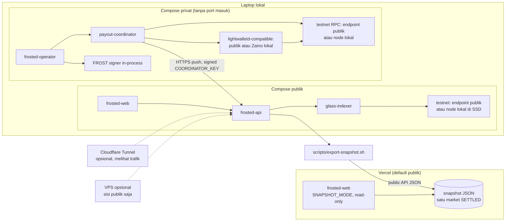

Langkah:
1. Laptop, sisi publik: `docker compose -f infra/docker-compose.yml up -d`, diarahkan ke endpoint testnet publik yang lolos V-31 (M12.0). Fallback: node testnet lokal di SSD eksternal (sync semalaman, §27.5).
2. Laptop, sisi privat: `docker compose -f infra/docker-compose.private.yml up -d` sebagai project Compose terpisah dengan DB terpisah. Tidak ada port masuk; coordinator mendorong data ke `API_INGEST_URL`. `frosted-operator` (termasuk signing FROST in-process) hanya di localhost. Pada demo laptop, zebrad sisi publik dan privat boleh satu node yang sama; ini dicatat di "Real vs simulated".
3. Committee: jalankan DKG sekali (atau trusted dealer untuk demo, dengan label jelas). Pada demo, ketiga share dipegang satu orang; tulis di tabel "Real vs simulated" (ADR-0008).
4. `scripts/seed-demo.sh` membuat market demo.
5. Setelah satu market `SETTLED`: `scripts/export-snapshot.sh <market_id>` mengekspor respons endpoint **publik** saja (`/markets`, `/markets/{id}`, `/odds`, `/bets`, `/resolution`, `/payout`, `/verify`, `/leaderboard`, Persona yang sudah di-thaw) ke JSON. Tidak ada data `coordinator.db`, txid bet, alamat, atau `env_esk`. Hasilnya di-deploy ke Vercel dengan `NEXT_PUBLIC_SNAPSHOT_MODE=true`.
6. Live via tunnel (opsional): `cloudflared tunnel` ke `frosted-api` (dan web) di laptop. README wajib menyatakan bahwa Cloudflare melihat trafik (IP pengunjung, path, isi request) dan bahwa ini melemahkan NFR-P3/T-8.
7. VPS (opsional): hanya `infra/docker-compose.yml` (sisi publik). Sisi privat tidak pernah pindah dari laptop.
8. Mainnet mikro (opsional, M13.4): jalankan stack kedua dengan `FROSTED_NETWORK=mainnet`, subpath terpisah, banner "Research demo, team-only". Akses mainnet dipilih setelah evaluasi V-30 (Zakura pruning/snapshot atau endpoint publik); tidak ada node mainnet penuh di laptop.
9. Rencana cadangan: video siklus penuh disiapkan sebelum presentasi live; snapshot Vercel tetap tersedia jika laptop atau jaringan gagal.

**Snapshot mode** (`NEXT_PUBLIC_SNAPSHOT_MODE=true`):
- Web membaca JSON statis yang di-bundle, tidak memanggil API, dan tidak membuka SSE.
- Bet Builder, Persona, Thaw, dan My Bets dinonaktifkan dengan label "Snapshot of a settled market (read-only)".
- Halaman Verify menampilkan perintah `frosted-verify` dan txid escrow yang publik, supaya juri tetap bisa memverifikasi dari chain sendiri.
- Vercel mencatat IP pengunjung di log platform; `LOG_IP=false` tidak berlaku di sana. Ini ditulis di How It Works dan README.

---

# PART F — Demo & Submission

## 31. Demo script (± 4 menit)

| Waktu | Adegan | Yang ditunjukkan | Kalimat kunci |
| --- | --- | --- | --- |
| 0:00–0:30 | Masalah | Screenshot posisi whale di dashboard prediction market publik | "Di prediction market hari ini, posisimu adalah data publik." |
| 0:30–0:50 | Ide | Diagram Glass Escrow | "Frosted: odds publik, penaruh tak terlihat." |
| 0:50–1:50 | Bet live | S-02 market "Pool Ironwood ≥ X di blok H?" di layar besar; 3 orang memindai QR dari HP; bar odds bergeser dalam 1–3 blok | "Kalian baru lihat tiga taruhan masuk." |
| 1:50–2:30 | **Wow moment** | Buka explorer testnet dan halaman bet publik: hanya jumlah dan outcome. Tantangan: "Siapa yang bertaruh NO 2 ZEC?" Lalu jalankan `frosted-verify pools` di terminal yang terhubung ke node lain: angka identik | "Siapa pun bisa menghitung odds-nya sendiri. Tidak ada yang bisa tahu siapa pesertanya, termasuk kami." |
| 2:30–3:15 | Resolusi + payout | Market Chain-Verified resolve dari `getblock`; 2 dari 3 share FROST menyetujui `plan_hash` (di demo ketiganya dipegang tim, dinyatakan terbuka); tx payout; HP pemenang menerima ZEC shielded | "Hasil dari chain Zcash sendiri. Dana bergerak hanya dengan 2 dari 3 tanda tangan FROST; hari ini ketiga share dipegang tim, dan itu kami tulis di README." |
| 3:15–3:40 | Thaw | Persona "orion" di-thaw: menang dan kalah muncul semua | "Reputasi anonim yang tidak bisa memilih-milih." |
| 3:40–4:00 | Penutup | Slide primitive + batasan trust | "Glass Escrow bisa dipakai untuk asuransi, crowdfund, arisan. Open-source." |

Persiapan: market dengan `close_height` dan `resolve_height` yang jatuh di tengah demo (di testnet perhitungkan waktu blok), atau gunakan market kedua yang sudah siap di-resolve. Selalu siapkan video cadangan.

## 32. Pitch deck outline

1. **Judul**: Frosted. Public odds. Invisible bettors. (Track: Private Markets)
2. **Masalah**: posisi prediction market bisa dilacak; >30% wallet Polymarket dijalankan agent.
3. **Kenapa privasi saja tidak cukup**: pasar privat lama membutuhkan operator terpercaya untuk angka.
4. **Insight**: viewing key Zcash memisahkan "apa yang masuk" dari "siapa pengirimnya".
5. **Glass Escrow**: diagram kunci (FROST → FVK → UIVK publik → Outcome Address).
6. **Demo** (live atau video).
7. **Trust-minimized**: Chain-Verified Market, FROST 2-of-3, `frosted-verify`, Envelope Proof. Apa yang masih harus dipercaya (termasuk kustodian share di demo), dinyatakan jujur.
8. **Thaw**: reputasi anonim anti-cherry-picking (dan batasan Sybil).
9. **Why now**: Ironwood, NU7 25 detik, Zakura Common, FROST (v3 sebagai langkah berikutnya; MVP memakai v2), NEAR Intents.
10. **Why Zcash**: hanya mungkin dengan pemisahan kunci + anonymity set shielded.
11. **Beyond prediction markets**: primitive untuk asuransi parametrik, crowdfund, arisan, voting sentimen.
12. **Roadmap & ask**: hibah ZCG untuk `zcash-glass`, threshold envelope decryption, FROST v3, audit.

## 33. Submission checklist

Aturan resmi Zecathon ada di balik login, jadi checklist ini disusun dari pola submission publik dan praktik umum. **`[TO VERIFY]` cocokkan dengan halaman Rules/FAQ setelah login.**

- [ ] Akun submission dibuat (satu akun per proyek, menurut halaman publik) dan track **Private Markets** dipilih.
- [ ] Repo publik dengan lisensi open-source (MIT/Apache-2.0).
- [ ] README berisi: pitch satu kalimat, arsitektur, cara menjalankan (regtest), dan link dokumen ini.
- [ ] Tabel **"Real vs simulated"** yang jujur (contoh: FROST trusted dealer vs DKG, demo di testnet (bukan mainnet), endpoint testnet publik yang melihat IP dan transaksi, satu orang memegang ketiga share FROST + `COORDINATOR_KEY`, Committee-Resolved Market dengan satu pemutus nyata, sisi publik dan privat di satu laptop, demo publik = snapshot read-only di Vercel).
- [ ] Catatan trafik: Vercel (snapshot mode) dan Cloudflare Tunnel (live opsional) melihat IP dan request pengunjung.
- [ ] Txid testnet untuk: announcement, ≥ 3 bet, payout batch.
- [ ] Video demo (umumnya ± 2 menit di submission publik; cek batas resmi).
- [ ] Pernyataan bahwa kode ditulis selama periode hackathon (praktik umum di README peserta).
- [ ] Bagian "Privacy & trust model" (salinan §24.3 dan batasan T-1, T-6, T-14).
- [ ] Disclaimer legal: riset/demo, bukan layanan taruhan publik.
- [ ] Link ke `frosted-verify` dan instruksi verifikasi independen.
- [ ] Deck PDF.
- [ ] Info tim dan kontak.

## 34. Risks & fallback plans

| Risiko | Kemungkinan | Dampak | Deteksi | Fallback |
| --- | --- | --- | --- | --- |
| FROST tidak bisa menandatangani spend Ironwood via PCZT | Sedang | Tinggi | M0.4 | Escrow kunci tunggal, berlabel "single-key demo"; FROST ditunjukkan sebagai tanda tangan pesan `plan_hash` saja |
| FVK tidak bisa dibangun dari `ak` FROST | Rendah–sedang | Tinggi | M0.3 | Sama seperti di atas |
| Zodl tidak meneruskan memo ZIP-321 | Sedang | Sedang | M0.6 | Bettor memakai Zingo/zcash-devtool; atau UI "copy memo" + instruksi tempel manual |
| Zodl tidak tersedia di testnet | Sedang | Sedang | M0.6 | Testnet dengan wallet CLI; Zodl hanya untuk uji memo mainnet mikro (M0.6) dan siklus mainnet opsional (M13.4) |
| `getblock` tidak memberi `valuePools` historis | Rendah | Sedang | M0.5 | Snapshot saat tip = `resolve_height`; market `UPGRADE_ACTIVE` tetap aman |
| Endpoint testnet publik tidak lengkap (RPC hilang, rate limit saat indexer mengambil semua tx, lightwalletd tanpa Ironwood) | Sedang | Sedang | M12.0 (V-31) | Node testnet lokal di SSD eksternal, sync semalaman (§27.5); snapshot Zakura; demo publik tetap jalan lewat snapshot mode di Vercel |
| Laptop atau jaringan gagal saat demo live | Sedang | Sedang | Latihan | Snapshot mode di Vercel + video (§30) |
| Zaino/gRPC belum mendukung Ironwood untuk wallet sync coordinator | Sedang | Tinggi untuk F-08 | M0.4 | Bangun witness dari `z_gettreestate` + scanning sendiri `[TO VERIFY]`; atau sync via `zcash-devtool` |
| Tidak cukup peserta untuk odds yang menarik | Tinggi | Rendah | Demo | Tim + 3 relawan; market kecil dengan bet seed dari beberapa wallet |
| Waktu blok testnet tidak menentu saat demo | Sedang | Sedang | Latihan | Market cadangan yang sudah resolved; video |
| Isu hukum | Rendah (demo) | Tinggi | — | Testnet; mainnet mikro opsional dan tim saja; disclaimer |

**Urutan yang dipotong jika waktu habis:** M13 → M11 → M10.2 (CLI tetap) → M9.4 leaderboard (Thaw tetap) → animasi UI. **Tidak boleh dipotong:** M2, M4, M6.3, M8 (atau fallback single-key), README jujur.

---

# PART G — Appendix

## 35. Glossary

| Istilah | Arti |
| --- | --- |
| **Ironwood** | Pool shielded Zcash yang aktif dengan NU6.3 (28 Juli 2026); memakai Orchard Actions dan Halo 2, dengan verifikasi formal integritas supply. |
| **Orchard** | Pool shielded sebelumnya (NU5). Sejak Ironwood, dana hanya bisa keluar lewat turnstile. |
| **Turnstile** | Mekanisme yang membatasi total dana keluar dari pool lama agar supply bisa diverifikasi. |
| **Unified Address (UA)** | Alamat Zcash yang membungkus beberapa receiver (ZIP 316). Frosted memakai UA Orchard-only. |
| **Receiver Orchard** | Komponen alamat 43 byte (diversifier + transmission key). |
| **Diversified address** | Banyak alamat berbeda yang diturunkan dari satu viewing key. |
| **Spending key / ask** | Kunci untuk membelanjakan; di Frosted dipecah lewat FROST. |
| **Full Viewing Key (FVK)** | Melihat dana masuk dan keluar; tidak bisa membelanjakan. Terdiri dari `ak`, `nk`, `rivk`. |
| **Incoming Viewing Key (IVK/UIVK)** | Melihat dana masuk (jumlah, memo, alamat penerima), tidak melihat pengirim. Dipublikasikan oleh Glass Escrow. |
| **Memo** | Field terenkripsi 512 byte di setiap output shielded. |
| **ZIP-321** | Standar URI permintaan pembayaran (`zcash:...?amount=..&memo=..`). |
| **ZIP 317** | Aturan fee: 5.000 zat × max(2, logical actions). |
| **PCZT** | Partially Created Zcash Transaction: format untuk membangun transaksi bertahap dengan penandatangan eksternal. |
| **FROST** | Flexible Round-Optimized Schnorr Threshold signatures. Di Zcash memakai RedPallas re-randomized (ZIP 312). |
| **DKG** | Distributed Key Generation: membuat kunci bersama tanpa satu pihak pun mengetahui kunci penuh. |
| **Zatoshi (zat)** | 1 ZEC = 100.000.000 zat. |
| **TAZ** | Koin testnet Zcash. |
| **Regtest** | Jaringan lokal pribadi untuk pengujian. |
| **Glass Escrow** | (Frosted) Akun shielded dengan UIVK publik. |
| **FRST1 / FRSTM1 / FRSTP1** | (Frosted) Format memo bet / announcement market / registrasi Persona. |
| **Sealed Envelope** | (Frosted) Payout address terenkripsi di memo bet. |
| **Persona / Thaw / Thaw Tag** | (Frosted) Identitas pseudonim; membuka riwayatnya; tag pengikat bet ke Persona. |
| **Chain-Verified Market** | (Frosted) Market yang hasilnya dihitung dari data chain Zcash. |
| **Treasury** | (Frosted) Alamat shielded operator yang menerima semua sapuan dana tak terhitung. |
| **Envelope Proof** | (Frosted) Bukti dari bettor bahwa Sealed Envelope-nya bisa dibuka. |
| **`note_ref`** | (Frosted) ID publik unik sebuah note escrow: hash dari `txid ‖ action_index`. |
| **JCS** | JSON Canonicalization Scheme (RFC 8785): serialisasi JSON deterministik untuk hashing. |
| **Parimutuel** | Model taruhan di mana semua taruhan dikumpulkan dan pemenang berbagi pool secara proporsional. |

## 36. Open questions & `[TO VERIFY]` (konsolidasi)

| # | Item | Bagian | Diselesaikan di | Status |
| --- | --- | --- | --- | --- |
| V-1 | Kirim ke receiver Orchard pasca-NU6.3 menghasilkan note Ironwood | §19.1, A-1 | M0.2 | **Terjawab** (SPIKES §M0.2) |
| V-2 | Zodl meneruskan memo dari URI ZIP-321; tersedia di testnet | A-2, §27 | M0.6 | **DEFERRED ke M6** (separuh regtest PASS, SPIKES §M0.6) |
| V-3 | `reddsa::frost::redpallas` bisa menandatangani spend Ironwood | A-4, SD-4 | M0.4 | **Terjawab** (SPIKES §M0.4) |
| V-4 | Konstruksi FVK dari `ak‖nk‖rivk`; validitas `ak` dari DKG | §19.2 | M0.3 | **Terjawab** (SPIKES §M0.3) |
| V-5 | API UFVK/UIVK Orchard-only dan encoding UIVK di `zcash_keys`; apakah Ironwood memakai item UFVK terpisah | §19.2 | M0.3 | **Terjawab**: item Orchard yang sama (SPIKES §M0.3) |
| V-6 | Method untuk diversifier index dari alamat penerima di `orchard` 0.15 | §19.4 | M0.2 | **Terjawab**: `IncomingViewingKey::diversifier_index` (SPIKES §M0.2) |
| V-7 | `getblock(h, 1)` memuat `valuePools.chainValueZat` per blok | A-6, SD-3 | M0.5 | **Terjawab** (SPIKES §M0.5) |
| V-8 | Cara membaca sighash/alpha dan menyisipkan `spend_auth_sig` di PCZT; penanganan dummy spend | SD-4 | M0.4 | **Terjawab** (SPIKES §M0.4) |
| V-9 | Kompatibilitas `reddsa` 0.5.x dengan `frost-rerandomized` 2.x vs FROST v3 | §25, T-7 | M0.4 | **Terjawab**: FROST v3; ADR-0013, ADR-0014 |
| V-10 | Accessor bundle Ironwood di `zcash_primitives` 0.29 untuk parsing tx v6 | §19.4 | M0.2 | **Terjawab**: `Transaction::ironwood_bundle()` (SPIKES §M0.2) |
| V-11 | Dukungan Ironwood di Zaino/gRPC untuk sync wallet escrow | §25, §34 | M0.4 (DoD mencakup sync lewat Zaino) | **Terjawab**: Zaino 0.10.1 (SPIKES §M0.4) |
| V-12 | ~~Transaksi shielded bernilai 0 untuk announcement~~ | US-02 | Tidak relevan lagi: announcement harus > `SWEEP_THRESHOLD_ZAT` (ADR-0009) | — |
| V-13 | Konfigurasi regtest Zebra: activation height NU6.3, internal miner, port RPC dan Zaino | §27 | M0.1 | **Terjawab** (SPIKES §M0.1) |
| V-14 | URL faucet TAZ yang aktif | §27 | Sebelum demo testnet | Faucet ditemukan, belum diverifikasi; dibutuhkan di M6/M12 |
| V-15 | Status aktivasi mainnet NU7 (target 5 Nov 2026) | §5, §25 | Sebelum demo | — |
| V-16 | Kemampuan NEAR Intents 1Click mengirim ke tujuan Zcash dengan memo | F-14 | M13.2 | — |
| V-17 | Kriteria juri, batas video, dan aturan submission Zecathon | §8, §33 | Login ke situs | — |
| V-18 | Versi terbaru crate pendukung (axum, sqlx, dalek, RustCrypto, Next.js, idb, qrcode) | §25 | M1 | **Terjawab** untuk M1 (SPIKES §M0.1); dicek ulang per change |
| V-19 | Bukti kasus doxxing/copy-trading whale untuk slide masalah | §2 | Sebelum pitch | — |
| V-20 | ID pool di `valuePools` (`transparent/sapling/orchard/ironwood/lockbox`) dan nama upgrade (`"NU7"`) di `getblockchaininfo` | §19.4, §22.3 | M0.5 | **Terjawab** (SPIKES §M0.5) |
| V-21 | `zcash-devtool` mendukung Ironwood dan bisa mengirim note bermemo ke UA Orchard-only | §27.1 | M0.1 | **Terjawab** (SPIKES §M0.1) |
| V-22 | Fallback witness lewat `z_gettreestate` + scanning sendiri | §34 | M0.4 (jika sync Zaino gagal) | **Tidak diperlukan**: sync Zaino berhasil (SPIKES §M0.4) |
| V-23 | Cek ulang submission Zecathon publik: belum ada prediction market berbasis Zcash | §7 | Sebelum submit | — |
| V-24 | Crate JCS (RFC 8785) yang sesuai standar dan bisa dikompilasi ke WASM | §25 | M2.8 | **Terjawab**: JCS minimal sendiri, lulus contoh RFC 8785 untuk subset (change `add-glass-core`) |
| V-25 | Zodl mengizinkan jumlah dari URI ZIP-321 diedit sebelum kirim (memengaruhi Thaw Tag v2) | §19.3, US-04 | M0.6 | **DEFERRED ke M6** |
| V-26 | Tinggi aktivasi Ironwood di testnet (4.134.000) | §19.1, §27.2 | Sebelum demo testnet | **Terjawab**: 4.134.000 dari source Zebra v6.4.2 (SPIKES §M0.6) |
| V-27 | A-5: `getblockchaininfo` di node live memuat `valuePools.ironwood` dan `upgrades` | A-5 | M0.1 dan M0.5 (regtest); live deferred to M12 (M12.0) | Regtest **terjawab**; live deferred to M12 |
| V-28 | A-7: fee ZIP 317 untuk aksi Ironwood = 5.000 zat per logical action | A-7, §23.4 | M0.4 | **Terjawab**: 10.000 zat untuk 2 aksi (SPIKES §M0.4) |
| V-29 | Kebutuhan disk dan waktu sync node testnet terkini (fallback lokal) | §27.5 | M12.0 (hanya jika fallback dipakai) | — |
| V-30 | Opsi akses mainnet tanpa node penuh di laptop: Zakura dengan pruning/snapshot, atau endpoint publik (dan dampaknya ke ADR-0007) | §27.3, M13.4 | Sebelum M13.4 (opsional) | — |
| V-31 | Endpoint testnet publik menyediakan `getrawtransaction` (tx penuh), `getblock(h, 1)` dengan `valuePools`, `getblockchaininfo` dengan `valuePools`/`upgrades`, `sendrawtransaction`, serta lightwalletd-compatible dengan data Ironwood; batas rate cukup untuk indexer | §27.3, M12.0 | M12.0 | — |
| Q-1 | ~~Siapa 3 Committee Member untuk demo?~~ Terjawab: satu developer memegang ketiga share (ADR-0008) | §6 | — | — |
| Q-2 | Apakah F-13 (publikasi UFVK) diaktifkan default setelah settlement? | F-13 | Tim | — |
| Q-3 | Threshold decryption untuk envelope pasca-hackathon? | T-6 | Roadmap | — |
| Q-4 | Vote komite multi-pihak lewat API (opsi pull, coordinator mengambil vote bertanda tangan member) | ADR-0007 | Roadmap | — |

## 37. Reference links

**Dokumentasi & kode Zcash**
- Zcash developer docs: https://zcash.readthedocs.io/en/latest/
- ZIPs: https://zips.z.cash/
- librustzcash: https://github.com/zcash/librustzcash
- Zebra: https://github.com/ZcashFoundation/zebra
- Zebra 6.0.0-rc.0 (Ironwood, `valuePools`, `block_notify_command`): https://github.com/ZcashFoundation/zebra/releases/tag/v6.0.0-rc.0
- Zebra ZIP 317 implementation: https://zebra.zfnd.org/internal/src/zebra_chain/transaction/unmined/zip317.rs.html
- Zebra lightwalletd compact formats: https://zebra.zfnd.org/internal/src/zebra_rpc/lightwalletd.rs.html
- lightwalletd `compact_formats.proto`: https://github.com/zcash/lightwalletd/blob/83bb19918fb36a5f6d5013fba7938daf3d73db1d/walletrpc/compact_formats.proto
- Zakura RPC `getblockchaininfo` snapshot: https://docs.rs/crate/zakura-rpc/latest/source/src/methods/tests/snapshots/get_blockchain_info@testnet_10.snap
- `orchard` 0.15 (`IronwoodDomain`): https://docs.rs/crate/orchard/0.15.0/source/tests/builder.rs
- `zip321`: https://docs.rs/zip321
- `pczt` roles: https://docs.rs/crate/pczt/0.9.1/source/src/roles.rs
- `zcash_client_backend` features (PCZT): https://lib.rs/crates/zcash_client_backend/features
- zecd Ironwood release (crate versions): https://github.com/zecrocks/zecd/releases/tag/v0.5.0-rc3
- ZODL repos: https://github.com/zodl-inc
- Ironwood is live (ZODL): https://zodl.com/ironwood-is-live-on-zcash/

**FROST**
- `reddsa` (FROST RedPallas): https://docs.rs/crate/reddsa/latest
- `reddsa` redpallas source: https://docs.rs/crate/reddsa/latest/source/src/frost/redpallas.rs
- `frost-rerandomized`: https://docs.rs/crate/frost-rerandomized/latest
- frost-zcash-demo: https://www.github.com/ZcashFoundation/frost-zcash-demo
- FROST v3.0.0-rc.0 news: https://zechub.substack.com/p/zcash-shielded-news-vol4-0a5

**Cross-chain**
- NEAR Intents docs: https://docs.near-intents.org/
- Zakura one-time viewing key proposal (via crypto.news): https://crypto.news/zcash-developer-proposes-quantum-privacy-fix-for-near-intents-swaps/

**Pasar & konteks**
- Aurora Intents / zkSNARKs auction: https://crypto.news/aurora-intents-routed-19m-into-zcash-nft-auction/
- AI agents in prediction markets (CoinDesk via MEXC): https://www.mexc.com/news/932530
- Keyrock 12 charts 2026: https://keyrock.com/12-charts-to-watch-in-2026/
- Ironwood & ZIP 318 overview (KuCoin): https://www.kucoin.com/blog/ua-zcash-ironwood-nu6-3-shielded-pool-migration
- ZecHub Hackathon 2026 (Steward FROST mainnet): https://zechub.wiki/tr/hackathon
- Testnet explorer: https://testnet.zcashexplorer.app
- Hackathon: https://thezecathon.com/

---

*Akhir dokumen. Jika ada perubahan desain, perbarui bagian terkait dan catat di `docs/decisions/`.*
